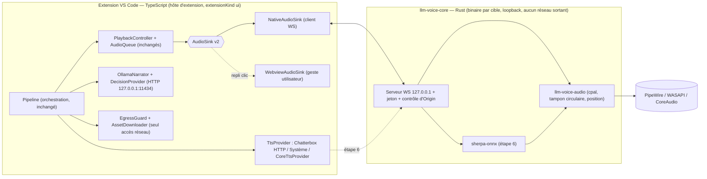

# Débat « langage du LLM Voice Core » — synthèse du juge, v1

> Rédigé le 2026-09-27 par platform-architect (Archie), juge indépendant : je n'ai pas pris part au débat.
> Tâche rattachée : `GAO-diagnostic-s-001` (critère « ADR Rust tranché »). **Statut : proposé.** La décision
> revient à guilhem-bonnet.
> Entrées lues : `shared-context.md`, `decisions-log.md` (entrées des 2026-09-11, 2026-09-12 et 2026-09-27),
> les trois plaidoiries `_grimoire-output/research/debate-language-core/position-{rust,go,typescript}.md`, les notes
> de veille `lecture-audio-native.md`, `controle-lecture-native-et-gapless.md`, `architectures-et-dialogue-vocal.md`
> et `tts-locaux.md`, `evidence/GAO-diagnostic-s-001/evidence-pack.md`, `decision-points-map-v1.md`,
> `docs/adr/ADR-013-decision-provider.md`, `_grimoire/standard/task-board.yaml`, ainsi que 111 en-têtes de fichiers
> sous `vscode-extension/src/`.
> Frontière d'outils : lecture et écriture de fichiers seulement. Je n'ai exécuté **aucune commande** : pas de `wc`,
> pas de `grep`, pas de build. Ce que je n'ai pas pu compter est marqué **non vérifié**.
> Aucun fichier sous `vscode-extension/` n'a été modifié.

---

## A. Résumé du débat

### A.1 Ce qui fait consensus entre les trois camps

Les trois avocats aboutissent au même périmètre. Ils l'annoncent chacun dans leur section 3.

- **Personne ne défend une réécriture complète.** Rust (§3) et Go (§3, point 2) proposent un Core minimal,
  audio plus moteurs natifs. TypeScript (§3, point 4) propose un module Rust napi-rs limité à l'audio.
- **Aucune option Node sans compilation ne couvre pause, reprise, seek et position.** C'est établi dans
  `lecture-audio-native.md` (§ « Which Node-side option… ») :
  - `node-speaker` et `naudiodon` exigent `node-gyp` ;
  - `audify` n'a que `start`/`stop` ;
  - `node-web-audio-api` est lui-même du Rust sous NAPI. Il n'a pas de `pause()` par source, et ses binaires
    Linux sont construits avec le drapeau `jack` (`controle-lecture-native-et-gapless.md`).
- **mpv piloté par IPC** est la seule voie documentée qui offre pause, position (`time-pos`) et `--gapless-audio`,
  et ce quel que soit le langage qui le pilote.
- **Aucune source ne mesure la productivité d'agents IA en Rust, Go ou TypeScript.** Les trois camps
  l'écrivent en section 5.

### A.2 La meilleure preuve de chaque camp

| Camp | Meilleure preuve retenue | Pourquoi elle pèse |
|---|---|---|
| **Rust** | Tout le chemin mûr vers une lecture native contrôlable passe par du natif, et la seule brique Node « prébuildée » est déjà du Rust (`node-web-audio-api`, `lecture-audio-native.md`). Rust fournit `cpal`/`rodio` pour l'audio ; sherpa-onnx y a une API officielle (le crate `sherpa-rs` est déclaré obsolète à son profit). Le camp y ajoute `candle` et `whisper-rs`. | Le développement est neuf dans tous les cas. Autant l'écrire dans l'écosystème natif le plus fourni, qui porte aussi la seule brique propre à Rust (`candle`/`any-tts`, `tts-locaux.md`). |
| **Go** | miniaudio fournit un chaînage de sources de données et `ma_sound_seek_to_pcm_frame` (miniaud.io, **cité par le camp, non revérifié**). sherpa-onnx et whisper.cpp publient des API Go officielles. | C'est une primitive gapless documentée dans une bibliothèque C mûre, avec un langage à petite surface. |
| **TypeScript** | La lecture du dépôt confirme que la machine d'état de lecture est déjà découplée de VS Code : `PlaybackController.ts` (593 lignes) et `AudioQueue.ts` (586 lignes) n'importent pas `vscode`. La surface de lecture passe par l'interface `AudioSink` (`src/playback/AudioSink.ts`, lignes 47-59 : `load`/`play`/`pause`/`stop`/`seek` et les événements `timeupdate`/`ended`/`error`), déjà doublée par `test/fakes/FakeAudioSink.ts`. S'y ajoutent le SDK MCP officiel en TypeScript et l'ingestion pdf.js/mammoth, native à Node. | C'est la jonction où un lecteur natif se branche **sans toucher** la machine d'état ni ses tests (vérifié, §A.4). L'idée hybride « Rust là où il compte, via napi-rs » est l'argument le plus utile du débat. |

### A.3 Affirmations rejetées

| Camp | Affirmation | Motif du rejet |
|---|---|---|
| Rust | RSS de 2 Mo contre 46 Mo, démarrage à froid de 1-5 ms contre 100-500 ms | Blog générique à méthode inconnue ; aucune mesure sur ce démon. |
| Rust | `ort` serait « 3-5x plus rapide et consommerait 60-80 % de mémoire en moins » | Comparaison avec **Python**, pas avec Node. Hors sujet. |
| Rust | 70 % des CVE mémoire (Microsoft, Chrome), baisse de 76 % à 24 % sur Android | Grandes bases C/C++. TypeScript est déjà sûr en mémoire (le camp le concède lui-même). Hors sujet. |
| Rust | Portage Zig vers Rust de 750 000 lignes en 11 jours | Anecdote sans lien ni point de comparaison. Ne prouve rien sur Claude ni sur ce dépôt. |
| Rust | Binaire de 2-5 Mo contre image Node de 200-500 Mo | Compare un binaire à une **image Docker**. Hors sujet. |
| Rust | « Supprime structurellement » le piège `ELECTRON_RUN_AS_NODE` en remote | Exagéré. D1 fixe `extensionKind: ["ui"]` : l'hôte d'extension est toujours local. Le piège documenté (`vscode#240901`) concerne un hôte distant. Le risque restant est `vscode#137510` (intention d'abandonner la variable), qui est faible. |
| Rust | `Pipeline.ts` ≈ 100 Ko, `AudioQueue.ts` 24 Ko, `PlaybackController.ts` 20 Ko | Tailles en octets **non vérifiées** (pas d'outil de mesure). Les lignes sont vérifiées au §A.4. |
| Go | Pauses du GC sous la milliseconde ; 30-60 Mo ; image Docker de 18 Mo | Générique, sans rapport avec un démon mono-client en localhost. |
| Go | « 94 % des erreurs LLM sont liées au typage » | Sans méthodologie (le camp le signale). Rejeté. |
| Go | « Le client Ollama du projet est `OpenAICompatibleNarrator.ts`, un client maison à réaligner » | **Erreur factuelle.** Le client Ollama est `src/narrator/OllamaNarrator.ts` (`POST /api/chat`, lu). Ollama est en HTTP, donc neutre vis-à-vis du langage. L'ADR-013 ajoute `/api/generate` en TypeScript. |
| Go | Binding Go officiel d'ONNX Runtime fusionné le 2026-08-13 | Non revérifié ; trop récent de toute façon (le camp le concède). |
| TS | « 65 % des lignes et 82 % des fichiers de test » (thèse) | Contredit par son propre tableau : 67 % des lignes, 77 % des fichiers, 81 % des fichiers de test, 78 % des lignes de test. Incohérence interne. |
| TS | « 25 fichiers importent `vscode` » | J'en compte **24** (§A.4). Écart probable, non vérifié : `src/onboarding/shouldOpenWalkthrough.ts` contient littéralement `import * as vscode from "vscode"` **dans un commentaire** (lignes 5-7), ce qu'un grep compterait. |
| TS | « `src/pipeline/` est prêt pour le démon (aucun import `vscode`) », d'où « un déplacement de frontière, pas une réécriture » | **Faux pour le fichier principal.** `src/pipeline/Pipeline.ts` ligne 21 contient `import * as vscode from "vscode"`. Ce fichier fait 2 329 lignes et c'est l'orchestrateur. Tout `src/sources/` est également couplé à `vscode`. |
| TS | « 83 % des développeurs trouvent Rust difficile » | Enquête auprès d'humains, pas d'agents. Générique. |
| TS | Latences Pipecat (« souvent sous 200 ms », 200-300 ms par phrase) invoquées pour disculper le GC de Node | Chiffres d'un pipeline Python cités par un blog (`architectures-et-dialogue-vocal.md`). Non transposables. |
| TS | Shai-Hulud, IronWorm, npm v12 | **Non vérifié**. Le camp conclut lui-même que ce n'est pas discriminant. Écarté. |
| TS | Axum 18,3 Mo contre Gin 27,6 Mo | Benchmark serveur générique (concédé). |

### A.4 Vérification des chiffres de réutilisation

Méthode :
- liste obtenue par Glob `vscode-extension/src/**/*.ts` (ventilée par dossier), soit **111 fichiers**, ce qui
  confirme le chiffre de la position TypeScript ;
- lecture (Read) de l'en-tête d'import de chaque fichier ;
- longueur des trois fichiers demandés établie en lisant leur dernière ligne.

| Affirmation (camp) | Valeur vérifiée | Preuve |
|---|---|---|
| 111 fichiers `.ts` sous `src/` (TS) | **111** ✔ | Glob |
| 25 fichiers importent `vscode` (TS) | **24**, dont 1 en `import type` effacé à la compilation (`src/infrastructure/logger.ts:31`). **23 imports à l'exécution.** | Lecture des en-têtes (liste ci-dessous) |
| 86 fichiers sans `vscode`, soit 77 % (TS) | **87 sur 111, soit 78 %** | Idem |
| 67 % des lignes sans `vscode`, 16 664 lignes au total (TS et Go) | **Non vérifié** (pas d'outil de comptage). Les deux plaidoiries donnent le même total, obtenu séparément. | — |
| `Pipeline.ts` = 2 329 lignes (Go) | **2 329** ✔. Importe `vscode` (ligne 21). Exclu de la couverture vitest selon `src/commands/playDecision.ts`, lignes 4-6. | Read, fin de fichier ligne 2329 |
| `AudioQueue.ts` = 586 lignes (Go) | **586** ✔, sans `vscode` | Read, fin ligne 586 |
| `PlaybackController.ts` = 593 lignes (Go) | **593** ✔, sans `vscode` (en-tête lignes 2-3 : « free of any `vscode` import ») | Read, fin ligne 593 |
| 115 fichiers de test, dont 93 sans `vscode` (TS) | **Non vérifié** | — |
| 956 tests unitaires et 63 d'intégration | Chiffres fournis par le brief, **non recomptés** | — |

Les 24 fichiers qui importent `vscode` :
- `extension.ts` ;
- `pipeline/Pipeline.ts` ;
- `playback/WebviewAudioSink.ts` ;
- `sources/` : `ClipboardSource`, `MarkdownDocumentSource`, `TextSelectionSource` ;
- `highlight/HighlightController.ts` ;
- `infrastructure/logger.ts` (type seulement) ;
- `claude/` : `ClaudeHookCommand`, `InboxContentProvider`, `GlobalStateReadStore`, `InboxTreeProvider`, `InboxQuickPick` ;
- `profiles/ProfileRepository.ts` ;
- `views/` : `PlayerViewProvider`, `ProfileEditorPanel`, `ProfilesTreeProvider` ;
- `ui/` : `StatusBar`, `CodeLensProvider` ;
- `commands/` : `index`, `PipelineFacade` ;
- `onboarding/` : `SetupVoice`, `Walkthrough`, `UseOwnVoice`.

Ce que la correction change :
- La conclusion générale de la position TypeScript tient : le code métier est largement indépendant de VS Code.
- Son corollaire, « déplacer le cœur dans un démon ne coûte qu'une frontière », est faux. `Pipeline.ts`
  représente à lui seul 2 329 lignes, soit 14,0 % des 16 664 lignes annoncées (total non vérifié) et 42,7 % des
  5 456 lignes couplées annoncées (non vérifié). Il faut le **découper** pour sortir l'orchestration de l'hôte
  d'extension, quel que soit le langage.
- En revanche, **aucune option qui laisse l'orchestration dans l'extension ne paie ce découpage.** Il suffit
  d'écrire un nouvel `AudioSink`.

Autre constat :
- La sonde `test/integration-security/audible-probe.test.ts`, citée par le pack de preuve, **n'est pas dans l'arbre
  de travail**. Glob sur `test/integration*/**/*.test.ts` ne trouve que `webview-csp.test.ts` dans ce dossier. Il
  faut la verser au dépôt (carte 2).

---

## B. Matrice de décision pondérée

### B.1 Les options

Dans toutes les options, l'extension VS Code reste en TypeScript : l'API d'extension l'impose. « Pur » désigne
donc le langage du Core, qui porte alors aussi l'orchestration.

| Code | Option |
|---|---|
| **A** | **Rust pur.** Le Core fait tout : orchestration, segmentation, narration, cache, fournisseurs, audio, inférence. L'extension se réduit à l'interface. |
| **B** | **Go pur.** Même périmètre que A. |
| **C** | **TypeScript pur.** Démon Node (SEA ou Node d'Electron). Audio par `node-web-audio-api` prébuildé ; aucun code natif écrit par nous. |
| **D** | **Hybride TS + module natif Rust napi-rs** pour l'audio seulement, chargé dans le processus TypeScript. |
| **E** | **Hybride Core Rust minimal**, binaire séparé pour l'audio puis l'inférence locale, en HTTP/WS sur la boucle locale. L'orchestration reste dans l'extension TypeScript. |
| **F** | **TS + mpv en sous-processus** piloté par IPC JSON, bundlé par plateforme. |

### B.2 Critères et poids (total 100)

| # | Critère | Poids | Justification du poids |
|---|---|---:|---|
| 1 | Zéro installation (ni Docker ni Python, VSIX autonome) | 15 | Décision « Zéro Docker » du 2026-09-11. Règle de release du 2026-09-09 : test sur un profil neuf sans service tiers. |
| 2 | Lecture native avec pause, position et gapless | 15 | C'est la raison d'être d'ADR-012. `NotAllowedError` a été mesuré deux fois (pack de preuve), ce qui rend ADR-001 structurellement impossible. |
| 3 | Réutilisation du code existant et des 956 tests | 12 | Ces tests sont le filet de régression d'un code écrit par des agents. |
| 4 | Productivité et fiabilité des agents IA dans le langage | 12 | La quasi-totalité du code est écrite par Claude. Aucune mesure n'existe (A.1), donc je ne pondère pas plus haut. |
| 5 | Packaging sur 5 cibles et CI | 8 | Un binaire natif oblige à `vsce --target` dans **toutes** les options qui le contiennent (`lecture-audio-native.md`). Le coût est en partie irréductible. |
| 6 | Écosystème IA locale embarquée (sherpa-onnx, whisper, ONNX, candle) | 8 | La synthèse et la reconnaissance locales sont prévues. sherpa-onnx existe en Node, en Go et en Rust, ce qui limite l'écart. |
| 7 | Ingestion documentaire (pdf.js, mammoth, SDK MCP) | 5 | Fonctionnalité future ; ces bibliothèques sont en JavaScript. |
| 8 | Remote, SSH, WSL | 4 | D1 (`["ui"]`) force déjà l'exécution locale ; le critère est presque neutre. |
| 9 | Empreinte mémoire et démarrage | 3 | Mono-client, localhost ; aucune mesure propre au projet. |
| 10 | Maintenance à long terme (un seul humain, deux chaînes d'outils, surface CVE, isolation des pannes) | 10 | Projet solo avec agents. |
| 11 | Préférence de l'utilisateur (Rust) | 8 | Réelle, et c'est lui qui valide. Elle ne passe pas devant les contraintes dures. |

### B.3 Notes de 0 à 5

Ces notes sont mon jugement d'arbitre, pas des mesures. Chacune s'appuie sur les sources des §A.2 et A.3.

| # | A Rust pur | B Go pur | C TS pur | D TS + napi-rs | E Core Rust min. | F TS + mpv |
|---|---:|---:|---:|---:|---:|---:|
| 1 | 4 | 4 | 2 | 4 | 4 | 3 |
| 2 | 4 | 3 | 2 | 4 | 4 | 4 |
| 3 | 1 | 1 | 4 | 5 | 4 | 5 |
| 4 | 2 | 2,5 | 4,5 | 4 | 3,5 | 5 |
| 5 | 3,5 | 3 | 3,5 | 4 | 3,5 | 2,5 |
| 6 | 5 | 3,5 | 3,5 | 4 | 5 | 3,5 |
| 7 | 2 | 2 | 5 | 5 | 5 | 5 |
| 8 | 4,5 | 4,5 | 3,5 | 5 | 4,5 | 4 |
| 9 | 5 | 4 | 2,5 | 4 | 4,5 | 3,5 |
| 10 | 2,5 | 2,5 | 3,5 | 3,5 | 4 | 3 |
| 11 | 5 | 1 | 0 | 3 | 4,5 | 0,5 |
| **Total pondéré /100** | **66,4** | **54,4** | **59,9** | **81,6** | **82,1** | **72,1** |

Justification des notes qui tranchent :

- **Critère 1.**
  - C : les binaires Linux de `node-web-audio-api` supposent Jack ou `pipewire-jack`
    (`controle-lecture-native-et-gapless.md`). Sa présence par défaut sur les distributions n'est **pas vérifiée**,
    d'où le risque d'une dépendance système.
  - F : mpv n'est préinstallé ni sur macOS ni sur Windows (même note). Il faut le bundler, sa licence n'est
    **pas vérifiée**, pas plus que la signature et la notarisation macOS d'un binaire tiers.
- **Critère 2.**
  - C : la pause se fait par `suspend()`/`resume()` globaux et le seek par recalcul manuel d'offset. Le
    web-audio-api#2636 documente une course à l'ordonnancement.
  - B : la maturité de `gominiaudio` n'est pas vérifiée ; `malgo` passe par cgo.
  - A, D, E, F : chemin documenté. `rodio` est en cours de réécriture (risque noté par le camp Rust).
    `cpal` documente un `DeviceBusy` lorsque PipeWire tient le périphérique ALSA par défaut.
- **Critère 3.**
  - D et F : on n'écrit qu'un nouvel `AudioSink` ; `PlaybackController`, `AudioQueue` et leurs tests restent
    intacts.
  - E : même jonction, plus un client HTTP/WS. Quand l'inférence migre, une partie des fournisseurs locaux
    (`SystemTtsProvider`, `PiperSetup`) est réécrite.
  - A et B : réécriture de l'orchestration et découpage de `Pipeline.ts`.
  - C : même langage, mais il faut découper `Pipeline.ts` (§A.4).
- **Critère 4.** Seul fait propre au projet : les phases 1 à 9 ont été livrées par des agents **en TypeScript**
  (`decisions-log.md`), et rien encore en Rust. D limite la surface Rust à un module ; E l'élargit (serveur,
  cycle de vie, inférence) ; A et B l'étendent à tout le Core.
- **Critère 10.**
  - E obtient 4 : une panne native n'abat pas l'hôte d'extension partagé par toutes les extensions (raisonnement
    d'architecture, non chiffré). Un processus unique possède aussi le périphérique entre les fenêtres (CdC §66).
  - D obtient 3,5 : un module natif fautif fait tomber tout l'hôte d'extension.
  - F obtient 3 : le binaire tiers est à suivre sur 5 cibles.

**Sensibilité.**
- Sans le critère 11 (total ramené à 92) : D = 83,5, E = 81,4, F = 77,5. D et E sont **à égalité dans la précision
  de l'exercice** ; la préférence et l'axe IA locale font pencher vers E.
- Les deux options partagent le même moteur Rust. Choisir E ne ferme pas D (§C.3).
- F reste le meilleur **repli** et devient la **référence de mesure** du spike (carte 3).

---

## C. Verdict

### C.1 Décision proposée

**Option E : Core Rust minimal, orchestration TypeScript conservée dans l'extension.**

1. **Moteur audio natif en Rust**, écrit comme une **bibliothèque** (`llm-voice-audio`) indépendante du
   transport. Elle est livrée dans un binaire `llm-voice-core` lancé par l'extension. La bibliothèque est d'abord
   prouvée par un spike sur un banc automatisé, contre mpv.
2. **L'orchestration reste en TypeScript dans l'hôte d'extension** : `Pipeline`, segmentation, profils, inbox,
   narrateur Ollama, mode Auto (ADR-013), cache, `EgressGuard`. La jonction de remplacement est
   l'interface `AudioSink`, à étendre en v2 pour le gapless (voir plus bas). Un `NativeAudioSink` remplace
   `WebviewAudioSink`.
3. **L'inférence locale** (sherpa-onnx par son API Rust officielle, voix Piper en ONNX) **entre dans le Core dans un
   second temps**, derrière un `CoreTtsProvider` TypeScript qui implémente le `TtsProvider` existant. P0 n°3
   (provider agnostic) est préservé.
4. **Le Core n'émet aucune connexion sortante.** Les téléchargements de modèles restent dans l'extension
   (`AssetDownloader` et `EgressGuard`, avec consentement et SHA-256). La garantie de l'ADR-010 reste ainsi
   prouvable par un seul test : « le Core n'ouvre aucune socket non-loopback ».

Deux faits pèsent le plus :
- **Fait 1.** La cause racine (`NotAllowedError`, 0 flux PipeWire, pack de preuve) rend la lecture native
  obligatoire. Aucune option Node sans compilation ne la couvre. **Un composant natif et une matrice
  `vsce --target` sont donc inévitables dans toutes les options.** La question du langage se réduit à : quel
  langage pour un composant natif étroit ?
- **Fait 2.** La jonction `AudioSink` existe, et la machine d'état (1 179 lignes, sans `vscode`) comme ses tests
  s'y branchent déjà via `FakeAudioSink`. `Pipeline.ts` (2 329 lignes) importe `vscode`. Garder l'orchestration en
  TypeScript et ne remplacer que la surface de lecture préserve donc les tests. Déplacer l'orchestration (A, B, C)
  force un découpage.

Le gapless ne dépend pas du langage, mais du contrat. Aujourd'hui, `AudioSink.load()` « remplace ce qui était
chargé » (`AudioSink.ts:48`), et le chunk suivant n'est chargé qu'après `ended`. Cet aller-retour crée un blanc
par construction. **Il faut un contrat `AudioSink` v2** (précharger le chunk suivant, position absolue), écrit en
TypeScript, quelle que soit l'option retenue.

### C.2 Réponse directe à « surtout pour les IA »

Deux lectures de la phrase, deux réponses.

**1. L'IA embarquée sur la machine de l'utilisateur**

Où Rust est **réellement** supérieur ici :
- **candle et `any-tts`** : Kokoro et d'autres modèles, avec sélection CPU/CUDA/Metal, n'ont **aucun binding Node
  confirmé** (`tts-locaux.md`). C'est la seule brique d'inférence propre à Rust dans la veille.
- **Synthèse et lecture dans le même processus natif.** L'API sherpa-onnx « generate-with-callback »
  (`tts-locaux.md`) peut alimenter directement le tampon circulaire de sortie audio. Plus de fichier WAV
  intermédiaire, plus de frontière de processus entre synthèse et lecture. C'est le gain structurel pour le
  premier son (TTFA). Son ampleur n'est **pas mesurée**.
- **whisper-rs et candle-whisper** pour la future reconnaissance vocale. Cet avantage est **partagé avec Go**
  (whisper.cpp publie des bindings Go).

Où ce n'est **pas un facteur** :
- **sherpa-onnx** existe en addon Node prébuildé, en Go et en Rust : parité.
- **Ollama** (narrateur, SemIf de l'ADR-013) et **Chatterbox** (Docker ou Python, option avancée) passent par HTTP
  en localhost. Ils restent en TypeScript.
- **Le SDK MCP officiel est en TypeScript** : le futur serveur MCP voix se loge côté extension ou dans un script
  Node lancé par Claude Code.
- **L'ingestion documentaire** (pdf.js, mammoth, Readability) est en JavaScript.
- **Le GPU AMD de la machine de dev.** ONNX Runtime a retiré ROCm depuis la 1.23 (`tts-locaux.md`), et `any-tts`
  n'annonce que CPU/CUDA/Metal. **Rust n'apporte donc pas le GPU sur la RX 9070 de l'utilisateur** : l'inférence
  embarquée y tournera sur CPU dans toutes les options.

**2. Les IA qui écrivent le code**

- Aucune mesure n'existe, dans aucun sens.
- Raisonnement (non mesuré) : le compilateur Rust est un vérificateur automatique qui colle à la doctrine du projet
  (« zéro done sans preuve »), au prix de plus d'itérations de compilation.
- **Je propose de mesurer plutôt que de débattre.** Le spike (carte 3) consigne pour chaque moteur le nombre de
  cycles fix-loop, d'escalades Sonnet vers Opus et d'échecs de compilation.
- Écart d'outillage : l'équipe d'agents n'a **pas de spécialiste Rust**. `backend-engineer` est décrit comme
  « TypeScript ». Il faudra passer un brief Rust explicite, et le concierge devra journaliser
  `grimoire agent-miss --category rust`.

### C.3 Ce qui ferait basculer le verdict

| Constat au spike ou après | Nouveau verdict |
|---|---|
| Le moteur Rust échoue au banc (blanc entre chunks, dérive de position, `DeviceBusy` non contournable sous PipeWire) dans son budget, alors que mpv passe | **F** (TS + mpv), sous réserve de la licence mpv. La jonction `AudioSink` v2 reste identique. |
| Le cycle de vie du Core coûte plus cher que l'audio lui-même au spike (instance unique, jeton, port, relance), ou l'audit (carte 7) refuse le WebSocket en boucle locale | **D** (même crate, emballée en napi-rs, chargée dans l'hôte d'extension) |
| Le spike Rust consomme plus de deux escalades Opus sur la même erreur (règle du circuit breaker) alors que mpv passe du premier coup | **F**, en gardant la crate Rust en réserve pour l'inférence (étape 6) |
| L'orchestration doit tourner hors de VS Code (produit autonome ou CLI de lecture) | **A**, avec découpage de `Pipeline.ts` : alors seulement, sortir l'orchestration se justifie |
| `node-web-audio-api` prouvé sans `pipewire-jack`, avec position exacte et enchaînement gapless au banc | C redevient discutable (improbable d'après la veille) |
| Go | Pas de piste Go conseillée : aucun critère où Go devance Rust sans que la préférence joue contre lui |

---

## D. Chemin de migration recommandé

| Étape | Écrit en | Contenu | Preuve d'acceptation automatisable | Risque |
|---|---|---|---|---|
| 0. ADR-012 accepté | Markdown | Architecture, lecture native, langage (§F) | Gate : relecture indépendante par `agent-optimizer` (Sonnet, contexte neuf), verdict dans evidence-pack ; `gate check --strict` vert | Validation utilisateur requise |
| 1. Banc de preuve audio | Bash + Python **de dev uniquement** (venv hors dépôt, jamais chez l'utilisateur) | Pérennise la boucle du pack de preuve sous `scripts/audio-proof/` : sink nul PipeWire, capture du monitor, transcription faster-whisper, mesure des silences entre segments | Test : le banc rend 0 sur le WAV de référence (transcription contenant la phrase attendue) et **≠ 0 sur un WAV silencieux**. Un banc qui ne peut pas échouer ne prouve rien. | Seuils (blanc maximal, dérive de position) **non mesurés** : fixés par l'étape 2. Faisabilité d'un PipeWire nul sur les runners CI **non vérifiée**, d'où un banc local d'abord. |
| 2. Spike moteur | Rust (crate `llm-voice-audio` + CLI de démo) ; mpv piloté par un script sur le même banc | Lecture, pause, reprise, seek, position, enchaînement de 3 chunks, sous Linux/PipeWire | Test : `cargo test` vert (logique sur sortie simulée) ; banc vert pour Rust **et** pour mpv. Tableau blanc/dérive/latence de reprise et métriques agent (cycles, escalades, échecs de compilation) dans evidence-pack. | Réécriture de `rodio` en cours ; `DeviceBusy` avec l'hôte ALSA ; faible expérience Rust de l'équipe d'agents |
| 3. Contrat `AudioSink` v2 | TypeScript | Préchargement du chunk suivant, position absolue par chunk, événement de sous-alimentation (underrun). Adaptation de `PlaybackController` et `FakeAudioSink`. | Test : vitest vert, dont « aucun aller-retour `ended`→`load` entre deux chunks prêts » sur `FakeAudioSink`. Lint : eslint et tsc verts. | Régression de la machine d'état (routage Opus) |
| 4. Protocole Core v1 | JSON Schema versionné + messages de référence `contracts/core-v1/*.json` | Commandes et événements du Core ; version du binaire contre celle de l'extension | Test : vitest (Zod) **et** `cargo test` (serde) verts **sur les mêmes fichiers de référence**. Pas de générateur de code à maintenir. | Dérive de contrat, bornée par ces tests croisés |
| 5. Core minimal + `NativeAudioSink` | Rust (`llm-voice-core` : tokio, WS, instance unique, jeton par session, liaison 127.0.0.1, fichier de verrou 0600) ; TypeScript (`CoreClient`, `NativeAudioSink`, réglage `llmVoice.audio.engine`) | Démarrage et arrêt par l'extension ; un seul propriétaire du périphérique entre fenêtres (CdC §66) | Tests : `cargo test` et vitest verts. Intégration Linux : lecture via le Core, capturée et transcrite par le banc. **Deux clients, une seule lecture.** Invariant statique « zéro autoplay » étendu (aucun chemin inbox ou hook vers `CoreClient`). | Cycle de vie (orphelins, relance) ; surface d'attaque locale |
| 6. Audit du Core | Tests d'attaque (TS ou Rust) | WS sans jeton, `Origin` étrangère, rebinding DNS sur `Host`, liaison hors boucle locale, socket sortante | Test : suite d'attaque verte (tout refusé) ; test « aucune connexion non-loopback ouverte par le Core » | Le fait que tout site web puisse ouvrir un WebSocket vers 127.0.0.1 relève de connaissances générales, **non sourcées dans la veille**. À confirmer par l'audit. |
| 7. Packaging 5 cibles | YAML CI (cargo, cross-rs pour linux-arm64, runners natifs macOS et Windows) + `vsce package --target` | `win32-x64`, `linux-x64`, `linux-arm64`, `darwin-x64`, `darwin-arm64` | Build/CI : workflow vert sur 5 cibles ; la gate VSIX existante (commit 88384dc) vérifie que chaque VSIX contient le binaire de **sa** cible ; smoke test « le Core démarre, répond sur `/health`, s'arrête » | Signature et notarisation macOS, SmartScreen Windows : **non vérifiés**. Temps de CI et taille des binaires : **non mesurés**. |
| 8. Bascule par défaut | TypeScript | `llmVoice.audio.engine = "native"` par défaut ; le webview `<audio>` reste en repli sur clic (issue 1 du pack de preuve) | Test : E2E réel sur profil VS Code jetable, sans service tiers ; son capturé et transcrit par le banc ; zéro `NotAllowedError`. C'est le critère « son audible prouvé sur profil jetable » de `GAO-diagnostic-s-001`. | Windows et macOS : écoute par l'utilisateur, **non automatisable ici** |
| 9. Inférence locale dans le Core | Rust (sherpa-onnx, API Rust officielle ; voix Piper ONNX) ; TypeScript (`CoreTtsProvider`) | Synthèse en flux directement vers le tampon de sortie ; les modèles sont téléchargés par l'extension, hors VSIX (P0 n°5) | Test : `cargo test` et vitest verts ; synthèse FR via le Core transcrite par le banc ; TTFA comparé au Piper en sous-processus et consigné ; toujours zéro socket sortante | Maturité de l'API Rust de sherpa-onnx **non vérifiée**. Taille avec ONNX Runtime **non mesurée**. Ce passage retire aussi le binaire Piper GPL-3.0 du chemin (decisions-log du 2026-09-27), sous réserve d'une revue de licences. |

La reconnaissance vocale et la détection de voix (VAD) dans le Core viendront plus tard, hors de ce plan.

---

## E. Impact sur les cartes du Mission Ledger

**Constat préalable.** `decision-points-map-v1.md` **ne contient pas de §E** : les sections vont de 0 à 5 (fichier lu
en entier, 146 lignes), alors que l'ADR-013 cite « §A », « §C.1 » et « §E ». J'ai donc raisonné sur deux sources
réelles :
- l'ordre des cartes écrit dans l'ADR-013 (« contrat et ADR, mock `/api/generate`, spike, puis implémentation et
  UI ») ;
- `_grimoire/standard/task-board.yaml`.

Il n'existe **pas de fichier « plan ADR-012 »** dans `planning-artifacts/`.

### E.1 Cartes existantes

| Carte | Effet | Motif |
|---|---|---|
| `GAO-diagnostic-s-001` (in_progress) | **À clore** quand ADR-012 est accepté. Son critère composite se répartit : « ADR Rust tranché » passe à la carte 1, « son audible prouvé sur profil jetable » à la carte 9. | Le diagnostic est livré (cause racine autoplay). Garder la carte ouverte masquerait l'avancement. |
| `GAO-file-de-lect-001` (proposed) | **Fusion partielle** : le verrou inter-fenêtres (CdC §66, `player.lock`) passe dans la carte 6, où le Core possède le périphérique. La file globale (§73) reste sur cette carte, toujours conditionnée à la décision sur la lecture automatique. | Le Core résout naturellement « une seule lecture » ; son test est le même. |
| `GAO-mode-auto-im-001` (ready) | **Inchangée**, en TypeScript. Sa dépendance devient « ADR-012 **accepté** » et non « Core livré ». | Ollama en HTTP ; le mode Auto vit dans `Pipeline.startInternal`, qui reste en TypeScript. |
| `GAO-adr-013-four-001`, `GAO-spike-valuat-001`, `GAO-fournisseur-001` | **Inchangées** | Aucune ne touche la lecture ; le langage TypeScript est confirmé pour la décision. |
| Cartes prévues par l'ADR-013 (mock `/api/generate`, implémentation et UI) | **Inchangées** | Idem |

### E.2 Liste finale des nouvelles cartes : 10

Le routage suit la table de `shared-context.md` et la décision du 2026-09-08 (« Opus = ADR,
PlaybackController »). Les cartes Rust vont à `backend-engineer` avec un brief Rust explicite, faute de spécialiste
(§C.2).

**Décision et preuve**

1. **ADR-012 : lecture audio native hors webview, Core Rust minimal, langage.**
   - Critères :
     - `gate : ADR-012 versé dans docs/adr/ADR-012-*.md au format MADR court, relu par un vérificateur indépendant (agent-optimizer, Sonnet, contexte neuf), verdict dans evidence-pack`
     - `gate : grimoire standard gate check --strict vert`
   - Routage : `platform-architect`, Opus puis Sonnet.
   - Mise à jour de `decisions-log.md` et de `shared-context.md` après validation : `agent-optimizer` +
     `meta-memory-quality`, Haiku.
2. **Banc de preuve audio automatisé** (`scripts/audio-proof/` : sink nul PipeWire, capture du monitor,
   transcription, mesure des silences ; verse aussi la sonde d'autoplay au dépôt).
   - Critères :
     - `test : code de sortie 0 sur le WAV de référence (transcription contenant la phrase attendue) et ≠ 0 sur un WAV silencieux`
     - `gate : grimoire standard gate check --strict vert`
   - Routage : `agent-optimizer` + `meta-toolsmithing`, Sonnet.
3. **Spike moteur audio : crate Rust `llm-voice-audio` contre mpv, sur le même banc (Linux/PipeWire).**
   - Critères :
     - `test : cargo test vert`
     - `test : banc vert pour Rust et pour mpv, tableau blanc/dérive/reprise et métriques agent dans evidence-pack`
     - `gate : grimoire standard gate check --strict vert`
   - Routage : `backend-engineer`, Sonnet ; `fix-loop-orchestrator` passe de Sonnet à Opus si le spike est stérile.

**Contrats**

4. **Contrat `AudioSink` v2 gapless** (préchargement, position absolue, underrun) ; adaptation de
   `PlaybackController` et `FakeAudioSink`.
   - Critères :
     - `test : vitest vert, dont aucun aller-retour ended→load entre deux chunks prêts`
     - `lint : eslint et tsc verts`
     - `gate : grimoire standard gate check --strict vert`
   - Routage : `backend-engineer`, **Opus** (machine d'état).
5. **Protocole Core v1** : JSON Schema et messages de référence partagés dans `contracts/core-v1/`.
   - Critères :
     - `test : vitest et cargo test verts sur les mêmes fichiers de référence`
     - `gate : grimoire standard gate check --strict vert`
   - Routage : `platform-architect` (contrat), Opus ; puis `backend-engineer` (tests), Sonnet.

**Core**

6. **Core Rust minimal `llm-voice-core` et `NativeAudioSink`** (instance unique, jeton, liaison loopback, cycle de
   vie, réglage `llmVoice.audio.engine`), avec le verrou venu de `GAO-file-de-lect-001`.
   - Critères :
     - `test : cargo test et vitest verts`
     - `test : intégration Linux, lecture via le Core capturée et transcrite par le banc`
     - `test : deux clients, une seule lecture`
     - `lint : eslint et tsc verts`
     - `gate : grimoire standard gate check --strict vert`
   - Routage : `backend-engineer`, Sonnet ; `fix-loop-orchestrator`, de Sonnet à Opus si nécessaire.
7. **Audit sécurité du Core local** (WebSocket loopback, jeton, `Origin`, rebinding DNS, zéro autoplay, aucune
   socket sortante).
   - Critères :
     - `test : suite d'attaque automatisée verte (tout refusé)`
     - `test : aucune connexion non-loopback ouverte par le Core`
     - `gate : grimoire standard gate check --strict vert`
   - Routage : `security-auditor`, Opus ; correctifs par `ops-engineer` + `infra-security-hardening`, Sonnet.

**Livraison**

8. **Packaging 5 cibles** : matrice CI cargo et `vsce package --target`, gate VSIX par cible, smoke test du Core.
   - Critères :
     - `build/CI : workflow vert sur les 5 cibles`
     - `test : chaque VSIX contient le binaire de sa cible et le Core répond sur /health`
     - `gate : grimoire standard gate check --strict vert`
   - Routage : `ops-engineer` + `infra-pipeline-cicd`, Haiku ; release par `backend-engineer` +
     `platform-deploy-release`, Sonnet.
9. **Bascule par défaut sur le moteur natif et acceptation sur un profil jetable sans service tiers.**
   - Critères :
     - `test : E2E réel sur profil VS Code jetable, son capturé et transcrit par le banc, zéro NotAllowedError`
     - `gate : grimoire standard gate check --strict vert`
   - Routage : `backend-engineer` + `platform-reliability-sre`, Sonnet.
   - L'écoute sous Windows et macOS par guilhem-bonnet reste une revue humaine, hors critère automatique.

**IA locale**

10. **Inférence locale dans le Core** : sherpa-onnx (API Rust officielle), voix Piper ONNX, `CoreTtsProvider`,
    synthèse en flux vers la sortie.
    - Critères :
      - `test : cargo test et vitest verts`
      - `test : synthèse FR via le Core transcrite par le banc, TTFA consigné`
      - `test : aucune connexion sortante du Core`
      - `gate : grimoire standard gate check --strict vert`
    - Routage : `backend-engineer`, Sonnet (Opus si stérile) ; revue de licences par `security-auditor`, Opus.

**Ordre et dépendances.**
- 1 d'abord : l'ADR est validé par l'utilisateur avant tout code produit.
- 2 et 3 peuvent démarrer en parallèle de 1 : ils ne touchent pas le code produit.
- 4 et 5 dépendent de 3.
- 6 dépend de 4 et 5 ; 7 dépend de 6 ; 8 dépend de 6 ; 9 dépend de 7 et 8 ; 10 dépend de 9.

---

## F. Projet de section « Langage » pour l'ADR-012

> **Statut : proposé — à valider par guilhem-bonnet.** Section destinée à `docs/adr/ADR-012-*.md` (format MADR court
> du dossier : Contexte / Décision / Conséquences / Alternatives rejetées / Tests qui prouvent la décision).

### Langage du moteur de lecture et du Core

**Contexte.**
- Mesure du 2026-09-27 : un webview de VS Code refuse `audio.play()` sans geste utilisateur (`NotAllowedError`,
  y compris en mode muet ; 0 flux PipeWire). L'ADR-001 est donc structurellement impossible pour une lecture
  déclenchée par l'extension.
- Aucune bibliothèque Node sans compilation ne fournit pause, reprise, seek et position. La lecture native
  exige un composant natif, et donc un VSIX par plateforme, quel que soit le langage.
- La machine d'état de lecture (`PlaybackController`, `AudioQueue`) est indépendante de `vscode` et pilote une
  interface `AudioSink`. L'orchestration (`Pipeline.ts`) dépend de `vscode`.
- L'équipe est composée d'un humain, qui préfère Rust, et d'agents IA qui écrivent la quasi-totalité du code.
  Ils ont livré neuf phases en TypeScript.

**Décision.**
1. Le moteur de lecture natif est écrit **en Rust**, sous forme de bibliothèque indépendante du transport. Il est
   distribué dans un binaire `llm-voice-core` par cible (`vsce package --target`), lancé par l'extension, qui
   écoute sur 127.0.0.1 avec un jeton de session. Le Core n'ouvre aucune connexion sortante.
2. L'extension **reste en TypeScript**, orchestration comprise (`Pipeline`, segmentation, profils, inbox,
   narrateur et décision via Ollama, cache, `EgressGuard`, ingestion, futur serveur MCP). Elle parle au Core par un
   `NativeAudioSink` qui implémente `AudioSink` v2.
3. L'inférence locale embarquée (sherpa-onnx, puis la reconnaissance vocale) rejoint le Core **après** la bascule
   du moteur de lecture, derrière un `TtsProvider` TypeScript.
4. Les services HTTP (Ollama, Chatterbox) restent appelés depuis TypeScript.
5. Condition d'entrée : le spike « `llm-voice-audio` contre mpv » passe le banc de preuve audio. En cas d'échec, la
   même jonction reçoit un `AudioSink` qui pilote mpv (ADR amendé).

**Conséquences.**
- Positives :
  - `PlaybackController`, `AudioQueue` et leurs tests unitaires sont conservés ;
  - une panne native n'abat pas l'hôte d'extension ;
  - un seul propriétaire du périphérique audio entre fenêtres ;
  - la synthèse peut alimenter directement la sortie sans fichier intermédiaire ;
  - un langage conforme à la préférence de l'utilisateur, sur un périmètre étroit.
- Négatives :
  - deux chaînes d'outils (npm et cargo) et deux surfaces CVE ;
  - une matrice CI sur 5 cibles ;
  - un protocole local à versionner et à sécuriser (jeton, `Origin`) ;
  - pas de spécialiste Rust dans l'équipe d'agents ;
  - la productivité des agents en Rust n'est pas mesurée (elle le sera au spike) ;
  - pas de GPU AMD pour l'inférence embarquée (ONNX Runtime sans ROCm depuis la 1.23).

**Alternatives rejetées.**
- **Rust pur ou Go pur (le Core porte l'orchestration)** : il faudrait réécrire l'orchestration et découper
  `Pipeline.ts` (2 329 lignes, couplé à `vscode`), sans bénéfice pour l'utilisateur. Aucun des deux avocats ne le
  défend.
- **Go (Core minimal)** : il n'a d'avance sur Rust ni pour l'audio ni pour l'inférence (pas de candle). Il passe par
  cgo et Zig pour la compilation croisée. Il va à l'encontre de la préférence de l'utilisateur.
- **TypeScript pur (`node-web-audio-api`)** : pause globale, seek manuel, course d'ordonnancement documentée,
  binaires Linux liés à Jack/`pipewire-jack`. Risque sur le zéro installation.
- **Module natif napi-rs chargé dans l'hôte d'extension** : écart minime avec l'option retenue. Il est rejeté pour
  l'isolation des pannes et la possession du périphérique entre fenêtres. **Il reste le repli** si le cycle de vie
  du Core ou l'audit sécurité échouent : c'est la même crate.
- **TS + mpv** : repli si le spike Rust échoue. La licence et le bundling sur 5 cibles ne sont pas vérifiés, et c'est
  un binaire tiers non maîtrisé.

**Tests qui prouvent la décision.**
- Banc audio :
  - code 0 sur la référence, ≠ 0 sur le silence ;
  - moteur Rust et mpv mesurés sur le même banc (blanc entre chunks, dérive de position, latence de reprise).
- `cargo test` (moteur, Core) et vitest (`AudioSink` v2, `NativeAudioSink`, `CoreClient`) verts, avec des tests
  de contrat croisés sur `contracts/core-v1/*.json`.
- Intégration Linux :
  - lecture via le Core capturée et transcrite ;
  - deux clients, une seule lecture ;
  - invariant statique « zéro autoplay » étendu au `CoreClient`.
- Sécurité :
  - WebSocket sans jeton ou avec une `Origin` étrangère refusé ;
  - liaison uniquement sur la boucle locale ;
  - aucune connexion sortante du Core.
- Packaging : CI verte sur 5 cibles ; gate VSIX binaire-par-cible ; smoke test `/health`.
- Acceptation : E2E sur profil VS Code jetable sans service tiers, son capturé et transcrit, zéro `NotAllowedError`.

---

### Non vérifié (récapitulatif)

- Total de 16 664 lignes et part de 67 % des lignes sans `vscode` ; 115 et 93 fichiers de test ; 956 et 63 tests.
- Tailles en octets de `Pipeline.ts`, `AudioQueue.ts` et `PlaybackController.ts`.
- Maturité de l'API Rust officielle de sherpa-onnx, de la réécriture de `rodio` et de `gominiaudio` ; binding Go
  d'ONNX Runtime.
- Présence par défaut de `pipewire-jack` ; licence, taille et notarisation d'un mpv bundlé ; gapless mpv sur
  stdin multi-chunks.
- Signature et notarisation macOS et SmartScreen Windows pour `llm-voice-core` ; temps de CI ; tailles de binaires.
- Faisabilité d'un sink nul PipeWire sur les runners GitHub Actions.
- Toute latence (TTFA, reprise, blanc entre chunks) : rien n'est mesuré, ce sera fait aux cartes 3 et 10.
