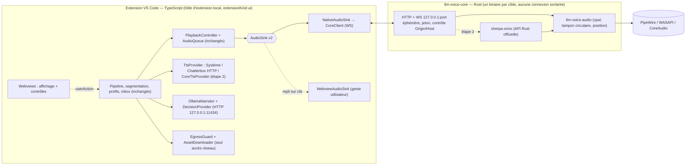

# ADR-012 — Lecture audio native hors webview : Core Rust minimal (`llm-voice-core`)

## Statut

Accepté (2026-09-27), sur décision de guilhem-bonnet (« Ok, je valide
l'option E », `decisions-log.md`, entrée du 2026-09-27). Rédigé le
2026-09-28. Carte du Mission Ledger : `GAO-adr-012-lect-001`.

- **Remplace** : ADR-001 (lecture via Webview `<audio>`), pour toute lecture
  déclenchée par l'extension.
- **Révise** : ADR-011 (le webview devient une surface d'affichage).
- **Laisse inchangés** : ADR-005 (contrats), ADR-009 (paliers de voix),
  ADR-010 (`EgressGuard`), ADR-013 (mode Auto, toujours en TypeScript).
- Condition d'entrée du code produit : le spike « `llm-voice-audio` contre
  mpv » passe le banc de preuve audio (voir « Tests »).

Sources : `_grimoire-output/planning-artifacts/debat-langage-core-synthese-v1.md`
(§B matrice, §C verdict, §D migration, §F section Langage) ;
`_grimoire-output/evidence/GAO-diagnostic-s-001/evidence-pack.md` (cause
racine) ; `_grimoire-output/research/research_notes/Briques existantes pour
LLM Voice/lecture-audio-native.md` et `controle-lecture-native-et-gapless.md`.

## Contexte

**1. ADR-001 est structurellement impossible pour une lecture lancée par
l'extension.** Mesure du 2026-09-27 (sonde dans un webview réel, affichage
réel, PipeWire surveillé toutes les 250 ms), reproduite deux fois :

```
playRejected: "NotAllowedError: play() can only be initiated by a user gesture."
flux audio VS Code détectés : 0
```

La lecture muette (`audio.muted = true`) est rejetée de la même façon. Le
comportement est la conséquence directe de la politique Electron
`autoplayPolicy: "user-gesture-required"`, lue telle quelle dans le binaire
VS Code (`/usr/share/code/resources/app/out/main.js`, VS Code 1.138 et 1.139,
preuve dans le pack de `GAO-diagnostic-s-001`). Aucune correction d'URI, de
CSP, de `localResourceRoots` ou de pont audio ne peut la contourner. Le
fichier audio, le cache, la synthèse et le transport de ressource sont sains :
seule la mise en lecture est bloquée. Un clic dans le lecteur débloque la
lecture pour la vie de ce document ; sa survie à un cycle masqué/affiché
n'est **pas vérifiée** (veille, « Gaps »).

**2. Aucune voie sans composant natif compilé ne couvre le besoin** (lecture,
pause, reprise, seek, position, enchaînement sans blanc) :

- `pw-cat`/`pw-play` : aucune pause, aucun seek, aucune position ; `aplay -i`
  et le clavier de `ffplay` supposent un terminal interactif ; `afplay` n'a ni
  pause ni position ; Windows n'a aucun lecteur CLI préinstallé avec pause ;
- `node-speaker`, `naudiodon` : `node-gyp` à l'installation ; `audify` :
  `start`/`stop` seulement ;
- `node-web-audio-api` : du Rust sous NAPI, pause globale par
  `suspend()`/`resume()`, binaires Linux construits avec le drapeau `jack`
  (dépendance à `pipewire-jack`, présence par défaut non vérifiée) ;
- mpv piloté par IPC JSON est la seule voie documentée avec pause,
  `time-pos` et `--gapless-audio`, mais il n'est préinstallé ni sur macOS ni
  sur Windows.

Conséquence : **un composant natif et un VSIX par plateforme
(`vsce package --target`, vsce ≥ 1.99.0) sont inévitables**, quel que soit le
langage. La question devient : quel langage pour un composant natif étroit,
et où le placer.

**3. La jonction existe déjà.** `PlaybackController.ts` (593 lignes) et
`AudioQueue.ts` (586 lignes) n'importent pas `vscode` et pilotent l'interface
`AudioSink` (`src/playback/AudioSink.ts` : `load`/`play`/`pause`/`stop`/`seek`,
événements `timeupdate`/`ended`/`error`), doublée en test par
`FakeAudioSink`. L'orchestration (`src/pipeline/Pipeline.ts`, 2 329 lignes)
importe `vscode` : la sortir de l'hôte d'extension exigerait de la découper.

**4. Contraintes.** Invariants P0 de `shared-context.md` (zéro autoplay,
local-first, provider agnostic, profils, modèles jamais dans le VSIX) ;
décision « Zéro Docker » du 2026-09-11 (voie par défaut autonome, sans
Docker ni Python) ; `extensionKind: ["ui"]` (D1) ; un seul humain, qui
préfère Rust ; neuf phases livrées par des agents en TypeScript, aucune en
Rust.

## Décision

### 1. Architecture : un Core Rust minimal à côté de l'extension TypeScript



(Rendu du diagramme non vérifié par un outil de rendu Mermaid.)

- **`llm-voice-audio`** : bibliothèque Rust indépendante du transport (sortie
  `cpal`, tampon circulaire, décodage, position par échantillons joués). Elle
  est la brique commune aux options E et D.
- **`llm-voice-core`** : binaire Rust qui embarque la bibliothèque et expose
  un serveur local (tokio, HTTP + WebSocket). Il ne connaît ni la file, ni les
  segments, ni les profils : il joue ce qu'on lui confie et rapporte ce qui se
  passe (même passivité que l'`AudioSink` actuel).
- **Étape 1 (0.3)** : lecture audio native seulement.
- **Étape 2** : inférence locale dans le Core — sherpa-onnx par son API Rust
  officielle, voix Piper au format ONNX, synthèse en flux directement dans le
  tampon de sortie (plus de WAV intermédiaire). Côté extension, un
  `CoreTtsProvider` TypeScript implémente le `TtsProvider` existant
  (ADR-005) : P0 n°3 est préservé. Reconnaissance vocale et VAD : plus tard,
  hors de cet ADR.

### 2. Ce qui reste en TypeScript dans l'extension

`Pipeline` et l'orchestration, segmentation (ADR-006), profils et leur schéma,
inbox et hook Claude (ADR-003, ADR-004, ADR-007), narrateur Ollama, mode Auto
et `DecisionProvider` (ADR-013), cache audio, `EgressGuard` et
`AssetDownloader` (ADR-010), surlignage (ADR-002), ingestion documentaire
future, futur serveur MCP voix, et toute l'UI VS Code. Les services HTTP
(Ollama, Chatterbox) restent appelés depuis TypeScript.

### 3. Contrat de jonction : `AudioSink` v2 et `NativeAudioSink`

- `NativeAudioSink` implémente `AudioSink` et remplace `WebviewAudioSink`
  comme moteur par défaut. `PlaybackController`, `AudioQueue` et leurs tests
  sont conservés.
- **`AudioSink` v2** (TypeScript, indépendant du moteur) : aujourd'hui
  `load()` « remplace ce qui était chargé » et le chunk suivant n'est chargé
  qu'après `ended`, ce qui crée un blanc par construction. v2 ajoute le
  **préchargement** du chunk suivant (`enqueue`), une **position absolue par
  chunk** et un événement de **sous-alimentation** (`underrun`). Les noms
  exacts sont fixés par la carte « contrat `AudioSink` v2 » ; la sémantique
  ci-dessus ne l'est pas.
- Réglage `llmVoice.audio.engine` : `"native"` (défaut après bascule) |
  `"webview"` (repli : lecture sur clic dans le lecteur, geste utilisateur).

### 4. Protocole local

- **Transport** : HTTP pour `GET /health` (version, capacités) et WebSocket
  (`/v1/ws`) pour les commandes et les événements, sur `127.0.0.1` uniquement,
  port éphémère choisi par le Core.
- **Messages** (v1, JSON) — commandes : `load`/`enqueue`, `play`, `pause`,
  `stop`, `seek`, `setRate`, `setVolume`, `hello` ; événements :
  `timeupdate` (250 ms), `ended`, `error`, `underrun`, `state`. Ce sont les
  messages de l'ADR-001, transportés hors webview.
- **Source audio** : un chemin absolu de fichier du cache (`DiskAudioCache`),
  jamais une URL ; le Core refuse tout chemin hors du dossier de cache déclaré
  au démarrage.
- **Contrat versionné** : JSON Schema et messages de référence dans
  `contracts/core-v1/*.json`, vérifiés **des deux côtés** par vitest (Zod) et
  `cargo test` (serde) sur les mêmes fichiers. Pas de générateur de code.
  `hello` échange les versions ; une version majeure différente est refusée et
  l'extension retombe sur le moteur webview.

### 5. Cycle de vie et instance unique

- L'extension **spawne** le binaire de sa cible (`bin/<target>/llm-voice-core`)
  à la première lecture, jamais à l'activation. Elle passe un **jeton de
  session** aléatoire et le dossier de cache par l'environnement ou stdin
  (jamais par la ligne de commande, visible dans `ps`).
- **Instance unique par utilisateur** : fichier de verrou `0600` dans le
  dossier d'état de l'utilisateur, contenant PID, port et jeton. Une seconde
  fenêtre VS Code lit le verrou et se connecte au Core existant au lieu d'en
  lancer un autre. Un seul processus possède le périphérique audio : **deux
  clients, une seule lecture** (reprend le verrou inter-fenêtres CdC §66 de
  `GAO-file-de-lect-001`).
- **Arrêt** : le Core s'arrête quand plus aucun client n'est connecté après un
  délai de grâce, et quand son parent disparaît ; un verrou orphelin (PID
  mort) est repris. Relance automatique bornée (circuit breaker), puis repli
  sur le moteur webview avec un message clair.

### 6. Sécurité de la boucle locale

- Liaison sur `127.0.0.1` uniquement, jamais `0.0.0.0` ni `::`.
- WebSocket refusé sans jeton ; en-tête `Origin` étranger refusé (tout site
  web peut tenter d'ouvrir un WebSocket vers 127.0.0.1 — connaissance
  générale, non sourcée dans la veille, à confirmer par l'audit) ; en-tête
  `Host` différent de `127.0.0.1:<port>` refusé (rebinding DNS).
- **Le Core n'ouvre aucune connexion sortante.** Les téléchargements de
  modèles de l'étape 2 restent dans l'extension (`AssetDownloader` +
  `EgressGuard`, consentement, SHA-256) : la garantie de l'ADR-010 reste
  prouvable par un seul test.
- **Zéro autoplay (P0 n°1)** : aucun chemin inbox ou hook vers `CoreClient` ;
  l'invariant statique existant est étendu au nouveau client. Le Core ne joue
  que sur commande d'une session lancée par l'utilisateur.

### 7. Packaging : 5 cibles

`win32-x64`, `linux-x64`, `linux-arm64`, `darwin-x64`, `darwin-arm64`, un VSIX
par cible (`vsce package --target`). Matrice CI : `cargo` natif sur runners
Linux, macOS et Windows, `cross-rs` pour `linux-arm64`. La gate VSIX existante
(commit 88384dc) vérifie que chaque VSIX contient le binaire de **sa** cible,
et un smoke test « le Core démarre, répond sur `/health`, s'arrête ». Aucun
modèle n'est embarqué (P0 n°5). Le VSIX universel sans binaire reste possible
avec le seul moteur webview (lecture sur clic).

### 8. Remote, SSH, WSL

`extensionKind: ["ui"]` (D1) est conservé : l'hôte d'extension, donc le Core,
tourne **sur la machine locale de l'utilisateur**, là où sont les haut-parleurs,
même quand l'espace de travail est en Remote SSH, WSL ou conteneur. Aucun
binaire n'est déployé côté distant. VS Code for the Web n'est pas une cible
(pas de binaire possible).

### 9. Langage (section issue du débat, §F de la synthèse)

1. Le moteur de lecture natif et le Core sont écrits **en Rust**.
2. L'extension **reste en TypeScript**, orchestration comprise.
3. L'inférence locale rejoint le Core **après** la bascule du moteur de
   lecture, derrière un `TtsProvider` TypeScript.
4. En cas d'échec du spike Rust au banc, la même jonction reçoit un
   `AudioSink` qui pilote mpv (ADR amendé) ; en cas d'échec du cycle de vie ou
   de l'audit, la même crate est emballée en module napi-rs (option D).

> **Amendement 2026-09-28** : packaging progressif — linux-x64 (Fedora/Wayland) d'abord, darwin en S3, win32 en S4 (decisions-log).

## Conséquences

### Sur les ADR existants

- **ADR-001 — remplacé.** Le `<audio>` du webview n'est plus le moteur de
  lecture. Son protocole (`load`/`play`/`pause`/`seek`, `timeupdate`/`ended`/
  `error`) survit comme vocabulaire du protocole Core v1. Le moteur webview
  reste un **repli explicite** qui exige un clic dans le lecteur.
- **ADR-011 — révisé.** Les webviews (mini-player du Panel, vue « Lecture en
  cours ») deviennent **affichage et contrôles seulement** : titre, profil,
  progression, boutons, qui émettent des `userAction` vers l'extension. Ils ne
  jouent plus de son en mode `native`. La limite connue « un seul
  `WebviewView` actif relié au `WebviewAudioSink` » disparaît : plusieurs vues
  peuvent afficher le même état.
- **ADR-009 — inchangé.** Les paliers de voix (local GPU, local sans
  installation, entreprise, API) et `OpenAICompatibleTtsProvider` restent tels
  quels ; le Core ne change que la **lecture**. À l'étape 2, sherpa-onnx dans
  le Core devient une implémentation du palier « local sans installation »
  derrière `CoreTtsProvider`, et retire le binaire Piper GPL-3.0 du chemin
  (sous réserve d'une revue de licences).
- **ADR-005, ADR-010, ADR-013 — inchangés** ; ADR-013 dépend désormais
  d'« ADR-012 accepté », pas de « Core livré ».

### Positives

- La lecture déclenchée par l'extension devient possible sans geste
  utilisateur dans un webview.
- `PlaybackController`, `AudioQueue` et leurs tests unitaires sont conservés ;
  aucun découpage de `Pipeline.ts`.
- Une panne native n'abat pas l'hôte d'extension partagé par toutes les
  extensions (raisonnement d'architecture, non chiffré).
- Un seul propriétaire du périphérique audio entre fenêtres.
- À l'étape 2, synthèse branchée directement sur la sortie (gain de premier
  son non mesuré).
- Langage conforme à la préférence de l'utilisateur, sur un périmètre étroit.

### Négatives

- Deux chaînes d'outils (npm et cargo) et deux surfaces CVE.
- Matrice CI sur 5 cibles et 5 VSIX par release ; signature et notarisation
  macOS, SmartScreen Windows, temps de CI et taille des binaires **non
  vérifiés**.
- Un protocole local à versionner et à sécuriser (jeton, `Origin`, `Host`).
- Aucun spécialiste Rust dans l'équipe d'agents : chaque carte Rust porte un
  brief Rust explicite pour `backend-engineer` ; productivité des agents en
  Rust non mesurée (elle le sera au spike).
- `rodio` en cours de réécriture ; `cpal` documente `DeviceBusy` quand
  PipeWire tient le périphérique ALSA par défaut.
- Pas de GPU AMD pour l'inférence embarquée (ONNX Runtime sans ROCm depuis la
  1.23) : CPU dans toutes les options.

## Alternatives rejetées

Scores pondérés du débat (/100, synthèse §B.3 ; notes d'arbitre, pas des
mesures) :

| Option | Score | Motif |
|---|---:|---|
| **E — Core Rust minimal + orchestration TS (retenue)** | **82,1** | — |
| D — TS + module Rust napi-rs audio seul, dans l'hôte d'extension | 81,6 | Écart dans la précision de l'exercice. Rejetée pour l'isolation des pannes (un module natif fautif abat l'hôte d'extension) et la possession du périphérique entre fenêtres. **Repli documenté** : même crate `llm-voice-audio`. |
| F — TS + mpv en sous-processus (IPC JSON) | 72,1 | Binaire tiers à bundler sur 5 cibles ; licence, signature et notarisation non vérifiées ; gapless sur stdin multi-chunks non documenté. **Repli** si le spike Rust échoue, et référence de mesure du spike. |
| A — Rust pur (le Core porte l'orchestration) | 66,4 | Réécriture de l'orchestration et découpage de `Pipeline.ts` (2 329 lignes, couplé à `vscode`) sans bénéfice utilisateur ; aucun avocat ne le défend. |
| C — TS pur (`node-web-audio-api`) | 59,9 | Pause globale, seek manuel, course d'ordonnancement documentée (web-audio-api#2636), binaires Linux liés à Jack : risque sur le zéro installation. |
| B — Go pur | 54,4 | Aucune avance sur Rust pour l'audio ni l'inférence (pas de candle) ; cgo pour la compilation croisée ; contraire à la préférence. |
| mpv seul (sans jonction TS) | — | Même motifs que F ; ne couvre pas l'inférence locale. |

Sensibilité : sans le critère « préférence », D = 83,5, E = 81,4, F = 77,5 ;
D et E restent à égalité, l'axe IA locale et la préférence font pencher vers E.

## Tests qui prouvent la décision

Chaque test est automatisable ; aucun ne dépend d'une écoute humaine.

- **Banc audio (capture + transcription)** — `scripts/audio-proof/` : sink
  nul PipeWire, capture du monitor, transcription faster-whisper (outil de
  dev, venv hors dépôt, jamais chez l'utilisateur), mesure des silences.
  Code de sortie 0 sur le WAV de référence (transcription contenant la phrase
  attendue) **et ≠ 0 sur un WAV silencieux**. Le moteur Rust et mpv sont
  mesurés sur le même banc : blanc entre chunks, dérive de position, latence
  de reprise (seuils fixés par le spike, aucun n'est mesuré aujourd'hui).
- **Unitaires** : `cargo test` (moteur, Core) et vitest (`AudioSink` v2,
  `NativeAudioSink`, `CoreClient`) verts, dont « aucun aller-retour
  `ended`→`load` entre deux chunks prêts » sur `FakeAudioSink`. Tests de
  contrat croisés (Zod et serde) sur `contracts/core-v1/*.json`.
- **Deux clients, une lecture** : deux `CoreClient` (deux fenêtres simulées)
  se connectent au même Core ; un seul processus `llm-voice-core` existe ; le
  banc capture un seul flux.
- **Zéro `NotAllowedError` sur profil jetable** : E2E réel sur un profil VS
  Code jetable, sans service tiers, moteur `native` par défaut ; son capturé et
  transcrit par le banc ; aucune occurrence de `NotAllowedError` dans les
  journaux. C'est le critère « son audible prouvé sur profil jetable » de
  `GAO-diagnostic-s-001`.
- **Aucune socket sortante** : pendant une lecture (et, à l'étape 2, une
  synthèse), le Core n'ouvre aucune connexion non-loopback (inspection des
  sockets du PID, `ss -tanp` sous Linux) et n'écoute que sur `127.0.0.1`.
- **Sécurité** : suite d'attaque verte — WebSocket sans jeton, avec `Origin`
  étrangère, avec `Host` falsifié (rebinding) : tous refusés ; chemin audio
  hors du cache refusé.
- **Zéro autoplay** : invariant statique étendu — aucun chemin inbox ou hook
  n'atteint `CoreClient`.
- **Packaging** : workflow CI vert sur les 5 cibles ; chaque VSIX contient le
  binaire de sa cible ; smoke test `/health`.
- **Non automatisable ici** : l'écoute sous Windows et macOS par guilhem-bonnet
  reste une revue humaine, hors critère automatique.
