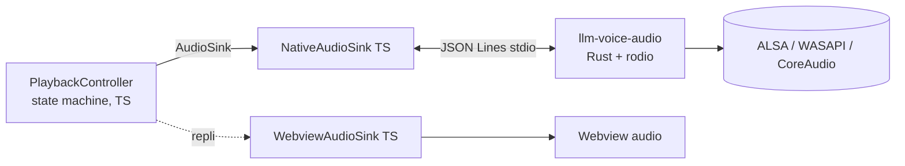

# ADR-012 — Moteur audio natif Rust : périmètre, migration, abandon

- Statut : proposé
- Date : 2026-09-14
- Décideurs : Archie (platform-architect) — tâche ledger `GAO-diagnostic-s-001`
- Références : ADR-001 (webview `<audio>`), ADR-002 (surlignage), ADR-005, ADR-009, ADR-010, ADR-011
- **Avertissement de vérifiabilité** : la recherche web n'était pas disponible dans la session
  qui a produit cet ADR. Tout ce qui concerne une bibliothèque externe (version, API, licence,
  poids) est marqué **non vérifié** et doit être confirmé par `cargo search` / `cargo tree`
  / le `LICENSE` amont **avant** d'ouvrir la phase 1. Les chiffres du dépôt, eux, sont sourcés.

## Contexte

La 0.2.1 échoue sur trois symptômes simultanés : aucun son, surlignage qui défile trop vite,
surlignage sur la mauvaise section. ADR-002 précise que le surlignage est piloté par les
transitions `load`/`ended` et **jamais** par `timeupdate`. Un chunk qui échoue produit donc,
par `PlaybackController`, un retry puis un skip — c'est-à-dire un `load` suivant immédiat.
**Un échec audio en cascade est visuellement indiscernable d'une lecture très rapide.** Les
deux premiers symptômes sont vraisemblablement le même défaut ; le troisième (mauvaise section)
relève du mapping `sourceRanges`, pas de l'audio.

Deux observations de code renforcent le diagnostic, à confirmer par l'équipe diagnostic :
`WebviewAudioSink.load()` **retourne silencieusement** quand aucune webview n'est attachée
(`src/playback/WebviewAudioSink.ts`) — aucun événement `error` n'est émis, donc aucune trace ;
et la chaîne webview accumule cinq causes d'échec muet (CSP `media-src`, `localResourceRoots`,
`asWebviewUri`, décodage WAV par Chromium, cycle de vie de la vue). L'Extension Host n'a aucun
moyen de distinguer « joué » de « chargé mais jamais audible ».

L'utilisateur demande « du Rust lorsque possible » et une stratégie repensée. Contraintes
inchangées : autonomie totale (ni Docker, ni Python, ni serveur), rien ne sort de la machine
par défaut (ADR-010). Fait favorable non relevé par ADR-001 : `extensionKind: ["ui"]`
(`vscode-extension/package.json`, vérifié) — l'Extension Host tourne **déjà** sur la machine
de l'utilisateur, y compris en Remote SSH. L'argument « la webview joue sur la bonne machine »
qui motivait ADR-001 ne discrimine donc plus : un processus local jouerait au même endroit.

## Options envisagées

1. **Statu quo durci** — garder la webview, instrumenter chaque cause d'échec.
2. **Binaire compagnon Rust de lecture seule** — la webview sort du chemin audio.
3. **Binaire compagnon Rust lecture + synthèse** (`sherpa-onnx` / `piper-rs`) — remplace aussi Piper.
4. **Réécriture du cœur en Rust** (parsing, pipeline, providers).

## Décision

### 1. On y va, sur la lecture audio uniquement

Un binaire compagnon **`llm-voice-audio`** écrit en Rust, piloté en **JSON Lines sur stdio**,
implémentant l'interface `AudioSink` déjà en place (`src/playback/AudioSink.ts`) via une classe
`NativeAudioSink`. Il ne connaît ni file, ni cache, ni state machine : il charge un fichier,
joue, rapporte sa position réelle. `PlaybackController` est inchangé.

- **Crate de lecture : `rodio`** (par-dessus `cpal`), licence MIT/Apache-2.0, position de
  lecture exposée par le `Sink` — **non vérifié** : nom exact de l'API de position, version
  courante, et si le seek sur WAV est exact. À valider en spike avant toute autre phase.
  `kira` est écarté (orienté jeu, surface bien plus large que nécessaire) ; `cpal` seul est
  écarté (il faudrait réécrire le décodage WAV et la file de samples).
- **Protocole** : `stdout` porte **uniquement** le protocole (une ligne JSON par message),
  `stderr` porte les logs. Handshake `hello {protocolVersion}` : version inconnue ⇒ l'extension
  se replie sans jouer. Commandes `load|play|pause|stop|seek|setRate|setVolume`,
  événements `ready|position|ended|error{code}`. `position` toutes les 50 ms, issue de
  l'horloge du flux de sortie et non d'un minuteur — c'est là le gain sur `timeupdate`.
- **Aucun échec muet** : tout chemin d'erreur (fichier illisible, WAV non décodable, aucun
  périphérique de sortie, périphérique volé) produit un `error` avec un **code machine nommé**.
  Un processus qui meurt est un échec observable ; une webview qui ne joue pas ne l'est pas.

### 2. Synthèse vocale native : non, pas maintenant

On garde Piper en binaire externe (MIT, voix `fr_FR-siwis-medium` CC0-1.0 — vérifié dans
`src/tts/piperAssets.json`). Chiffres vérifiés sur ce même fichier : binaire Piper 19,1 Mo
(macOS) à 26,5 Mo (Linux x64), modèle de voix **63,2 Mo**. Embarquer `sherpa-onnx` ou
`piper-rs` remplacerait un binaire MIT de 26 Mo par un binaire maison d'un ordre de grandeur
comparable, **sans supprimer les 63 Mo de modèle ni les données de phonémisation espeak-ng**.
Le gain réel — synthèse en flux dans le lecteur, sans fichier WAV intermédiaire, et durées de
phonèmes exploitables pour un surlignage au mot (le manque explicite d'ADR-002) — est réel mais
n'adresse aucun des trois symptômes de la 0.2.1. Ce serait payer la matrice de compilation
ONNX Runtime pour un bénéfice différé. **Non vérifié** : licences et maturité des liaisons Rust
`sherpa-rs` / `piper-rs`, poids d'ONNX Runtime par plateforme, latence CPU en français.
Réexamen en phase 3, sous condition d'entrée nommée ci-dessous.

### 3. Ce qui ne passe pas en Rust — jamais dans ce périmètre

Intégration VS Code, parsing Markdown (`unified`/`remark`), segmentation, mapping des
`sourceRanges`, interface et vue dédiée (ADR-011), profils, providers TTS, `EgressGuard`.
Ces composants n'ont aucun problème de performance ni de fiabilité que Rust résoudrait, et
la frontière process ferait perdre l'accès direct à l'API VS Code. **Aucune réécriture.**

### 4. Chemin de migration

- **Phase 0 — bloquante, TypeScript, sans Rust.** (a) `WebviewAudioSink.load()` émet un `error`
  au lieu de retourner en silence ; (b) `PlaybackController` distingue « chunk terminé » de
  « chunk abandonné » et **arrête** la session après N échecs consécutifs au lieu de dérouler ;
  (c) un journal nomme la cause. Sans cette phase, on ne pourra pas savoir si le binaire Rust
  a corrigé quoi que ce soit — on aurait juste changé de boîte noire.
- **Phase 1 — spike** (1 plateforme, Linux x64) : `rodio` joue un WAV produit par
  `SystemTtsProvider` et rapporte une position. Mesures ci-dessous. Go/No-Go.
- **Phase 2 — intégration** : `NativeAudioSink` + sélection à l'exécution. Ordre : binaire
  présent et handshake réussi ⇒ natif ; sinon ⇒ `WebviewAudioSink`, sans message d'erreur pour
  l'utilisateur. Réglage `llmVoice.playback.engine: auto|native|webview` pour forcer. La webview
  **reste** le chemin de secours pendant toute la 0.3 ; ADR-001 n'est pas abrogé, il est cantonné.
- **Phase 3 — conditionnelle** : synthèse native, seulement si (a) la phase 2 est stable sur les
  3 OS pendant une version complète, **et** (b) le surlignage au mot devient une exigence.

**Critère d'abandon explicite.** On revient à la webview et on clôt cette piste si l'un de ces
faits est constaté : le taux de « son effectivement produit » n'est pas strictement supérieur à
celui de la webview sur les trois OS ; macOS impose une notarisation payante ou un flux de
consentement utilisateur supplémentaire ; l'ajout dépasse +15 Mo par VSIX de plateforme ; ou la
CI Rust fait plus que doubler la durée du pipeline.

### 5. Distribution

- **VSIX par plateforme** (`vsce package --target linux-x64|linux-arm64|darwin-x64|darwin-arm64|win32-x64`),
  **un seul** binaire par paquet. Le Marketplace sert le bon paquet — **non vérifié** : nom exact
  des cibles et comportement de repli du Marketplace pour une plateforme non publiée ; un VSIX
  « universel » sans binaire, qui se replie sur la webview, doit rester publié en filet.
- **Pas de téléchargement à la demande.** C'est le point décisif pour ADR-010 : le binaire arrive
  par le canal déjà signé du Marketplace, donc **zéro nouvelle sortie réseau**, à l'inverse du
  chemin `AssetDownloader` utilisé pour Piper. La promesse « rien ne sort » est renforcée, pas
  affaiblie. Le binaire n'a **aucune dépendance réseau** : à prouver par un test CI qui échoue si
  `cargo tree` fait apparaître une crate de socket ou de HTTP.
- **Intégrité** : somme SHA-256 de chaque binaire produite par la CI, publiée avec la release, et
  vérifiée par l'extension au premier lancement (même discipline que `piperAssets.json`).
- **CI** : un job `build-native` en matrice (`ubuntu-latest`, `ubuntu-24.04-arm`, `macos-latest`,
  `windows-latest`) en amont du job `package` existant, artefacts passés par `upload-artifact`.
  Linux exige `libasound2-dev` à la compilation et `libasound.so.2` à l'exécution — **non
  vérifié** : disponibilité d'un runner GitHub Linux arm64 pour ce dépôt public, et coût réel de
  la signature macOS d'un binaire livré dans un VSIX (quarantaine Gatekeeper à tester en vrai).

## Conséquences

- Positives : l'échec devient observable (code de sortie, `stderr`, code d'erreur nommé) ;
  position de lecture réelle au lieu d'un `timeupdate` throttlé, ce qui ouvre le surlignage au
  mot laissé ouvert par ADR-002 ; indépendance vis-à-vis de la CSP, du décodeur Chromium et du
  cycle de vie des webviews ; aucune sortie réseau ajoutée.
- Négatives : cinq artefacts à compiler, signer et versionner ; une seconde chaîne d'outils
  (Rust) dans la CI et dans la compétence de l'équipe ; un protocole inter-processus à versionner
  et à tester ; deux implémentations d'`AudioSink` à maintenir pendant toute la 0.3 ; le
  diagnostic se déplace vers « le binaire s'est-il lancé » (Flatpak, SELinux, antivirus Windows).
- Neutres : ADR-001 reste en vigueur comme chemin de secours ; ADR-009 est intact (la synthèse
  ne bouge pas) ; ADR-011 est intact (l'interface ne change pas).

## Alternatives rejetées

- **Statu quo durci seul** : la phase 0 est nécessaire mais pas suffisante — elle rend l'échec
  visible sans supprimer la classe d'échec. La webview restera un composant dont l'extension ne
  peut pas prouver qu'il produit du son.
- **Rust pour la synthèse d'abord** : coût maximal (matrice ONNX Runtime) pour un bénéfice qui
  n'adresse aucun symptôme de la 0.2.1. Inversion de priorité.
- **Réécriture du cœur en Rust** : aucun problème mesuré que cela résoudrait ; perte de l'accès
  direct à l'API VS Code ; contredit ADR-005.
- **Addon natif Node (`node-speaker`, napi-rs)** : déjà rejeté par ADR-001 pour l'ABI VS Code ;
  un processus séparé garde la même fiabilité sans coupler le cycle de vie à l'Extension Host.
- **Commandes système (`aplay`, `afplay`, `paplay`)** : rejeté par ADR-001 (pause par signal,
  seek impraticable, pas de position) ; cet ADR ne revient pas dessus.

## Tests qui prouvent la décision

- Unit (TS) : `NativeAudioSink` contre un faux processus — une séquence `ready → position×n →
  ended` produit les mêmes événements `AudioSink` que `FakeAudioSink` ; les tests existants de
  `PlaybackController` passent **sans modification** contre les deux implémentations.
- Unit (TS) : handshake de version incompatible ⇒ repli sur `WebviewAudioSink`, zéro exception
  remontée à l'utilisateur ; binaire absent ⇒ même repli.
- Unit (TS, phase 0, **exigible avant tout Rust**) : `WebviewAudioSink.load()` sans webview émet
  `error` ; N échecs consécutifs arrêtent la session au lieu de dérouler le surlignage.
- Unit (Rust) : décodage d'un WAV de référence, `position` monotone, `seek` puis `position`
  cohérente à ±20 ms ; fichier tronqué ⇒ `error` avec code nommé, jamais de panique.
- Intégration CI 3 OS : le binaire joue un WAV de 2 s sur un périphérique nul et rapporte une
  durée totale à ±50 ms de la durée réelle du fichier.
- Confidentialité (AC-SEC-01) : `cargo tree` ne contient aucune crate réseau (test bloquant), et
  le scénario complet de lecture n'émet aucune requête sortante.
- Mesures de validation Go/No-Go (phase 1) : (1) délai avant premier échantillon audible ;
  (2) écart entre position rapportée et position réelle ; (3) **zéro** échec silencieux sur un
  corpus d'échecs provoqués ; (4) taille ajoutée par VSIX de plateforme ; (5) durée de CI ajoutée.
