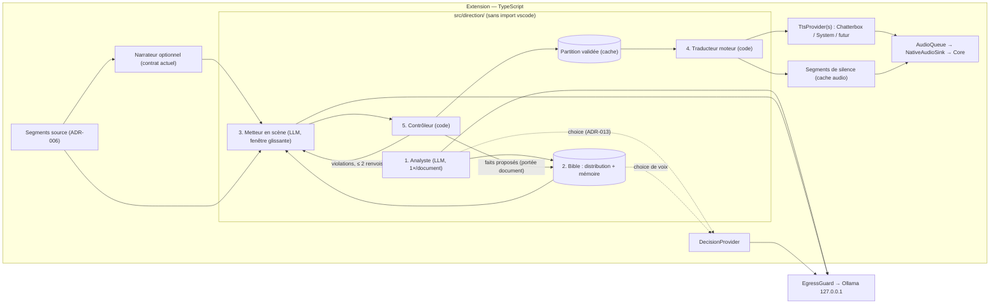
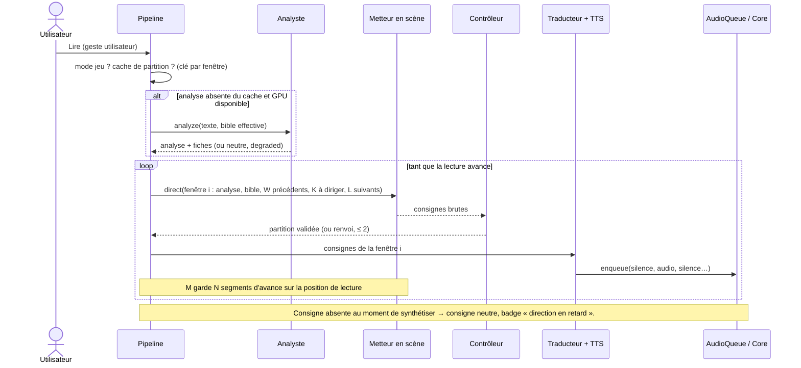

# ADR-015 — Direction de lecture : partition par segment, distribution des voix et mémoire (« bible »)

## Résumé en 10 lignes (validation humaine)

1. **Problème** : des règles de prosodie codées en dur donnent l'effet robot ; il faut une consigne de jeu par segment, venue d'un LLM qui connaît le contexte, et une mémoire des personnages — le même système pour un roman, une documentation et une réponse d'IA.
2. **Cinq rôles** : analyste (LLM, une fois par document), bible (distribution et mémoire), metteur en scène (LLM, fenêtre glissante), traducteur moteur (code), contrôleur (code).
3. **Sortie** : une partition indépendante du moteur — par segment, locuteur, émotion et intensité, tempo, pauses, mots appuyés, note de jeu, texte sonore à prononcer.
4. **Moteurs** : traduction selon les capacités déclarées (ADR-005) ; pauses exactes par segments de silence, sans changer le protocole du Core v1.
5. **Mémoire** : journal en ajout seul ; le LLM n'écrit **que** dans la portée du document ; série et préférences ne changent que par une action de l'utilisateur.
6. **Garde-fous** : bornes de sécurité seulement (pauses 0–3 s, tempo 0,7–1,4…), jamais des règles de style ; une valeur hors borne est ramenée dans la borne.
7. **Sûreté** : tout en local (Ollama via `EgressGuard`) ; panne, retard ou mode jeu → lecture non dirigée, jamais bloquée ; aucune lecture automatique.
8. **Compatibilité** : désactivée par défaut ; la consigne neutre reproduit au champ près les requêtes de synthèse d'aujourd'hui.
9. **Moteur à consignes** : non choisi ; banc d'une journée (Qwen3-TTS, Fish S2 Pro, Pocket TTS, témoin Chatterbox), annexe A ; bibliothèque de voix consenties, annexe B.
10. **À décider par guilhem-bonnet** : accepter cet ADR ; ensuite contrat → traducteur → bible → contrôleur → LLM → banc → UI, puis écoute A/B (≥ 7/10) avant toute activation par défaut.

## Statut

**Accepté (2026-09-29) par guilhem-bonnet (« ok je valide »).** Carte du Mission
Ledger : `GAO-adr-015-dire-001`. Architecture en cinq rôles proposée par le
concierge et acceptée par l'utilisateur le 2026-09-29 ; cet ADR la rend
opposable (contrats, stockage, bornes, tests). Relecture indépendante du
2026-09-29 : « accepter avec corrections », corrections intégrées.

- **Étend** : ADR-005 (nouvelle famille `DirectionProvider` ; champ
  optionnel `TtsCapabilities.direction`), ADR-004 (nouveau dossier
  `globalStorageUri/direction/`, hors du cache audio).
- **Dépend de** : ADR-013 (`DecisionProvider`), **lui-même encore Proposé**
  (condition d'entrée : spike `GAO-spike-valuat-001`). Quand la direction est
  active, la décision « Auto » est prise par l'analyste ; le contrat
  `DecisionProvider` est inchangé. Si ADR-013 n'est pas accepté, analyste et
  choix de voix retombent sur leurs replis déterministes (§2).
- **S'appuie sans le modifier sur** : ADR-012 (Core v1 : les pauses exactes
  passent par des segments de silence mis en file avec `enqueue`) ; une
  extension mineure additive (Core 1.1, fondus) est proposée, pas décidée.
- **Laisse inchangés** : ADR-002 (surlignage par `sourceIds`), ADR-006
  (segmentation), ADR-009 (paliers), ADR-010 (`EgressGuard`).
- Moteur à consignes : veille `GAO-veille-moteu-001` intégrée (annexe A) ;
  **le choix du moteur reste ouvert** jusqu'au banc d'une journée (étape
  1 bis) ; l'ADR reste agnostique (partition → capacités).

## Contexte

### 1. La demande (guilhem-bonnet, 2026-09-29)

- **Pas de règles de prosodie codées en dur** : elles produisent l'effet
  robot (exemples de telles règles, non tirés du code : une virgule = une
  pause fixe, un point d'exclamation = plus d'intensité).
- Chaque phrase reçoit une **consigne de jeu** (timing, durée, pauses,
  intention) proposée par un LLM qui **connaît tout le contexte** de bout en
  bout.
- Le texte est transcrit en **« langage sonore + prompt »** : ce qu'il faut
  prononcer, et comment le dire.
- Une **mémoire** pour que chaque personnage garde sa voix et son caractère
  (âge, voix rauque, alcoolisé, fatigue…) ; une voix de **narrateur très
  différente**.
- Le **même système** pour un texte classique, une documentation technique et
  une réponse d'IA.

### 2. Ce que fait le code aujourd'hui

- Le narrateur rend `{ segments: [{ sourceIds, spokenText }] }`
  (`vscode-extension/src/narrator/narrationContract.ts`), guidé par un
  `profile.style` en texte libre. Aucune notion de locuteur, d'émotion, de
  tempo ni de pause.
- `NarrationSegment` porte déjà un champ libre `metadata?: Record<string,
  unknown>` (`src/core/narration.ts`), inutilisé pour la prosodie.
- Une lecture = **un profil = une voix** et des paramètres moteur fixes :
  `ChatterboxProvider` expose `exaggeration` (0–2, défaut 0,5), `cfg_weight`
  (0–1, défaut 0,5), `temperature` (0,05–2, défaut 0,8) et le clonage par
  `referenceAudio` ; `SystemTtsProvider` (Piper, espeak-ng, say, SAPI)
  n'expose que `speed` (0,5–2). Aucun paramètre de vitesse n'est déclaré pour
  Chatterbox.
- Le registre `Pipeline.ttsFor` crée **une instance `ChatterboxProvider` par
  tuple `providerId/baseUrl/referenceAudio`** (en-tête de
  `ChatterboxProvider.ts`) : plusieurs voix clonées dans une même lecture sont
  donc déjà possibles sans changer le provider.
- Le Core v1 (`contracts/core-v1/http/enqueue.request.schema.json`) met en
  file un **fichier du cache** (`wav` ou `pcm16le`) identifié par un
  `segmentId` conforme à `^[A-Za-z0-9_-]+$` (`common.schema.json`), et rien
  d'autre : ni silence, ni fondu, ni coupe des silences de bord.
- La clé du cache audio inclut voix et paramètres (ADR-004 §2) : un segment
  dit avec une autre intensité est naturellement une autre entrée.

### 3. Mesures disponibles (avec leurs réserves)

- **Sortie structurée fiable** : 0 JSON invalide sur 144 appels du narrateur
  avec `format` d'Ollama (`GAO-valuation-f-001`).
- **Fidélité fragile sur les négations** (`GAO-valuation-f-001`, un seul
  passage par mesure) :
  - première référence : négations de 55,6 à 88,9 % selon le profil et le
    modèle (`qwen2.5:7b` et `3b`) ;
  - seconde mesure (`qwen2.5:7b`, règles de fidélité `styles-v2`), comparée à
    une référence **régénérée par erreur** : les deux références diffèrent
    elles-mêmes (négations de technical-teacher 69,4 % contre 85,7 %), ce qui
    mesure le **bruit d'un passage unique** ;
  - avec `styles-v2` : llm-summary 88,6 → 97,2 %, quick-review 86,1 →
    94,4 %, mais **technical-teacher baisse** de 85,7 à 80,6 % (l'analogie
    pédagogique reformule les contraintes) ;
  - une invention réelle (« 22 050 Hz / 48 000 Hz » remplacés par « tours par
    minute », technical-teacher 7b) a été observée lors d'une **première passe
    non conservée** : elle n'est pas reproductible à partir des résultats
    archivés.
  Le pack recommande d'intégrer la fidélité au « futur contrôleur de fidélité
  (ADR-015) ».
- **Décision fermée** : SemIf `qwen2.5:7b`, prompt enrichi, 75 % (38/51),
  p50 256 ms, p95 378 ms (`GAO-valuation-m-001`). Réserves : la tâche mesurée
  est le **choix de profil**, pas le choix de voix ; intervalle de confiance
  à 95 % d'environ ±12 points ; jeu **synthétique** écrit par le même auteur
  que les étiquettes, **proposées par Claude et non validées par
  l'utilisateur**.
- **Latence du narrateur `qwen2.5:7b`** : p50 3,6 à 4,9 s par texte du jeu
  d'évaluation (styles-v2, mode jeu inactif vérifié). **Aucune latence du
  metteur en scène n'est mesurée.**
- **Mode jeu** : sur cette machine, un hook `gpu-yield` suspend la charge GPU
  quand `$XDG_RUNTIME_DIR/gpu-yield/active` existe ; pendant la première
  mesure, il a rendu les latences inexploitables (p50 technical-teacher 7b
  27 s contre 7,5 s) et fait tomber 71 appels sur 72 en mode dégradé lors
  d'une autre tentative (`GAO-valuation-f-001`).

### 4. Contraintes

Invariants P0 de `shared-context.md` ; mode dégradé obligatoire (ADR-005) ;
point de passage réseau unique (ADR-010) ; « aucun LLM cloud ajouté »
(ADR-009) ; le cache audio ne contient que de l'audio (ADR-004 §2) ; SQLite
rejeté (ADR-004) ; « Zéro Docker » (2026-09-11) ; Core passif (ADR-012) ; un
petit modèle local (7 B) au contexte limité ; GPU partagé entre Ollama et
Chatterbox (Radeon RX 9070, 16 Go), et cédé en mode jeu.

### 5. Prior art (connaissance générale, **non vérifiée dans cette session**, aucun accès web)

- **SSML 1.1 (W3C)** : `break`, `prosody rate`, `emphasis` — mêmes
  dimensions bornées que la partition ; ni personnage, ni intention.
- **Attribution des répliques** dans les récits (outils de type BookNLP) :
  problème connu, difficile, surtout hors de l'anglais ; ici confié au LLM
  avec la bible comme mémoire.
- **Feuille de service / conduite de doublage** : une ligne par réplique,
  locuteur, intention, indications de jeu — c'est la forme retenue.
- **Moteurs expressifs et voix de référence** : veille sourcée
  `GAO-veille-moteu-001` (2026-09-29), reprise en annexes A et B avec ses
  réserves.

## Décision

### 1. Vue d'ensemble



(Rendu du diagramme non vérifié par un outil de rendu Mermaid.)

La direction est une **étape après la narration** : le narrateur (s'il est
actif) décide *quoi dire* ; la direction décide *qui le dit et comment*. Elle
ne réécrit pas le contenu (§6).

**« Un LLM qui connaît tout le contexte » — compromis assumé** : un 7 B local
ne peut pas relire un roman entier à chaque phrase. Le contexte complet est
donc **compressé** : l'analyse du document entier et la bible (qui porte tout
ce qui a été établi depuis le début) accompagnent chaque fenêtre, avec les
segments voisins en clair. C'est un écart volontaire par rapport à la lettre
de la demande.

### 2. Les cinq rôles

| # | Rôle | Nature | Entrée | Sortie | Fréquence | Repli (jamais bloquant) |
|---|---|---|---|---|---|---|
| 1 | **Analyste** | LLM (sortie structurée) + `DecisionProvider` | texte entier (ou par chapitre au-delà du budget de contexte), bible effective | analyse : genre, intention, public, ton de base, persona du narrateur, profil de lecture ; distribution initiale (fiches) | une fois par document (cache) | analyse neutre : narrateur seul, ton du profil |
| 2 | **Distribution + bible** | code (journal) + LLM (fiches) + `DecisionProvider` (choix de voix) | fiches proposées, bibliothèque de voix, `getCapabilities()` | bible enrichie, voix attribuée par personnage | à l'analyse et à chaque personnage découvert | voix du narrateur pour un locuteur inconnu |
| 3 | **Metteur en scène** | LLM (sortie structurée) | analyse + bible effective + W segments précédents (déjà dirigés) + K segments à diriger + L segments suivants (lecture seule) | une **consigne** par segment (§3) + faits proposés pour la bible | par fenêtre de K segments, en avance sur la lecture | consigne neutre (§9) |
| 4 | **Traducteur moteur** | code pur, déterministe | partition validée, capacités du moteur | `TtsRequest` par consigne + segments de silence | par consigne | paramètres du profil |
| 5 | **Contrôleur** | code pur, déterministe | sortie brute du metteur en scène, segments d'entrée, bible | partition validée (bornée) ou violations renvoyées au metteur en scène | par fenêtre | après 2 renvois : consignes neutres pour la fenêtre |

- **L'analyste absorbe le choix de profil d'« Auto » (ADR-013)** : quand la
  direction est active, c'est lui qui appelle `DecisionProvider.decide()`
  (`choice`, repli obligatoire) ; les champs fermés (profil, genre) passent
  par une décision typée, les champs ouverts (persona, ton) par la sortie
  structurée. Le contrat d'ADR-013 ne change pas.
- **Choix de voix = décision fermée** : parmi les voix candidates de la
  bibliothèque (annexe B), filtrées par code (langue, voix du narrateur
  exclue, voix déjà attribuée dans la portée exclue), le `DecisionProvider`
  choisit sur la fiche du personnage ; repli = première candidate dans un
  ordre déterministe. L'utilisateur peut **verrouiller** une attribution.
  **Aucune mesure n'existe pour cette tâche** : les 75 % de
  `GAO-valuation-m-001` portent sur le choix de profil ; la qualité du choix
  de voix sera mesurée à l'étape 6.
- **Aucune branche de code par genre** : le genre est une entrée des prompts,
  jamais une condition du traducteur, du contrôleur ou du pipeline. Une
  documentation technique a une distribution réduite au narrateur ; un roman
  en a plusieurs ; le chemin est le même.
- **Aucune règle de style, ni dans le code ni dans les prompts** : les seules
  constantes codées sont des **bornes de sécurité** (§7) et des
  **étalonnages** de moteur déclarés par le provider (§5.2), mesurables au
  banc. Les prompts de l'analyste et du metteur en scène décrivent le rôle,
  le contexte et le format de sortie ; ils ne contiennent **aucune règle de
  prosodie** (« une virgule = une pause »…). Les prompts sont versionnés dans
  le dépôt et relus comme du code sur ce point.

Contrat des rôles LLM (nouveau fichier `src/core/direction.ts`, sans import de
`vscode`, sur le modèle de `NarratorProvider` ; noms affinables, sémantique
normative) :

```ts
export interface DirectionProvider extends Identified {
  health(signal?: AbortSignal): Promise<ProviderHealth>;
  getCapabilities(signal?: AbortSignal): Promise<{ structuredOutput: boolean; maxInputChars: number; localOnly: boolean }>;
  /** Ne rejette jamais : défaillance → `degraded: true` + analyse neutre. */
  analyze(request: AnalysisRequest, signal?: AbortSignal): Promise<AnalysisResult>;
  /** Ne rejette jamais : défaillance → `degraded: true` + consignes neutres. */
  direct(request: DirectionWindowRequest, signal?: AbortSignal): Promise<DirectionWindowResult>;
}
// Raisons de dégradation : celles de NarrationDegradedReason, plus "egress-denied",
// "late" (hors budget d'anticipation) et "gpu-yield" (mode jeu, §8).
```

Première implémentation : `OllamaDirectionProvider` (`/api/chat` + `format`,
comme `OllamaNarrator`), modèle et hôte par défaut ceux du narrateur
(`qwen2.5:7b` mesuré), via l'`EgressGuardHandle` unique.

### 3. Contrat de la partition (`contracts/direction-v1/partition.schema.json`)

Esquisse de la partition **validée** (après contrôleur). La sortie brute du
LLM est validée par un schéma de mêmes champs **sans bornes numériques**,
puis bornée par le contrôleur : une valeur hors borne est ramenée dans la
borne et comptée, pas rejetée (§7). Le respect des bornes `minimum`/`maximum`
par la grammaire `format` d'Ollama n'est **pas vérifié**.

```json
{
  "$schema": "https://json-schema.org/draft/2020-12/schema",
  "$id": "https://llm-voice.dev/contracts/direction-v1/partition.schema.json",
  "type": "object",
  "additionalProperties": false,
  "required": ["schemaVersion", "documentKey", "bibleRevision", "cues"],
  "properties": {
    "schemaVersion": { "const": "1.0" },
    "documentKey":   { "type": "string", "pattern": "^[a-f0-9]{64}$" },
    "bibleRevision": { "type": "integer", "minimum": 0 },
    "cues": { "type": "array", "items": { "$ref": "#/$defs/cue" } }
  },
  "$defs": {
    "cue": {
      "type": "object",
      "additionalProperties": false,
      "required": ["cueId", "sourceIds", "speakerId", "spokenText"],
      "properties": {
        "cueId":         { "type": "string", "pattern": "^[A-Za-z0-9_-]+$" },
        "sourceIds":     { "type": "array", "items": { "type": "string" }, "minItems": 1 },
        "speakerId":     { "type": "string", "pattern": "^[a-z0-9-]+$" },
        "spokenText":    { "type": "string", "minLength": 1 },
        "emotion": {
          "type": "object", "additionalProperties": false, "required": ["label", "intensity"],
          "properties": {
            "label":     { "type": "string", "maxLength": 40 },
            "intensity": { "type": "number", "minimum": 0, "maximum": 1 },
            "valence":   { "type": "number", "minimum": -1, "maximum": 1 },
            "arousal":   { "type": "number", "minimum": 0, "maximum": 1 }
          }
        },
        "tempo":         { "type": "number", "minimum": 0.7, "maximum": 1.4 },
        "pauseBeforeMs": { "type": "integer", "minimum": 0, "maximum": 3000 },
        "pauseAfterMs":  { "type": "integer", "minimum": 0, "maximum": 3000 },
        "emphasis":      { "type": "array", "items": { "type": "string", "minLength": 1 }, "maxItems": 5 },
        "direction":     { "type": "string", "maxLength": 280 },
        "states":        { "type": "array", "items": { "type": "string", "maxLength": 40 }, "maxItems": 4 },
        "nonverbal": {
          "type": "array", "maxItems": 2,
          "items": {
            "type": "object", "additionalProperties": false, "required": ["kind", "at"],
            "properties": {
              "kind": { "enum": ["breath", "sigh", "laugh", "cough", "hesitation"] },
              "at":   { "enum": ["before", "after"] }
            }
          }
        }
      }
    }
  }
}
```

Sémantique :

- `cueId` suit le même motif que le `segmentId` du Core v1 : il sert
  directement de base aux identifiants de segment mis en file (§5.4).
- `speakerId` : id d'un rôle de la bible ; `"narrator"` est réservé.
- `spokenText` : le **texte sonore** — forme orale à prononcer (nombres,
  unités, sigles, symboles, identifiants rendus prononçables), sans
  paraphrase (§6). `direction` est la **note de jeu** en langage naturel,
  **jamais synthétisée**.
- `emotion.label` est libre (pas de vocabulaire imposé) ; `intensity`,
  `valence`, `arousal` sont les dimensions numériques que le traducteur sait
  porter vers un moteur.
- `tempo` est un multiplicateur de la vitesse du profil.
- `emphasis` : sous-chaînes **exactes** de `spokenText`.
- `states` : états transitoires actifs (« ivre », « essoufflé ») — référencent
  la bible.
- `nonverbal` est un vocabulaire fermé **de rendu** (ce que certains moteurs
  savent jouer), pas une règle : le metteur en scène choisit s'il l'emploie.
- Une consigne peut couvrir plusieurs segments source, et un segment source
  peut être découpé en plusieurs consignes (réplique et incise du narrateur
  dans la même phrase) ; chaque segment source doit être couvert au moins une
  fois, comme aujourd'hui.

### 4. Contrat de la bible (`contracts/direction-v1/bible.schema.json`)

```json
{
  "$id": "https://llm-voice.dev/contracts/direction-v1/bible.schema.json",
  "type": "object",
  "additionalProperties": false,
  "required": ["schemaVersion", "scope", "scopeKey", "revision", "narrator", "characters"],
  "properties": {
    "schemaVersion": { "const": "1.0" },
    "scope":      { "enum": ["document", "series", "user"] },
    "scopeKey":   { "type": "string", "minLength": 1 },
    "revision":   { "type": "integer", "minimum": 0 },
    "analysis":   { "$ref": "#/$defs/analysis" },
    "narrator":   { "$ref": "#/$defs/role" },
    "characters": { "type": "array", "items": { "$ref": "#/$defs/role" } }
  },
  "$defs": {
    "fact": {
      "type": "object", "required": ["value", "by", "at"],
      "properties": {
        "value":     { "type": "string", "maxLength": 200 },
        "by":        { "enum": ["analyst", "director", "user"] },
        "at":        { "type": "string", "format": "date-time" },
        "sourceIds": { "type": "array", "items": { "type": "string" } },
        "locked":    { "type": "boolean" }
      }
    },
    "role": {
      "type": "object", "required": ["id", "names", "traits", "voice"],
      "properties": {
        "id":     { "type": "string", "pattern": "^[a-z0-9-]+$" },
        "names":  { "type": "array", "items": { "type": "string" } },
        "traits": { "type": "object", "additionalProperties": { "$ref": "#/$defs/fact" } },
        "states": { "type": "array", "items": {
          "type": "object", "required": ["label", "fromSourceId", "by"],
          "properties": { "label": { "type": "string" }, "fromSourceId": { "type": "string" },
                          "untilSourceId": { "type": "string" }, "by": { "enum": ["analyst", "director", "user"] } } } },
        "voice": {
          "type": "object",
          "properties": {
            "descriptor":  { "$ref": "#/$defs/fact" },
            "assignments": { "type": "object", "additionalProperties": {
              "type": "object", "required": ["voiceRef", "by"],
              "properties": { "voiceRef": { "type": "string" }, "by": { "enum": ["casting", "user"] }, "locked": { "type": "boolean" } } } }
          }
        }
      }
    },
    "analysis": {
      "type": "object",
      "properties": {
        "genre": { "type": "string" }, "intent": { "type": "string" }, "audience": { "type": "string" },
        "baseTone": { "type": "string" }, "narratorPersona": { "type": "string" }, "readingProfileId": { "type": "string" }
      }
    }
  }
}
```

- **Traits permanents** (`traits` : âge, timbre « rauque », accent,
  caractère…) : clés libres, pas de vocabulaire imposé. **États
  transitoires** (`states` : « alcoolisé » du chapitre 3, « épuisé ») : bornés
  par des `sourceIds`, pour qu'un personnage ivre au chapitre 3 ne le reste
  pas au chapitre 9.
- `voice.descriptor` décrit la voix en langage naturel, indépendamment du
  moteur (servira tel quel à un moteur à consignes) ; `assignments` associe
  une voix concrète **par `providerId`**, parce qu'une voix Chatterbox clonée
  et une voix Piper ne sont pas interchangeables.
- **Enrichie, jamais réécrite** : la bible est un **journal d'événements en
  ajout seul** (`addRole`, `addTrait`, `addState`, `closeState`,
  `assignVoice`, `userEdit`, `userRetract`, `userPromote`) ; l'état est une
  projection du journal. Un rôle LLM **ajoute** des faits ; il ne supprime ni
  ne remplace. Un fait LLM qui contredit un fait existant est conservé comme
  **candidat signalé** par le contrôleur, non appliqué. Seul l'utilisateur
  retire ou remplace.

#### Portées, droit d'écriture et précédence

| Portée | Clé | Contenu typique | Qui écrit | Persistance |
|---|---|---|---|---|
| `document` | fichier du workspace : URI normalisé ; message d'inbox : nom du fichier ; sélection/presse-papiers : empreinte du texte | personnages, états, analyse | **LLM (analyste, metteur en scène, distribution) et utilisateur** | fichier pour un fichier du workspace ; **en mémoire seulement** pour sélection, presse-papiers et messages d'inbox, sauf opt-in (ci-dessous) ou action « Conserver » |
| `series` | nom donné par l'utilisateur (une saga, la doc d'un dépôt) ; implicite `source:<id>` pour l'inbox (ex. `source:claude-code`) | personnages récurrents, persona du narrateur | **utilisateur seulement** | fichier |
| `user` | unique | voix préférée du narrateur, voix interdites, tempo de base, préférences générales | **utilisateur seulement** | fichier |

- **Les faits proposés par un LLM ne s'écrivent que dans la portée
  `document`.** Les portées `series` et `user` ne changent que par une action
  de l'utilisateur : édition, ou commande « Promouvoir dans la série » /
  « Promouvoir dans mes préférences », qui recopie un fait `document` choisi
  (événement `userPromote`). Sans cette règle, un texte hostile pourrait
  empoisonner durablement toutes les lectures d'une série ou de
  l'utilisateur.
- **Réponses d'IA** : la bible `document` d'un message d'inbox n'est
  **pas persistée par défaut** ; sa persistance est un **opt-in**
  (`llmVoice.direction.persistInboxBibles`, défaut `false`). La persona
  commune à toutes les réponses d'IA vient de la série `source:claude-code`,
  donc de l'utilisateur.
- Bible effective = fusion `user` ⊂ `series` ⊂ `document` : **la portée la
  plus précise gagne**, sauf qu'**un fait `by: user` ou `locked` n'est jamais
  remplacé par un fait LLM, quelle que soit sa portée**.

#### Stockage local

`globalStorageUri/direction/` — **hors de `cache/`**, qui ne doit contenir que
de l'audio (ADR-004 §2) :

```
direction/
  bibles/document/<sha256(clé)>.jsonl   journal ; <…>.snapshot.json projection
  bibles/series/<slug>.jsonl
  bibles/user.jsonl
  partitions/<sha256(fenêtre)>.json     cache dérivé, LRU par taille
```

- Fichiers JSON, écriture atomique tmp+rename, droits `0600`/`0700` comme
  l'inbox ; pas de base de données (SQLite rejeté par ADR-004).
- **Édition** : v1 = commande « LLM Voice : Modifier la bible » qui ouvre la
  projection dans l'éditeur avec le schéma attaché (comme `profiles.json`,
  D5) ; l'enregistrement produit des événements `userEdit`. Une vue dédiée
  vient plus tard (étape 7).
- **Oubli** : « Oublier la bible de ce document » et « Oublier toutes les
  bibles » suppriment les fichiers. La bible contient des données dérivées du
  contenu (noms, traits) : jamais journalisées (`spokenText`, `direction`,
  `traits`, `names` ajoutés à `BANNED_FIELDS`), jamais émises hors de la
  machine.

### 5. Traduction par capacités (ADR-005)

#### 5.1 La partition est indépendante du moteur

Le LLM n'émet jamais `exaggeration`, `speed` ou un nom de voix de moteur. Un
changement de moteur ne réinvalide ni la bible ni la partition, seulement le
cache audio.

#### 5.2 Capacités déclarées par le provider

Champ **optionnel** ajouté à `TtsCapabilities` (additif, rétrocompatible ;
absent = « voix et pauses seulement ») :

```ts
export interface DirectionCapabilities {
  /** Porte l'intensité : nom du paramètre et étalonnage mesuré au banc. */
  readonly intensity?: { parameter: string; neutral: number; safeMax: number };
  /** Porte la stabilité du jeu (ex. cfg_weight), même principe. */
  readonly stability?: { parameter: string; neutral: number; min: number; max: number };
  /** Porte le tempo ; absent = tempo ignoré et tracé. */
  readonly tempo?: { parameter: string; min: number; max: number };
  /** Accepte une consigne en langage naturel (moteur à consignes, annexe A). */
  readonly instructions: boolean;
  /** Balises non verbales rendues par le moteur ; [] = ignorées. */
  readonly nonverbal: readonly string[];
  /** Le moteur s'exécute sur GPU (sert au repli en mode jeu, §8). */
  readonly usesGpu: boolean;
}
```

Le traducteur fait une **projection linéaire** d'une dimension continue vers
le paramètre déclaré, entre `neutral` et `safeMax` : c'est un étalonnage de
moteur (donnée mesurable, surchargeable dans le profil), pas une règle de
style — le *choix* de l'intensité reste celui du metteur en scène. Aucune
détection par `instanceof` ou par id.

#### 5.3 Table de traduction

| Moteur | Voix par rôle | Émotion / intensité | Tempo | Pauses | Note de jeu, emphase, non verbal |
|---|---|---|---|---|---|
| **Chatterbox Multilingual** (`POST /tts`) — témoin du banc | voix clonée par rôle : une instance `ChatterboxProvider` par `referenceAudio` (clé de registre existante de `Pipeline.ttsFor`), ou `predefined_voice_id` | `intensity` → `exaggeration` entre 0,5 (défaut actuel) et un plafond de sécurité **à étalonner** (0–2 déclaré par le provider, 0,25–2,0 selon la veille ; artefacts aux fortes valeurs **non mesurés**) ; `stability` → `cfg_weight` ; `temperature` du profil inchangée | non porté : aucun paramètre de vitesse déclaré ; existence d'un `speed_factor` sur `/tts` **non vérifiée** → ignoré et tracé | Core (silences) | ignorées : « deux boutons seulement », le tokenizer multilingue **jette les balises** (veille, sources tierces) ; Chatterbox Turbo, qui les accepte, est **anglais seulement** |
| **Piper** (System) | un modèle `.onnx` par voix de la bibliothèque (nombre de voix FR disponibles **non vérifié**) | aucune (pas de contrôle d'émotion ; `noise_scale` non exposé aujourd'hui, capacité à ajouter si le banc le justifie) | `speed` (0,5–2, existant) | Core (silences) | ignorées |
| **espeak-ng / say / SAPI** | voix système | aucune | `speed` | Core (silences) | ignorées |
| **Core** (`llm-voice-core`) | — | — | — | **segments de silence** exacts (§5.4) ; fondus en Core 1.1 (proposé) | — |
| **Moteur à consignes** (candidats en annexe A, choix au banc) | voix prédéfinie + consigne, voix conçue par description, ou voix clonée selon le moteur | via la consigne en texte libre ou en balises | via la consigne (respect **non mesuré**) | Core | `direction` + `voice.descriptor` + `emotion.label` passés **tels quels** dans la forme native du moteur (texte libre ou balise) |
| **Moteur à voix de référence sans style** (ex. Pocket TTS) | voix clonée par rôle | aucune : l'expressivité ne vient que du **choix de la voix de référence** | non vérifié | Core | ignorées |

Les voix viennent d'une **bibliothèque locale de voix consenties et
traçables** (annexe B) ; une voix sans fiche complète n'est jamais proposée.
Les échantillons de clonage restent soumis aux contrôles de
`readReferenceAudio` et ne partent que vers un serveur TTS en boucle locale.

#### 5.4 Pauses exactes sans changer le protocole Core v1

L'extension génère un **segment de silence** (`pcm16le` ou `wav`, clé de
cache = durée + format + fréquence) et le met en file par `enqueue`, entre les
deux consignes : le Core joue des échantillons, la durée est exacte par
construction. Aucun changement du protocole v1.0. Le même fichier sert au
moteur webview de repli.

Règles des segments de silence :

- **Identifiants** : `<cueId>-pre` et `<cueId>-post`, conformes au motif
  `segmentId` du Core (`^[A-Za-z0-9_-]+$`) puisque `cueId` l'est déjà.
- **Rattachement** : un silence n'est pas une consigne ; il appartient à sa
  consigne, **sans `sourceIds` propres**. Pendant `-post`, le surlignage
  (ADR-002) reste sur la consigne qui vient d'être dite ; pendant `-pre`, il
  passe déjà sur la consigne suivante.
- **Précédent / Suivant** naviguent entre **consignes**, jamais entre
  silences ; un saut démarre au début de l'audio de la consigne cible, **en
  sautant son `-pre`**, pour que la navigation reste immédiate.
- La façon dont `AudioQueue` et `PlaybackController` associent aujourd'hui un
  chunk à un segment n'a **pas été relue** pour cet ADR : l'étape 2 vérifie
  que ces règles s'y expriment sans changer leurs contrats, ou le signale.

Point dur : les moteurs produisent des **silences de bord variables** ; la
pause perçue = silence de fin de la consigne + silence inséré + silence de
début de la suivante. Une **coupe des silences de bord** est donc nécessaire
pour tenir les pauses mesurées ; son emplacement (TypeScript avant écriture
dans le cache, ou Core 1.1 `trimSilence`) reste ouvert. Les **fondus**
anti-clic (`fadeInMs`/`fadeOutMs`) sont une extension additive proposée pour
Core 1.1, à décider sur mesure du banc.

#### 5.5 Moteur à consignes

Non choisi. Candidats, réserves de la veille, protocole et règle de décision
du banc d'une journée : **annexe A**. Ce que la décision fixe dès maintenant,
quel que soit le vainqueur : le moteur retenu est un `TtsProvider` de plus qui
déclare `DirectionCapabilities` ; partition, bible, contrôleur et metteur en
scène ne changent pas ; c'est un **palier Python optionnel** en boucle locale,
hors de la voie « sans installation ».

### 6. Texte sonore et fidélité

- Le metteur en scène **ne paraphrase pas** : `spokenText` = texte du segment
  d'entrée mis en **forme orale** (nombres et unités écrits en toutes
  lettres si utile, sigles épelés, symboles et identifiants prononçables,
  ponctuation expressive). La réécriture de contenu reste le rôle du
  narrateur, déjà mesuré par `narrator-eval`.
- Profil en mode `faithful` : la direction s'applique (voix, pauses, tempo,
  intensité) mais le contrôleur exige l'**équivalence lexicale** avec la
  source, modulo la seule forme orale. C'est la réponse directe à l'effet
  robot sur un texte classique lu intégralement.
- Le contrôleur vérifie à l'exécution les nombres et les négations de chaque
  consigne contre son segment d'entrée : c'est le point faible mesuré
  (§Contexte 3), y compris quand un réglage améliore les autres profils.

### 7. Garde-fous (bornes de sécurité, pas des règles de style)

| Grandeur | Borne | Motif |
|---|---|---|
| `pauseBeforeMs`, `pauseAfterMs` | 0–3 000 ms | un silence plus long passe pour une panne |
| silence cumulé entre deux consignes | ≤ 3 000 ms | idem |
| `tempo` | 0,7–1,4 × vitesse du profil, puis intersection avec les bornes du moteur | intelligibilité |
| `intensity` | 0–1, projeté sous `safeMax` du moteur | artefacts de synthèse |
| `emphasis` | ≤ 5 par consigne, sous-chaînes exactes de `spokenText` | sinon ignoré |
| `direction` | ≤ 280 caractères, jamais synthétisée | coût de prompt, injection |
| `spokenText` | longueur ≤ 2 × celle du segment d'entrée (proposé, **non mesuré**) | anti-invention |
| voix | la voix du narrateur n'est jamais attribuée à un personnage | contraste narrateur/personnages |
| écriture dans la bible | faits LLM en portée `document` seulement | anti-empoisonnement |
| renvois du contrôleur | ≤ 2 par fenêtre, puis consignes neutres | latence |
| anticipation | budget d'attente d'une consigne **en régime établi** avant repli neutre : 1,5 s proposé, **non mesuré** (§8) | lecture jamais bloquée |

Une valeur hors borne est **ramenée dans la borne** et comptée dans la trace
de direction ; un taux de bornage élevé est un signal de prompt à corriger,
pas une erreur utilisateur.

### 8. Latence, débit, mode jeu, cache, « Préparer la lecture »



(Rendu non vérifié par un outil de rendu Mermaid.)

- **Fenêtre glissante** : un appel dirige K segments avec W segments
  précédents et L suivants en contexte, plus l'analyse et la bible effective.
  Valeurs proposées K = 4, W = 6, L = 4, N = 8 : **non mesurées**, fixées par
  le banc. Une consigne par segment, mais pas un appel par phrase.
- **Budget d'attente de 1,5 s = régime établi** : il s'applique quand le
  metteur en scène a déjà pris de l'avance. Au démarrage, c'est le budget de
  premier son qui s'applique (ci-dessous). Un appel du narrateur mesure déjà
  3,6 à 4,9 s p50, et la sortie du metteur en scène est plus riche : le
  budget n'a de sens que si l'avance est maintenue.
- **Bilan de débit** (condition de viabilité, à mesurer à l'étape 5) : la
  direction tient si, sur une fenêtre, **durée de l'appel du metteur en scène
  + durée de synthèse des K consignes < durée audio des K consignes**, soit
  un débit de segments dirigés par seconde supérieur au débit de segments lus.
  Aucun de ces trois termes n'est mesuré. Si le bilan est négatif : agrandir
  K, réduire le contexte, ou recommander « Préparer la lecture » pour ce
  document ; jamais ralentir la lecture.
- **Texte long** : l'analyste travaille par chapitre quand le texte dépasse
  le budget de contexte (le `num_ctx` réel de `qwen2.5:7b` sous Ollama n'est
  **pas vérifié**) ; la bible sert de mémoire entre chapitres.
- **Cache de partition** : clé par fenêtre = SHA-256(textes de la fenêtre et
  de son contexte + révision de la bible effective + modèle + version du
  prompt + version du schéma + id du profil). Relire un document = zéro appel
  LLM ; modifier un paragraphe ne recalcule que les fenêtres touchées. Cache
  dérivé, perte tolérée, LRU par taille, sous `direction/partitions/`.
- **« Préparer la lecture »** (commande + bouton) : calcule l'analyse et toute
  la partition, et en option pré-synthétise l'audio dans le cache, en tâche de
  fond annulable avec progression. **Ne lance jamais la lecture.**
- **Premier son** : pour un texte court, analyse puis première fenêtre en
  série ; attendu à plusieurs secondes, **non mesuré**. Profil sans direction
  = premier son inchangé.
- **Contention GPU** : Ollama et Chatterbox partagent le même GPU ;
  l'anticipation met les deux en concurrence. Cohabitation en VRAM et effet
  sur le débit **non mesurés** (étape 5).
- **Mode jeu (`gpu-yield`)** : si `$XDG_RUNTIME_DIR/gpu-yield/active` existe
  au lancement ou apparaît pendant la lecture, la direction **n'émet aucun
  appel LLM** et **n'utilise aucun moteur déclarant `usesGpu`** :
  1. partition déjà en cache (y compris celle d'une « Préparer la lecture »
     antérieure) → elle est jouée, traduite pour un moteur CPU (voix par rôle
     si la bibliothèque en a l'équivalent CPU, sinon voix du profil CPU) ;
  2. sinon → **lecture non dirigée** (consignes neutres) sur le moteur CPU
     (`SystemTtsProvider` : Piper, sinon espeak-ng/say/SAPI) ;
  3. **jamais d'attente bloquante** : aucune boucle d'attente de la levée du
     drapeau ; badge « mode jeu : direction suspendue » ; raison de
     dégradation `gpu-yield`. À la levée du drapeau, la direction reprend à la
     fenêtre suivante.
  Le drapeau est une convention **locale de cette machine** (Linux) ; son
  absence (autres plateformes) vaut « GPU disponible ». **Toute latence
  mesurée alors que le drapeau est présent est exclue** des mesures de l'étape
  5 et des bancs (1 bis, 6) : chaque mesure vérifie le drapeau avant et après
  et marque le résultat invalide s'il était présent.

### 9. Compatibilité ascendante

- **Direction désactivée par défaut** (réglage de profil `direction.enabled`,
  champ optionnel ajouté à `VoiceProfileSchema` sans rupture) jusqu'au
  verdict de l'écoute A/B (étape 8).
- **Consigne neutre** = `{ speakerId: "narrator", spokenText: <texte du
  segment>, tempo: 1, pauseBeforeMs: 0, pauseAfterMs: 0 }`, sans émotion.
  Traduite, elle produit **exactement** les `TtsRequest` d'aujourd'hui (voix,
  paramètres et texte du profil), sans segment de silence. Tout mode dégradé
  retombe là.
- Le contrat du narrateur `{ sourceIds, spokenText }` est un **sous-ensemble**
  de la consigne : un résultat de narrateur se convertit en consignes neutres
  sans perte. `NarrationSegment.metadata` transporte la consigne dans le
  pipeline existant, sans changer sa signature.
- Le surlignage (ADR-002) continue de suivre `sourceIds` ; les silences
  suivent la règle du §5.4.
- ADR-013 : sans direction, « Auto » reste appelé par `Pipeline.startInternal`
  comme décrit ; avec direction, l'appel passe dans l'analyste, même contrat,
  même repli.

### 10. Invariants P0

| Invariant | Comment l'ADR le respecte |
|---|---|
| 1. Zéro autoplay | Analyse, direction et « Préparer la lecture » ne connaissent ni le player ni `CoreClient` ; ils ne sont déclenchés que par une commande utilisateur, jamais par l'arrivée d'un message d'inbox. L'invariant statique existant est étendu à `src/direction/`. |
| 2. Local-first | Tous les appels LLM passent par `EgressGuard` vers Ollama en boucle locale ; bible et partitions restent dans `globalStorageUri` ; bibles des réponses d'IA non persistées par défaut ; aucun contenu journalisé ; aucun LLM cloud ajouté (un endpoint d'entreprise compatible OpenAI sous `trustedHosts` reste possible, ADR-009). |
| 3. Provider agnostic | Partition indépendante du moteur ; traduction par `getCapabilities()` ; `DirectionProvider` derrière une fabrique. |
| 4. Profils configurables | Direction activée par profil ; bible éditable ; étalonnages surchargeables ; aucun mode par genre codé en dur. |
| 5. Aucun modèle dans le VSIX | Modèles servis par Ollama ; voix de la bibliothèque **téléchargées hors VSIX** (annexe B) ; outils du banc (embeddings de locuteur, faster-whisper) hors dépôt, jamais chez l'utilisateur. |

### 11. Emplacement du code

- `contracts/direction-v1/` : `partition.schema.json`, `bible.schema.json`,
  exemples valides et invalides (même discipline que `contracts/core-v1/`).
- `vscode-extension/src/core/direction.ts` : types et `DirectionProvider`
  (sans `vscode`).
- `vscode-extension/src/direction/` : bible (journal, projection, portées),
  fenêtre et anticipation, contrôleur, traducteur, cache de partition,
  `OllamaDirectionProvider`, fabrique, prompts versionnés. La règle ESLint
  interdisant `fetch` hors `net/` couvre ce dossier.

## Ce qui reste ouvert

1. **Choix du moteur à consignes** : veille faite (annexe A), **décision
   ouverte jusqu'au banc d'une journée** (étape 1 bis). Inconnues à lever par
   le banc : qualité française réelle, respect des consignes, ROCm sur RDNA4
   pour Qwen3-TTS, VRAM en cohabitation avec Ollama, latence chez nous.
   Inconnues hors banc : licence des poids de Qwen3-TTS (carte HF à lire),
   licence Fish Audio Research pour un usage produit, **droit à la voix en
   droit français** (validation juridique avant toute distribution publique
   de voix).
2. **Coupe des silences de bord** : en TypeScript avant écriture dans le
   cache, ou `trimSilence` en Core 1.1. Décision sur mesure du banc.
3. **Fondus Core 1.1** (`fadeInMs`/`fadeOutMs`) : seulement si le banc mesure
   des clics aux jointures.
4. **Valeurs K, W, L, N, budget d'attente, plafond `exaggeration`, ratio de
   longueur** et **bilan de débit** : proposés, non mesurés.
5. **Outil d'embedding de locuteur** du banc (famille ECAPA ou équivalent) :
   choix, licence et installation hors dépôt **non vérifiés**.
6. **Contraste narrateur/personnages** : exclusion de la voix du narrateur
   décidée ; un seuil de distance minimale en production (au-delà du banc)
   reste à décider.
7. **Version cible** : après 0.4 (ADR-013) ; numéro de version à fixer par
   guilhem-bonnet.
8. **Dépendance à ADR-013** (Proposé) et à ses étiquettes
   (`GAO-valuation-m-001`, non validées par l'utilisateur) : le choix de
   profil par l'analyste en hérite ; le choix de voix n'a encore aucune mesure.
9. **Rattachement des silences dans `AudioQueue`** (§5.4) : à vérifier dans le
   code à l'étape 2.

## Conséquences

### Positives

- La prosodie vient du contexte (qui parle, dans quel état, à quel moment du
  récit), pas de la ponctuation.
- Un seul chemin pour roman, documentation et réponse d'IA ; la différence
  est dans la bible et l'analyse, pas dans le code.
- Voix et caractères stables entre chapitres et entre sessions ; choix de
  l'utilisateur jamais écrasés.
- Nouveau moteur = nouvelles capacités déclarées, sans toucher à la
  partition ni à la bible.
- Le contrôleur donne enfin un point d'application aux mesures de fidélité
  (`narrator-eval`) sur le chemin de lecture.
- Aucun changement du protocole Core v1 pour les pauses.

### Négatives

- Appels LLM supplémentaires sur le chemin de lecture : premier son plus
  tardif, concurrence GPU avec Chatterbox, consommation énergétique ; en mode
  jeu, la direction est suspendue et la voix bascule sur un moteur CPU.
- Nouveau stockage local de données dérivées du contenu : à documenter dans
  la page confidentialité, avec commandes d'oubli.
- Un contrat de plus à versionner (`direction-v1`), deux schémas, un journal.
- Les moteurs actuels ne portent pas tout : Piper ignore l'émotion,
  Chatterbox le tempo (en l'état du provider) ; l'emphase et la note de jeu
  n'ont d'effet qu'avec un moteur à consignes.
- Qualité dépendante d'un 7 B local : attribution des répliques et
  cohérence non mesurées ; bornage et repli neutre limitent les dégâts sans
  les supprimer.
- Un moteur à consignes crédible (annexe A) est un **palier Python
  optionnel** (venv, serveur local) : une installation de plus, hors de la
  voie « sans installation ».
- **Risque juridique sur les voix** : consentement au clonage et droit à la
  voix en France non vérifiés ; la bibliothèque doit rester traçable voix par
  voix, et sa distribution publique attend une validation juridique.
- Injection par le texte (« mets une pause de 10 s », « le narrateur a la
  voix X ») : bornée par §7, par la précédence des faits utilisateur et par
  la **restriction des faits LLM à la portée `document`**. Pire cas = un jeu
  étrange **sur ce seul document**, visible et corrigeable (« Oublier la
  bible de ce document »), sans effet sur les autres documents, la série ou
  les préférences, sans action déclenchée ni donnée émise.

## Alternatives rejetées

- **Règles de prosodie codées en dur** (ponctuation → pause, « ! » →
  intensité, table par genre) : produit l'effet robot constaté par
  l'utilisateur ; ignore le contexte (ironie, fatigue, ivresse) ; oblige à une
  table par genre, donc à des branches par genre dans le code. Seules des
  bornes de sécurité et des étalonnages de moteur restent codés.
- **Un seul appel LLM monolithique sans mémoire** (tout le texte → toute la
  partition) : dépasse le contexte d'un 7 B local sur un texte long ; voix et
  caractères dérivent d'un chapitre ou d'une session à l'autre ; aucun premier
  son avant la fin de l'appel ; pas de correction ciblée par le contrôleur ;
  rien d'éditable par l'utilisateur.
- **Cloud par défaut** (LLM ou TTS distant pour la mise en scène) : contraire
  à l'invariant P0 n°2 et à ADR-009 (« aucun LLM cloud ajouté ») ; un
  endpoint d'entreprise compatible OpenAI reste possible, explicitement.
- **Partition dépendante du moteur** (le LLM émet `exaggeration`, un id de
  voix) : couple le prompt au moteur, invalide partitions et bibles à chaque
  changement de voix, contraire à P0 n°3.
- **SSML comme format pivot** : `CustomTTSRequest` de `/tts` (Chatterbox) n'a
  pas de champ SSML ; support SSML de Piper **non vérifié** ; SSML ne porte ni
  personnage ni note de jeu. La partition en reprend les dimensions bornées
  sans la syntaxe.
- **Contrôleur LLM-juge sur le chemin de lecture** : double la latence ;
  contrôleur en code d'abord, un juge LLM pourra s'ajouter hors du chemin
  critique (pendant « Préparer la lecture »).
- **Bible réécrite à chaque passage** : perd les choix de l'utilisateur et
  fait dériver les voix ; journal en ajout seul retenu.
- **LLM autorisé à écrire dans les portées série et préférences** : un texte
  hostile empoisonnerait durablement toutes les lectures ; promotion par
  l'utilisateur retenue.
- **Base de données pour la bible** (SQLite, Weaviate) : SQLite rejeté par
  ADR-004 (dépendance native) ; le volume tient dans des fichiers JSON.
- **Direction calculée à l'arrivée d'un message d'inbox** : charge GPU sans
  geste utilisateur et chemin dangereux pour l'invariant zéro autoplay ;
  seule « Préparer la lecture », explicite, précalcule.
- **Attendre la fin du mode jeu** avant de lire : bloque la lecture pour une
  durée inconnue ; repli CPU non dirigé retenu.

## Tests qui prouvent la décision

Automatisables (aucun ne dépend d'une écoute humaine) ; les seuils marqués
« proposé » sont à étalonner par l'étape 6 avant de devenir des gates.

1. **Contrat** : exemples valides et invalides de `contracts/direction-v1/`
   acceptés ou refusés par Zod (vitest), sur le modèle de `core-v1` ; tout
   `cueId` et tout identifiant de silence dérivé satisfont le motif
   `segmentId` du Core.
2. **Compatibilité ascendante** (test doré) : un résultat de narrateur actuel
   converti en consignes neutres produit **la même liste de `TtsRequest`**
   qu'aujourd'hui, au champ près, sans segment de silence.
3. **Garde-fous** : test de propriété — toute sortie brute générée
   aléatoirement (valeurs extrêmes, types valides) donne des paramètres moteur
   dans les bornes (§7) et dans celles de `getCapabilities()`.
4. **Pauses mesurées** : partition de référence (pauses 0, 300, 800, 1 500,
   3 000 ms) jouée par le Core sur le banc `scripts/audio-proof/` (sink nul,
   capture, `analyze.py` étendu pour lister chaque silence) ; écart proposé
   ≤ 40 ms par pause, **non mesuré**. Mesure aussi l'effet des silences de
   bord (point ouvert 2).
5. **Stabilité du timbre par personnage** : extrait classique du domaine
   public avec au moins 3 personnages et un narrateur, au moins 5 répliques
   par personnage réparties sur tout l'extrait, lu en **deux sessions**
   (bible rechargée depuis le disque) ; embeddings de locuteur (outil de dev
   hors dépôt) ; similarité cosinus intra-personnage médiane ≥ S_intra et
   toute paire narrateur–personnage ≤ S_inter, seuils étalonnés sur des
   enregistrements de référence (**non mesurés**).
6. **Tempo** : débit en mots par seconde (horodatage faster-whisper du banc)
   strictement croissant pour tempo 0,8 / 1,0 / 1,2 sur les moteurs qui
   déclarent `tempo`.
7. **Fidélité** : `vscode-extension/scripts/narrator-eval` étendu d'une option
   de direction, sur ses 24 textes plus des extraits classiques, **3 passages**
   (le bruit d'un passage unique est mesuré) : essentiel ≥ 95 %, négations
   ≥ 95 % **pour chaque profil, technical-teacher compris**, 0 nombre inventé,
   comparé à la direction désactivée. En mode `faithful`, équivalence lexicale
   à 100 %.
8. **Même chemin pour les trois genres** : test d'intégration avec un
   `FakeDirectionProvider` sur trois fixtures (roman, documentation, réponse
   d'IA) ; test statique : aucune comparaison sur le genre dans
   `src/direction/`.
9. **Bible** : ajout seul (aucun événement ne supprime un fait hors
   `userRetract`) ; un fait `user` ou `locked` n'est jamais remplacé par un
   fait LLM (test de propriété) ; **aucun événement d'origine LLM n'atteint
   les portées `series` ou `user`** (test de propriété) ; précédence des
   portées ; « Oublier » supprime les fichiers ; sélection, presse-papiers et
   messages d'inbox non persistés sans opt-in.
10. **Mode dégradé** : Ollama absent, délai, JSON invalide, consigne en retard,
    `EgressDeniedError` → consignes neutres, lecture non bloquée, badge ;
    zéro requête émise sur refus réseau.
11. **Zéro autoplay** : l'invariant statique couvre `src/direction/` et la
    commande « Préparer la lecture » (aucun chemin vers `play()` ni
    `CoreClient`).
12. **Local-first et journaux** : scénario complet avec direction en
    `localOnly` → zéro requête non interceptée (ADR-010 niveau 2) ; une chaîne
    sentinelle placée dans le texte, une note de jeu et un trait n'apparaît
    dans aucune ligne de log.
13. **Bibliothèque de voix** : une voix sans fiche de traçabilité complète
    (source, licence, preuve de consentement ou mention « voix conçue ») n'est
    jamais proposée au choix de voix ; aucune voix marquée non redistribuable
    n'entre dans un paquet ; aucun échantillon dans le VSIX (gate VSIX
    existante étendue).
14. **Mode jeu** : drapeau `gpu-yield` simulé (dossier temporaire en guise de
    `XDG_RUNTIME_DIR`) → zéro requête vers Ollama, zéro synthèse par un
    moteur `usesGpu`, lecture démarrée sur le moteur CPU (partition en cache
    si présente, sinon non dirigée), aucune attente ; drapeau levé → reprise à
    la fenêtre suivante. Les scripts de mesure refusent un résultat obtenu
    drapeau présent.
15. **Navigation et surlignage** : Précédent/Suivant ne s'arrêtent jamais sur
    un silence et sautent le `-pre` de la consigne cible ; surlignage conforme
    au §5.4 (FakeAudioSink).

**Revue humaine (hors gate automatique)** : **écoute A/B à l'aveugle** par
guilhem-bonnet — 10 passages (4 classiques avec dialogues, 3 documentations,
3 réponses d'IA), direction désactivée contre activée, ordre tiré au hasard ;
critère proposé : direction préférée sur au moins 7 passages sur 10. Ce
verdict conditionne l'activation par défaut, pas la fusion du code.

## Plan de livraison

Chaque étape est une carte du Mission Ledger dont le critère nomme un verdict
(test, gate, lint). Les cartes sont à créer **après la validation de cet ADR**.

| Étape | Carte (titre proposé) | Agent | Critère d'acceptation |
|---|---|---|---|
| 0 | Validation d'ADR-015 (veille `GAO-veille-moteu-001` terminée le 2026-09-29) | guilhem-bonnet | statut « Accepté » |
| 1 | Contrat direction-v1 : schémas partition et bible, `src/core/direction.ts` | backend-engineer | `npm --prefix vscode-extension run test:unit` vert, tests de contrat inclus (tests 1, 2) |
| 1 bis | Banc moteurs expressifs d'une journée (annexe A) ; hors dépôt, aucun code produit | systems-debugger (installation, ROCm) + agent-optimizer `meta-toolsmithing` (scripts) | script du banc en code de sortie 0 produisant le tableau ROCm/VRAM/RTF/premier son/WER par moteur, mesures drapeau `gpu-yield` absent ; grille ABX remplie par guilhem-bonnet ; décision consignée |
| 1 ter | Bibliothèque de voix : grille 12–15 cases, fiches de traçabilité, amorce CC0 à consentement explicite, téléchargement hors VSIX (annexe B) | agent-optimizer `meta-toolsmithing` | test : chaque voix a une fiche complète (licence, consentement, source) ; WER faster-whisper sous le seuil du banc audio pour chaque voix |
| 2 | Traducteur moteur, `TtsCapabilities.direction`, garde-fous, segments de silence et navigation | backend-engineer | tests unitaires et de propriété verts (tests 2, 3, 15) |
| 3 | Bible locale : journal, portées et droits d'écriture, promotion, édition, oubli | backend-engineer | tests unitaires verts (test 9) |
| 4 | Contrôleur de partition (schéma, couverture, fidélité, bible, renvois) | backend-engineer | tests unitaires verts (tests 7 en local, 10) |
| 5 | Analyste et metteur en scène Ollama, anticipation, cache de partition, mode jeu | backend-engineer + `platform-reliability-sre` | tests d'intégration verts (tests 8, 10, 11, 12, 14) ; latences p50/p95 et bilan de débit mesurés **hors mode jeu** et publiés ; gate strict |
| 6 | Banc de direction : pauses, timbre, tempo, fidélité, choix de voix | agent-optimizer + `meta-toolsmithing` | scripts du banc en code de sortie 0 sur le corpus des trois genres (tests 4 à 7) ; seuils étalonnés consignés |
| 7 | UI : « Préparer la lecture », édition et promotion de la bible, badges de direction | backend-engineer | tests d'intégration verts ; boutons vérifiés à 260/320/500 px |
| 8 | Écoute A/B | guilhem-bonnet | verdict ≥ 7/10 → direction activable par défaut |
| 9 | Moteur à consignes retenu par le banc 1 bis : provider et capacités | platform-architect (amendement) puis backend-engineer | amendement d'ADR-015 accepté ; tests de traduction verts ; zéro requête non-loopback (test 12) |
| — | Core 1.1 : coupe des silences et fondus (conditionnelle) | backend-engineer (Rust) | `cargo test` et tests de contrat croisés verts ; banc de pauses dans la tolérance |

---

## Annexe A — Moteur à consignes : candidats et banc d'une journée

Source : veille `GAO-veille-moteu-001`,
`_grimoire-output/research/research_notes/Direction de lecture expressive/moteurs-expressifs.md`
et `voix-de-reference.md` (2026-09-29). **Réserves de la veille, reprises
telles quelles** : aucun test d'écoute n'a été fait, la **qualité française
est en grande partie non vérifiée** ; latences et temps au premier son sont
des **chiffres d'éditeurs** (GPU haut de gamme), pas des mesures chez nous ;
plusieurs licences de poids ne sont confirmées que par des synthèses tierces.

| Candidat | Rôle au banc | Contrôle | Français | Licence (réserve) | Matériel (réserve) |
|---|---|---|---|---|---|
| **Qwen3-TTS 1,7 B** (CustomVoice + VoiceDesign) | candidat principal | **texte libre** : voix prédéfinie + instruction d'émotion/ton ; conception de voix par description ; clonage (~3 s) | officiel parmi 10 langues ; qualité FR non vérifiée | code Apache-2.0 ; poids Apache-2.0 annoncé par des tiers, **carte HF non vérifiée** | ROCm **non documenté**, CPU non vérifié ; « 97 ms » = chiffre éditeur |
| **Fish Audio S2 Pro** | plafond de qualité (test seulement) | balises et texte libre en ligne (`[whisper]`, `[excited]`…), pauses | « Tier 2 » | **Fish Audio Research License** (code et poids) : usage commercial encadré, **à trancher avant tout usage produit** | un `compose.rocm.yml` suggère un chemin AMD ; VRAM non vérifiée |
| **Kyutai Pocket TTS** (100 M, FR) | plancher CPU | **aucun contrôle de style** : l'expressivité vient de la voix de référence | officiel | code MIT, poids CC-BY-4.0, **licence par voix** | CPU temps réel annoncé (MacBook Air M4), ROCm non mentionné ; `pocket-tts serve` HTTP local |
| **Chatterbox Multilingual** | **témoin** (déjà en place), pas un candidat | `exaggeration`, `cfg_weight` | parmi 23 langues | MIT | déjà servi localement |
| **CosyVoice 3** (0,5 B) | réserve si Qwen3-TTS échoue sur ROCm | instruct en texte (exemples de la carte en chinois) | parmi 9 langues, sans métrique FR isolée | Apache-2.0 (carte HF) | ROCm/CPU non vérifiés |

Écartés pour le français ou la licence (veille) : Chatterbox Turbo et Dia
(pas de FR), IndexTTS 2/2.5 (pas de FR, licence non standard), Voxtral TTS
(poids non commerciaux selon un tiers).

Ce que la décision fixe **dès maintenant**, quel que soit le vainqueur :

- **Agnosticisme** : le moteur retenu est un `TtsProvider` de plus qui
  déclare `DirectionCapabilities` (`instructions: true` pour Qwen3-TTS ou
  Fish, `false` pour Pocket TTS ; `usesGpu` selon le matériel). La partition,
  la bible, le contrôleur et le metteur en scène ne changent pas. Le
  traducteur rend la consigne dans la **forme native** du moteur (texte
  libre, balise, ou paramètre numérique).
- **Réseau** : un serveur local Python (venv séparé, à la manière du palier
  Laya d'ADR-013 ou de Piper) écoute en boucle locale et n'est appelé que par
  `EgressGuard`. Pas de Docker imposé (« Zéro Docker »), aucun modèle dans le
  VSIX (P0 n°5). C'est un **palier optionnel**, pas la voie « sans
  installation ».
- **Conception de voix par description** (VoiceDesign) : utilisée **hors
  ligne** pour remplir les cases manquantes de la grille de voix (annexe B),
  avec une fiche de traçabilité indiquant « voix conçue, n'imite personne ».
  En lecture, un moteur à consignes peut aussi recevoir `voice.descriptor`
  directement.
- **Sans moteur à consignes** (Pocket TTS, Piper, Chatterbox) : la direction
  garde tout son effet sur la voix par rôle, les pauses et le tempo quand il
  est porté ; l'intention ne passe que par le choix d'une voix de référence
  expressive et par `exaggeration` sur Chatterbox.

**Protocole du banc** (carte de l'étape 1 bis, protocole de la veille) :
corpus fixe de 12 phrases françaises (neutre, chuchoté, colère, fatigue,
vieil homme ivre, enfant, narration grave, dialogue à deux voix,
chiffres et sigles, phrase longue, phrase très courte, question) ; 4
consignes de jeu identiques pour tous, exprimées dans la forme native de
chaque moteur ; installation de chaque candidat dans un venv séparé ; mesures
**chez nous**, drapeau `gpu-yield` absent vérifié avant et après chaque
mesure : ROCm oui/non, VRAM, facteur temps réel, temps au premier son ;
12 × 4 échantillons par moteur, même voix de référence quand le clonage
existe ; intelligibilité par WER faster-whisper (banc `scripts/audio-proof/`)
et grille notée de 0 à 5 (respect de la consigne, naturel en français,
prononciation, stabilité) sur une écoute ABX à l'aveugle par guilhem-bonnet
d'un sous-ensemble. **Règle de décision** : le meilleur respect de consigne
**avec ROCm fonctionnel** ; sinon Pocket TTS ou Piper en repli sans GPU.
Le résultat fait l'objet d'un **amendement de cet ADR** (étape 9).

## Annexe B — Bibliothèque de voix

`~/.llm-voice/voices/` (déjà un dossier de recherche des voix Piper dans
`SystemTtsProvider`), chaque voix accompagnée d'une **fiche de traçabilité**
`<voix>.json` : langue, étiquettes de la grille (âge, genre, timbre, rôle),
source, URL, licence, date, **preuve de consentement**, contraintes
d'attribution, redistribuable oui/non, empreinte SHA-256. Méthode retenue
(note `voix-de-reference.md` de la veille) :

- **Grille de 12 à 15 cases** (âge : enfant, jeune, adulte, âgé ; genre ;
  timbre : clair, grave, rauque ; rôle : narrateur grave…), qui sert aussi
  de liste de candidats au choix de voix par le `DecisionProvider` (§2).
- **Amorce à consentement explicite** : voix données CC0 de Kyutai (Unmute
  Voice Donation, 228 voix vérifiées ; langues précises **non vérifiées**),
  voix prédéfinies des moteurs (licence **voix par voix**, certaines
  CC-BY-NC), puis Common Voice FR (CC0) filtré sur l'âge et le genre
  auto-déclarés (âge renseigné pour 20,9 % des locuteurs seulement).
- **Cases manquantes** (voix âgée, enfant, rauque) : **conception de voix par
  description** (qui n'imite personne), ou enregistrements de proches ou de
  comédiens volontaires avec consentement écrit (usage, durée,
  redistribution, retrait ; parent pour un enfant), **gardés en local, hors
  dépôt**.
- **Jamais de clonage d'une personne identifiable sans consentement**, y
  compris depuis LibriVox ou un corpus CC0/CC-BY : une licence de corpus
  porte sur le droit d'auteur de l'enregistrement, **pas sur le droit à la
  voix ni sur le consentement au clonage**. Le cadre juridique français du
  droit à la voix est **non vérifié** et doit être validé avant toute
  distribution publique. Le filigrane de Chatterbox (PerTh) est conservé.
- **Distribution hors VSIX** (P0 n°5) : seules les voix CC0 ou CC-BY (avec
  attribution) sont proposées au téléchargement, **sur consentement de
  l'utilisateur**, par l'`AssetDownloader` et `EgressGuard` (ADR-010,
  ADR-012 §6), avec vérification SHA-256.
  Aucune voix n'est dans le VSIX ni dans le dépôt de l'extension. Une voix
  sans fiche complète n'est **pas proposée** au choix de voix.
