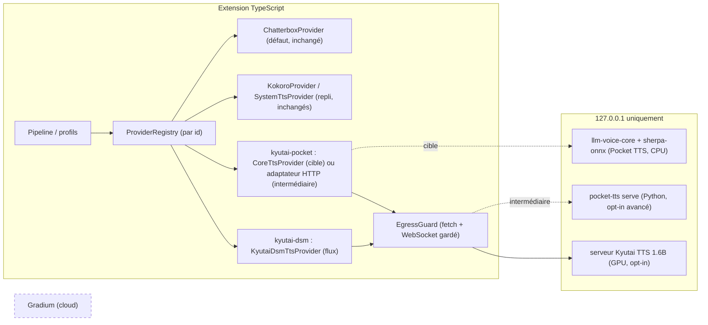

# ADR-016 — Kyutai TTS (Pocket TTS, TTS 1.6B) comme palier TTS local supplémentaire

## Statut

**Proposé (2026-11-05).** Carte du Mission Ledger : `GAO-kyutai-tts-c-001`.

> **Vérification documentaire (2026-11-05).** Le brouillon initial de cet ADR
> a été rédigé sans accès web (frontière d'outils read/edit) à partir des
> notes de veille du projet. Les pages primaires ont depuis été lues
> directement (README `github.com/kyutai-labs/pocket-tts`, model cards
> Hugging Face `kyutai/tts-1.6b-en_fr`, `kyutai/pocket-tts` et
> `kyutai/tts-voices`, README `github.com/kyutai-labs/delayed-streams-modeling`,
> doc officielle sherpa-onnx) : **V1, V2 et V3 sont levées intégralement**
> (R1, R2, R4 fermés). **V5 est partiellement levée** : le clonage est
> confirmé dans sherpa-onnx, mais pas le français du paquet packagé — nouveau
> risque R9. Restent ouvertes V4 (VRAM 1.6B), V6 (ROCm) et V7 (protocole exact
> du serveur 1.6B), faute de donnée officielle publiée — voir Risques
> R3/R5/R8/R9. La page marketing `kyutai.org/next/tts` ne s'est pas chargée
> (contenu rendu en JavaScript, 0 caractère exploitable) : aucune affirmation
> ne s'appuie sur elle.

- **Étend** : ADR-009. Ajoute une famille de paliers **opt-in** ; ne remplace
  ni Chatterbox (principal, niveau 1) ni Kokoro/Piper (repli léger,
  niveau 1b).
- **S'appuie sans le modifier sur** : ADR-005 (`TtsProvider`,
  `getCapabilities()`, `AbortSignal`), ADR-010 (`EgressGuard`), ADR-012
  (étape 2 : inférence dans le Core via sherpa-onnx, `CoreTtsProvider`),
  ADR-015 (`TtsCapabilities.direction.usesGpu`, banc d'une journée où Pocket
  TTS est déjà candidat).
- **Reprend le précédent de** : ADR-013 (« jamais de cloud par défaut ») pour
  écarter Gradium.
- **Laisse inchangé** : ADR-002. Le contrat d'horodatage par mot relève de
  l'ADR séparé qu'ADR-002 annonce ; cet ADR n'en fixe que la condition côté
  Kyutai (§5).

## Contexte

### 1. Deux problèmes déjà journalisés

1. **Accent anglophone sur du texte français** (`shared-context.md`, requêtes
   inter-agents, point 3, diagnostiqué le 2026-09-08) : sur le serveur
   communautaire Chatterbox, `language` est ignoré par `/v1/audio/speech`
   (WAV identiques octet pour octet, MD5 comparés), les 28 voix prédéfinies
   sont anglophones et Chatterbox reproduit l'accent de la référence. Le
   clonage à partir d'une référence française améliore le résultat, mais
   reste « un correctif, pas une solution produit ».
2. **Surlignage au mot** : ADR-002 surligne au chunk ; la granularité mot
   « nécessitera des timings par mot du provider TTS » et « fera l'objet d'un
   ADR séparé ». Le contrat actuel n'en porte aucun : `AudioResult`
   (`vscode-extension/src/core/tts.ts`) n'a que `format`, `data`,
   `durationMs`, `sampleRate`, `channels`.

### 2. La proposition et ce qui est déjà tranché

L'utilisateur a comparé Moshi (open source, local) à Gradium (API cloud
commerciale) et proposé d'ajouter Kyutai TTS. Décision déjà validée par
l'utilisateur, reprise telle quelle ici :

- rester **local-first** ; **Gradium n'est pas utilisé par défaut**
  (invariant P0 n° 2, « zéro contenu sortant par défaut ») ;
- préférer les **modèles Kyutai TTS dédiés** (Pocket TTS, léger, CPU ;
  TTS 1.6B, serveur en flux) au modèle conversationnel Moshi complet.

### 3. Ce que la veille du projet établit déjà

| Propriété | Kyutai TTS 1.6B (`kyutai/tts-1.6b-en_fr`) | Kyutai Pocket TTS (`kyutai/pocket-tts`) |
|---|---|---|
| Français | **Natif FR + EN** — model card HF [V1/S7] | **Natif** : « english, french, german, portuguese, italian, spanish » (+ « dutch » selon le README le plus récent) [V1/S8] |
| Licence des poids | CC-BY-4.0 — model card HF, champ `license: cc-by-4.0` [V2/S7] | CC-BY-4.0 — model card HF [V2/S8] ; accès **gated** (accord HF requis) |
| Licence du code | MIT (Python), Apache (Rust backend) — README `delayed-streams-modeling` [V2/S9] | MIT — README GitHub [V2/S8] |
| Taille | 1,8 milliard de paramètres réels (le nom dit 1,6B) — model card HF [S7] | 100 millions de paramètres ; variantes anglaises 18,2M/6,9M/1,9M (octobre 2026) [S8] |
| Matériel | Débit « 75× l'audio généré par unité de calcul » (unité non précisée) ; **aucune VRAM officielle** ; implémentations PyTorch/Rust/MLX [V4 partielle, S7/S9] ; ROCm **non mentionné** (R3) | **CPU seul, officiellement** : 2 cœurs CPU, ~6× temps réel sur MacBook Air M4, ~200 ms au premier chunk ; pas d'option GPU documentée (`generate --device` défaut `cpu`) [V4, S8] |
| Clonage vocal | **Non** : « nous avons préféré restreindre le clonage vocal à l'usage d'embeddings de voix pré-calculés » — model card HF, citation exacte [V3/S7] | **Oui, confirmé officiellement** : « L'argument `--voice` peut aussi prendre un fichier wav en entrée pour le clonage vocal » — README GitHub [V3/S8] ; consentement explicite exigé |
| Horodatage par mot | **Non** en sortie TTS (seule mention de timestamps : transcrits d'entraînement via `whisper-timestamped`) — model card HF [V3/S7] | **Non officiellement** ; seul un fork communautaire tiers (`pocket-tts-timestamped`, non maintenu par Kyutai) l'ajoute [V3/S8] |
| Contrôle de style | Aucun documenté | Aucun ; le style vient de la référence audio |
| Distribution | Python / Rust / MLX (`kyutai-labs/delayed-streams-modeling`) [S9] | `pip install pocket-tts` / `uvx pocket-tts`, `pocket-tts serve` (HTTP, port **8000** par défaut) [S8] |
| Voix | Embeddings pré-calculés du dépôt `kyutai/tts-voices` [S7] | Voix intégrées + clonage libre ; licence **par voix** du catalogue : CC-BY-NC (Expresso, EARS), CC-BY (VCTK, CML-TTS) ; dons « Unmute » CC0 [S3] |

**Constat confirmé par les pages primaires (pas seulement par la veille).**
L'hypothèse de départ de la carte (« clonage + word-timing natifs sur un
même modèle ») ne tient pas, et c'est désormais sourcé directement, pas
seulement par la veille du projet :

- **TTS 1.6B** répond au problème d'accent par des **voix françaises
  natives pré-calculées** (pas de clonage libre) et **n'a pas**
  d'horodatage par mot en sortie.
- **Pocket TTS** répond au problème d'accent par le **clonage libre**
  d'une référence française consentie, sur CPU seul, mais **n'a pas non
  plus** d'horodatage par mot officiel (seulement un fork tiers non
  maintenu par Kyutai, à ne pas retenir en dépendance de production).
- Le point 2 du contexte (horodatage par mot pour le surlignage) **n'est
  résolu par aucun des deux modèles Kyutai** : il reste entièrement à
  charge de l'ADR séparé annoncé par ADR-002 (§5), quel que soit le
  provider retenu.

### 4. Contraintes

- Invariants P0 de `shared-context.md` : zéro autoplay, local-first,
  provider agnostic, profils configurables, **modèles jamais dans le VSIX**.
- Décision « Zéro Docker » du 2026-09-11 : la voie par défaut est autonome,
  sans Docker ni Python.
- Machine cible : Fedora, **AMD RDNA4 / ROCm** ; aucune page officielle
  (model card, README) ne mentionne de chemin ROCm/AMD pour `kyutai-dsm` ;
  `kyutai-pocket` n'est pas concerné (CPU officiellement seul, voir §3).
- Mode jeu : aucune charge GPU pendant que l'utilisateur joue (`gpu-yield`,
  ADR-015 §8, `DirectionCapabilities.usesGpu`).
- ADR-010 : tout accès réseau passe par `EgressGuard` ; il garde `fetch`, pas
  encore les WebSocket sortants de l'hôte d'extension.

## Décision

### 1. Place dans la grille de l'ADR-009

| Niveau ADR-009 | Existant (inchangé) | Ajout ADR-016 (opt-in) |
|---|---|---|
| 1. Local GPU | Chatterbox Multilingual (principal), Kokoro | **`kyutai-dsm`** : Kyutai TTS 1.6B sur serveur local en boucle locale |
| 1b. Local sans installation | Piper, Kokoro, `spd-say`/`espeak-ng` ; plus tard sherpa-onnx dans le Core (ADR-012 étape 2) | **`kyutai-pocket`** : Pocket TTS, voie cible dans le Core via sherpa-onnx, voie intermédiaire par `pocket-tts serve` |
| 2. Entreprise | `OpenAICompatibleTtsProvider` + `trustedHosts` | possible pour `kyutai-dsm` hébergé par la DSI, mêmes règles (TLS, `trustedHosts`) |
| 3. API cloud | OpenAI-compatible, puis dédiés | **rien** : Gradium hors de cet ADR (§6) |

Aucun défaut ne change. Le profil livré reste sur Chatterbox, avec repli
Kokoro/Piper. Les deux paliers Kyutai se choisissent par profil
(`providerId`), comme tout provider (ADR-005, registre par id).

(Rendu du diagramme non vérifié par un outil Mermaid. Gradium n'a aucune
flèche : il n'est câblé nulle part.)

### 2. `kyutai-pocket` : Pocket TTS, palier CPU avec clonage

- **Rôle** : voix française sans GPU, par clonage d'une référence **française
  et consentie** (§4). C'est la réponse au point 1 du contexte qui ne dépend
  ni de ROCm ni du mode jeu.
- **Voie cible** : inférence dans le Core Rust via sherpa-onnx (ADR-012
  étape 2), exposée par le `CoreTtsProvider` déjà prévu : aucun Python, aucun
  nouveau code réseau, la garantie « le Core n'ouvre aucune connexion
  sortante » reste vraie. **Clonage confirmé** dans sherpa-onnx (paramètre
  `referenceAudio`, doc officielle lue le 2026-11-05) ; **français non
  confirmé** pour le paquet sherpa-onnx packagé (R9) — à tester concrètement
  avant d'écrire le `CoreTtsProvider`. Si le français n'y est pas, cette voie
  cible reste valable pour l'anglais seul et le français passe par la voie
  intermédiaire ci-dessous jusqu'à nouveau paquet sherpa-onnx.
- **Voie intermédiaire**, tant que l'étape 2 d'ADR-012 n'est pas livrée :
  adaptateur HTTP vers `pocket-tts serve` lancé par l'utilisateur sur
  `127.0.0.1`. C'est un **réglage avancé**, pas un défaut (il exige Python,
  contraire à « Zéro Docker » pour la voie par défaut). **Contrat HTTP
  vérifié par lecture directe du code source** (`pocket_tts/main.py`,
  2026-11-05) : `POST /tts` (`multipart/form-data` : `text` obligatoire,
  `voice_url` ou `voice_wav` mutuellement exclusifs, optionnels) renvoie un
  flux `audio/wav` chunké (pas de JSON, pas de taille connue à l'avance) ;
  `GET /health` → `{"status":"healthy"}` ; pas d'endpoint de liste de voix.
  **La langue est un paramètre de démarrage du serveur** (`--language
  french`), pas un champ de requête : l'adaptateur ne peut pas la changer
  par appel, le profil doit documenter que le serveur `pocket-tts serve`
  cible doit avoir été lancé avec `--language french` pour du français.
- **Capacités déclarées** : `streaming` seulement si l'adaptateur implémente
  `synthesizeStream` ; `languages` d'après V1 ; `direction.usesGpu: false` ;
  aucune capacité d'horodatage tant que V3 n'est pas prouvé.

### 3. `kyutai-dsm` : Kyutai TTS 1.6B, palier GPU en flux

- **Rôle** : voix françaises natives pré-calculées, synthèse en flux.
  Concurrent de Chatterbox **pour le français**, pas son remplaçant. **Ne
  fournit pas** d'horodatage par mot (R4, confirmé par la model card HF) :
  ne pas en attendre pour §5.
- **Serveur** : lancé par l'utilisateur ou par un futur assistant
  d'installation, lié à `127.0.0.1`. Ses poids sont téléchargés depuis
  Hugging Face au premier lancement : téléchargement volontaire, puis
  `HF_HUB_OFFLINE=1` comme pour Chatterbox (ADR-010).
- **Transport** : protocole exact du serveur 1.6B non confirmé sur les pages
  lues (README `delayed-streams-modeling` : implémentations PyTorch/Rust/MLX,
  pas de détail de protocole réseau) — hypothèse WebSocket à vérifier (V7).
  `EgressGuard` ne garde aujourd'hui que `fetch` : **avant tout code**, la
  garde est étendue à l'ouverture de WebSocket (même résolution DNS préalable,
  même liste loopback/`trustedHosts`, même journal sans corps), et la règle
  ESLint qui interdit `fetch` direct interdit aussi `new WebSocket` hors
  `net/`. Sans cette extension, `kyutai-dsm` n'est pas implémenté.
- **Voix** : uniquement les voix du catalogue `kyutai/tts-voices` dont la
  licence est compatible (§4) ; pas de clonage arbitraire (bloqué par le
  modèle, [S1]).
- **Capacités déclarées** : `direction.usesGpu: true` (le mode jeu bascule
  sur le repli CPU, jamais de contournement) ; `streaming: true` seulement
  avec `synthesizeStream` implémenté.

### 4. Voix et licences

- **Amendement du 2026-11-05** : de courts échantillons Ogg Vorbis de 20 voix (le webview de VS Code 1.145 ne décode pas Opus, mesure de la carte `GAO-refonte-ux-0-005`) et leurs crédits sont inclus dans le VSIX, pour écouter sans rien installer (`media/voices/`, décision de guilhem-bonnet). Les modèles et les données de voix restent hors du VSIX.
- **Aucun modèle ni donnée de voix dans le VSIX** (P0 n° 5) : modèles et voix sont téléchargés par
  `AssetDownloader` + `EgressGuard`, avec consentement et SHA-256 (ADR-010,
  ADR-012 §6).
- **Catalogue proposé par défaut** : seulement les voix **CC0** (dons
  « Unmute », consentement explicite [S3]) et **CC-BY** (VCTK, CML-TTS, dont
  les voix françaises [S3]), avec un fichier d'attribution affiché dans
  l'extension et le README.
- **Voix CC-BY-NC exclues du catalogue par défaut** (Expresso, EARS [S3]) :
  une extension publique gratuite peut être utilisée dans un cadre
  commercial par ses utilisateurs.
- **Poids CC-BY-4.0** (les deux modèles) : attribution à Kyutai dans le même
  fichier. Conditions d'usage supplémentaires éventuelles sur les cartes
  Hugging Face (accès restreint au modèle de clonage, usages interdits) :
  non vérifiées, V2.
- **Clonage (Pocket TTS)** : la référence par défaut est une voix française
  CC0 ou CC-BY du catalogue ; un échantillon personnel reste local, hors
  dépôt, et l'interface rappelle l'exigence de consentement
  (`voix-de-reference.md`, méthode §6).

### 5. Horodatage par mot

- Cet ADR **ne fixe pas** le contrat : c'est l'objet de l'ADR séparé
  annoncé par ADR-002 (numéro à attribuer). Il pose seulement deux règles.
- Un provider Kyutai qui reçoit des horodatages du moteur **les conserve**
  jusqu'au contrat (aucune perte dans l'adaptateur), et ne les annonce dans
  `getCapabilities()` qu'une fois le contrat accepté.
- Un provider sans horodatage (Pocket TTS tant que V3 n'est pas prouvé,
  Chatterbox, Kokoro) garde le surlignage au chunk d'ADR-002 : l'absence
  d'horodatage n'est jamais une erreur.

### 6. Gradium et Moshi : écartés

- **Gradium** : API cloud commerciale (description fournie par
  l'utilisateur). Il n'est **ni défaut, ni palier de cet ADR**. Une
  intégration éventuelle serait un provider de niveau 3 (ADR-009) sous ADR
  distinct, avec les règles d'ADR-013 §6 : instancié seulement si
  `privacy.localOnly = false`, hôte dans `trustedHosts`, TLS, clé dans
  `SecretStorage`, badge ☁.
- **Moshi complet** : modèle de dialogue parole-à-parole, pas un moteur qui
  lit un texte donné ; écarté par la décision de l'utilisateur.

### 7. Invariants P0

| Invariant | Comment l'ADR le respecte |
|---|---|
| 1. Zéro autoplay | Aucun nouveau chemin vers le lecteur : les providers Kyutai ne sont appelés que par une session lancée par l'utilisateur. |
| 2. Local-first | Serveurs liés à `127.0.0.1` ; `EgressGuard` (fetch **et** WebSocket) ; Gradium non câblé ; le Core n'émet rien. |
| 3. Provider agnostic | Deux implémentations de `TtsProvider` sélectionnées par id ; capacités lues par `getCapabilities()`, jamais par `instanceof`. |
| 4. Profils configurables | Choix par profil ; aucun défaut modifié. |
| 5. Aucun modèle dans le VSIX | Téléchargement consenti, SHA-256, hors VSIX. |

## Conséquences

### Positives

- Deux réponses à l'accent français : voix natives (1.6B, GPU) et clonage
  d'une référence française consentie (Pocket, CPU).
- Pocket TTS donne un palier français sans GPU, compatible avec le mode jeu
  et avec la voie sans Python d'ADR-012 étape 2.
- Le flux de TTS 1.6B prépare le lecteur en flux d'ADR-005 (D2) et une
  source d'horodatage par mot, sans alignement forcé (rejeté par ADR-002).
- Aucun changement de contrat `TtsProvider` ; aucun défaut modifié.

### Négatives

- **Écart à ADR-009 « un seul code pour 1, 2, 3 »** : ni le serveur Kyutai
  en WebSocket, ni `pocket-tts serve` ne sont réputés compatibles
  `/v1/audio/speech` (non vérifié). Deux adaptateurs dédiés de plus, comme
  `ChatterboxProvider` et `SystemTtsProvider` aujourd'hui.
- **Extension d'`EgressGuard` aux WebSocket** : nouvelle surface à garder et à
  tester (prérequis de `kyutai-dsm`).
- **ROCm** : TTS 1.6B n'a pas de chemin AMD documenté par la veille ; sur la
  machine de développement, il peut ne pas tourner du tout (R3).
- Un serveur de plus (Python ou Rust) à installer pour les voies
  intermédiaires ; coût d'installation pour l'utilisateur.
- Un fichier d'attribution à maintenir (CC-BY).

## Alternatives rejetées

- **Moshi complet comme moteur TTS** : modèle conversationnel, ne lit pas un
  texte imposé ; décision de l'utilisateur.
- **Gradium par défaut** : le texte quitterait la machine (P0 n° 2), même
  motif que Jev dans ADR-013.
- **Remplacer Chatterbox par Kyutai TTS 1.6B** : aucune mesure n'établit la
  supériorité en français chez nous ; ROCm non documenté ; Chatterbox
  fonctionne déjà sur la machine cible. Le remplacement ne se discute
  qu'après le banc (V8).
- **Corriger seulement Chatterbox** (`/tts` avec `language`, clonage d'une
  référence française) : reste nécessaire pour le défaut, mais l'utilisateur
  l'a qualifié de correctif ; il ne donne ni palier CPU français cloné ni
  horodatage par mot.
- **Pocket TTS par `pocket-tts serve` comme voie par défaut** : Python à
  installer, contraire à « Zéro Docker » ; gardé en voie intermédiaire
  opt-in.
- **Alignement forcé (WhisperX, aeneas) pour l'horodatage** : rejeté par
  ADR-002 (GPU, dépendance lourde).

## Risques

| Id | Risque | Statut | Conduite |
|---|---|---|---|
| R1 | **Français de Pocket TTS** : **résolu**, confirmé sur le README officiel (`english, french, german, portuguese, italian, spanish` [+dutch]) et la model card HF. | **Fermé (2026-11-05)** | V1 levée. |
| R2 | **Licences** : **résolu intégralement (2026-11-05)** — poids CC-BY-4.0 confirmés (model cards HF) pour les deux modèles ; code MIT (Python) + Apache (Rust) pour `delayed-streams-modeling`, MIT pour `pocket-tts` (README officiels) ; catalogue `kyutai/tts-voices` vérifié voix par voix : **CC-BY-NC** (Expresso, EARS — usage non commercial seulement), **CC-BY-4.0** (VCTK, voix françaises de CML-TTS), **CC0** (dons Unmute, site Unmute) — confirme exactement S3, aucun écart. Reste : accès **gated** à Pocket TTS (accord HF requis), sans incidence sur la licence elle-même. | **Fermé (2026-11-05)** | V2 levée intégralement. |
| R3 | **ROCm / RDNA4** : aucune mention officielle (README, model cards) d'un chemin AMD pour TTS 1.6B ; Pocket TTS est **CPU seul officiellement** (`--device` défaut `cpu`, pas d'option GPU documentée), donc indépendant de ROCm. | **Ouvert pour `kyutai-dsm` seul** | V6, mesure locale avant d'activer `kyutai-dsm` sur la machine cible ; `kyutai-pocket` n'est pas concerné (CPU). |
| R4 | **Horodatage par mot** : **résolu, dans le sens négatif** — ni TTS 1.6B (model card HF : seule mention, des transcrits d'entraînement) ni Pocket TTS (README : seul un fork tiers non maintenu par Kyutai) n'en produisent nativement. | **Fermé (confirmé absent)** | Le point 2 du contexte reste entièrement renvoyé à l'ADR séparé d'ADR-002, quel que soit le provider (voir §5). |
| R5 | **VRAM de 1.6B** : non chiffrée par Kyutai. Ordre de grandeur calculé, non mesuré : 1,8 Md de paramètres × 2 octets (bf16) ≈ 3,6 Go de poids, hors codec et activations. Signal faible non officiel (guide tiers Libre WebUI, non Kyutai) : 6 Go mini / 8 Go+ recommandé — à ne retenir qu'à titre indicatif, pas comme source d'autorité. | **Ouvert** | V4, mesure locale sur la machine cible avant d'activer `kyutai-dsm`. |
| R6 | **Qualité française réelle** : aucune écoute ni mesure faite chez nous. | **Ouvert** | V8 (banc WER + écoute ABX). |
| R7 | **Droit à la voix et consentement au clonage** : cadre juridique français non vérifié (`voix-de-reference.md`). | **Ouvert** | Catalogue CC0/CC-BY seulement ; échantillons personnels locaux ; validation juridique avant distribution publique. |
| R8 | **Protocole du serveur 1.6B** (WebSocket, format des messages) non vérifié. | **Ouvert** | V7 ; fake bâti sur une capture réelle. |
| R9 | **Français du paquet sherpa-onnx pour Pocket TTS** : le clonage y est confirmé (`referenceAudio`, doc sherpa-onnx JS `tts_pocket.html`, 2026-11-05), mais le modèle int8 packagé (`sherpa-onnx-pocket-tts-int8-2026-01-26`) ne documente ni langue ni taille ; la seule démo publique trouvée (Hugging Face Spaces) est étiquetée « (English) ». Si ce paquet n'est que le petit modèle anglais de Pocket (18,2M/6,9M/1,9M, variantes EN only citées par le README officiel), **la voie cible du §2 (sherpa-onnx dans le Core) ne couvre pas le français** et retombe sur la voie intermédiaire (`pocket-tts serve`, Python). | **Accepté par décision utilisateur (2026-11-05)** : jugé probable au vu du français déjà confirmé officiellement sur Pocket TTS lui-même (Kyutai) — nuance : R9 porte sur un **paquet tiers** (export sherpa-onnx), pas sur Pocket TTS directement, donc l'argument ne referme pas totalement le doute, mais le risque est jugé faible et non bloquant. Ne concerne que la future voie cible (sherpa-onnx/Core), pas la voie intermédiaire déjà livrée (`KyutaiPocketProvider`, carte `GAO-kyutai-pocke-001`, qui utilise Pocket TTS directement, français confirmé). | V5 complémentaire reste recommandée avant de coder le `CoreTtsProvider`, mais plus bloquante pour avancer ailleurs (ex. câblage UI du provider HTTP déjà livré). |

## Tests qui prouvent la décision

### Conditions d'entrée (vérification documentaire, avant acceptation)

| Id | À vérifier | Source primaire à lire | Résultat attendu pour garder l'ADR tel quel |
|---|---|---|---|
| V1 | Langues de Pocket TTS et de TTS 1.6B | README `pocket-tts` (lu), model cards HF (lues) | **✅ levée (2026-11-05)** : français confirmé pour les deux |
| V2 | Licences : code, poids, accès, usages interdits | README officiels + model cards (lus) | **✅ levée pour code/poids** (MIT/Apache, CC-BY-4.0) ; voix une à une et accès gated Pocket : à faire avant implémentation |
| V3 | Horodatage par mot documenté (1.6B ; Pocket) | model card HF `tts-1.6b-en_fr` (lue), README `pocket-tts` (lu) | **✅ levée, réponse négative** : absent des deux officiellement |
| V4 | Taille et VRAM/CPU | cartes HF, README (lus) | **Partielle** : tailles connues (1,8Md / 100M) ; **aucune VRAM officielle pour 1.6B** (reste ouvert, R5) ; Pocket confirmé CPU seul |
| V5 | Pocket TTS dans sherpa-onnx : français, clonage, API | doc officielle sherpa-onnx, lue le 2026-11-05 | **Partielle** : clonage **confirmé** (paramètre `referenceAudio`, doc JS `tts_pocket.html`) ; **français non confirmé** — le modèle sherpa-onnx packagé (`sherpa-onnx-pocket-tts-int8-2026-01-26`) ne précise ni langue ni taille, la seule démo publique trouvée est étiquetée « (English) » ; risque R9 ouvert |
| V6 | Chemin AMD (ROCm) pour 1.6B | README, issues du dépôt | documenté, ou risque R3 confirmé |
| V7 | Protocole du serveur 1.6B | doc du serveur | WebSocket confirmé ; format des messages relevé |
| V8 | Banc français (ADR-015 annexe A) : Pocket TTS et 1.6B contre le témoin Chatterbox | mesures locales | intelligibilité (WER faster-whisper) au moins égale au témoin ; écoute ABX par l'utilisateur ; hors mode jeu |

### Tests du code (cartes d'implémentation, après acceptation)

- Unitaires : chaque provider Kyutai contre un fake bâti sur une réponse réelle
  capturée ; `AbortSignal` déjà avorté → `AbortError` sans requête ;
  `health()` → `unreachable` serveur absent, jamais de faux vert.
- Unitaires `EgressGuard` : WebSocket vers `ws://127.0.0.1` autorisé ; vers
  un hôte non loopback refusé en `localOnly` ; `localhost` résolu vers une IP
  publique refusé ; aucun corps journalisé.
- Statique : la règle ESLint échoue sur un `new WebSocket` volontairement
  placé hors `net/`.
- Intégration : scénario complet avec `kyutai-pocket` puis `kyutai-dsm` en
  `localOnly` → zéro requête non interceptée (ADR-010 niveau 2).
- Mode jeu : `usesGpu: true` + `gpu-yield` actif → synthèse servie par le
  repli CPU, aucune requête vers le serveur GPU.
- Catalogue : test qui échoue si une voix CC-BY-NC figure dans le catalogue
  par défaut, ou si une voix n'a pas de ligne d'attribution.
- Banc audio (ADR-012) : la sortie de chaque provider Kyutai est transcrite
  par faster-whisper et contient la phrase française attendue.

## Sources de vérification

Le brouillon initial s'appuyait sur la veille du projet sans relecture directe
(S1–S6). Le 2026-11-05, les pages primaires ont été lues directement (S7–S9)
et servent désormais de référence en cas d'écart avec S1–S6 — notamment sur
le clonage du 1.6B (S1 disait déjà « bloqué », confirmé par S7) et sur le
français de Pocket (S2 l'annonçait, confirmé par S8, R1 fermé).

| Id | Source | Ce qui en est tiré | Statut |
|---|---|---|---|
| S1 | `_grimoire-output/research/research_notes/Direction de lecture expressive/moteurs-expressifs.md` (2026-09-29, `GAO-veille-moteu-001`), citant `https://huggingface.co/kyutai/tts-1.6b-en_fr` | 1.6B : poids CC-BY-4.0, FR + EN natifs, pas de contrôle de style, voix par embeddings pré-calculés, clonage arbitraire bloqué | veille du projet ; **confirmé par S7** |
| S2 | même note, citant `https://github.com/kyutai-labs/pocket-tts` et `https://huggingface.co/kyutai/pocket-tts` | Pocket : ~100 M de paramètres, code MIT, poids CC-BY-4.0, FR annoncé, clonage avec consentement, ~6× temps réel CPU (MacBook Air M4), ~200 ms au premier chunk, `pocket-tts serve` | veille du projet ; **confirmé par S8** |
| S3 | `_grimoire-output/research/research_notes/Direction de lecture expressive/voix-de-reference.md` (2026-09-29), citant `https://huggingface.co/kyutai/tts-voices` | licences par voix (CC-BY-NC Expresso/EARS, CC-BY VCTK/CML-TTS) ; 228 voix données CC0 ; voix FR issues de CML-TTS | veille du projet ; non relu directement le 2026-11-05 |
| S4 | `_grimoire-output/research/research_notes/Briques existantes pour LLM Voice/tts-locaux.md` (2026-09-27), citant `https://github.com/kyutai-labs/delayed-streams-modeling/` et une source tierce (scalebytech.com) | FR + EN natifs ; ~200–220 ms ; 32 flux < 350 ms sur L40 (chiffres non confirmés par S9, absents du README officiel lu) | source tierce pour les chiffres de latence, non recoupée |
| S5 | même note, citant `https://github.com/k2-fsa/sherpa-onnx/blob/master/nodejs-addon-examples/README.md` | sherpa-onnx a ajouté PocketTTS | langues et clonage dans sherpa-onnx **non vérifiés** (V5, toujours ouvert) |
| S6 | `_grimoire/_memory/shared-context.md`, requêtes inter-agents, point 3 ; `docs/e2e/report-2026-09-08.md` (cité, non relu) | accent anglophone, `language` ignoré par `/v1/audio/speech` | mesure locale du projet |
| S7 | Page primaire lue le 2026-11-05 : `https://huggingface.co/kyutai/tts-1.6b-en_fr` (model card) | FR+EN natif ; poids CC-BY-4.0 ; **1,8 Md de paramètres réels** ; clonage restreint aux embeddings pré-calculés (« nous avons préféré restreindre le clonage vocal à l'usage d'embeddings de voix pré-calculés ») ; **aucun horodatage par mot en sortie** ; débit « 75× l'audio généré par unité de calcul » ; aucune VRAM d'inférence publiée | **lu intégralement, citations exactes relevées** |
| S8 | Pages primaires lues le 2026-11-05 : `https://github.com/kyutai-labs/pocket-tts` (README) et `https://huggingface.co/kyutai/pocket-tts` (model card) | FR natif (« english, french, german, portuguese, italian, spanish » [+dutch, README]) ; clonage libre confirmé (« L'argument `--voice` peut aussi prendre un fichier wav en entrée pour le clonage vocal ») avec exigence de consentement ; pas d'horodatage officiel (seul un fork tiers non maintenu, `pocket-tts-timestamped`) ; code MIT, poids CC-BY-4.0, **accès gated** ; 100M paramètres, CPU seul (2 cœurs, ~6× temps réel M4, ~200 ms premier chunk), pas d'option GPU documentée ; `pocket-tts serve`, port **8000** | **lu intégralement, citations exactes relevées** |
| S9 | Page primaire lue le 2026-11-05 : `https://github.com/kyutai-labs/delayed-streams-modeling` (README) | Implémentations PyTorch/Rust/MLX ; code MIT (Python)/Apache (Rust) ; aucun détail de protocole réseau du serveur (V7 reste ouvert) ; aucune VRAM d'inférence TTS (seul un chiffre GPU L40S cité pour le **STT** Rust, hors périmètre de cet ADR) | **lu intégralement** ; `kyutai.org/next/tts` n'a pas pu être lue (contenu JS, 0 caractère) |
| S10 | `WebSearch` (2026-11-05) sur `huggingface.co/kyutai/tts-voices` | licences par dossier : CC-BY-NC (Expresso, EARS, usage non commercial) ; CC-BY-4.0 (VCTK, voix FR de CML-TTS) ; CC0 (dons Unmute, site Unmute, une exception 1940 présumée domaine public) | **confirme exactement S3**, aucun écart ; ferme R2 intégralement |
| S11 | Agent `web-fetch`, lecture directe le 2026-11-05 : `k2-fsa.github.io/sherpa/onnx/javascript-api/examples/tts_pocket.html` (doc officielle sherpa-onnx) | « Pocket uses a reference audio clip to clone the speaker's voice » ; paramètre `referenceAudio` confirmé ; modèle packagé `sherpa-onnx-pocket-tts-int8-2026-01-26` sans langue ni taille indiquées ; seule démo publique liée depuis le README sherpa-onnx étiquetée « (English) » | **lu intégralement** ; clonage confirmé, français **non confirmé** → risque R9 |
