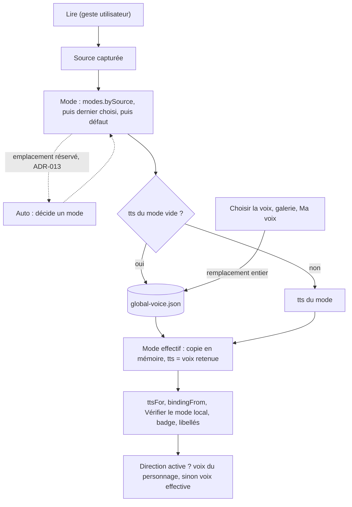

# ADR-017 — Voix globale et mode de lecture : retrait du mot « profil », migration, fusion des vues

## Résumé en 10 lignes (validation humaine)

1. **Modèle** : la voix (qui parle) vit dans un nouveau fichier `global-voice.json` ; le mode (comment le texte est lu) reste un `VoiceProfile` dans `profiles.json`, ids conservés.
2. **Priorité** : voix du personnage (direction) > voix propre du mode > voix globale. Remplacement entier, jamais de mélange champ par champ. Un `tts` non vide est une voix propre, sans exception.
3. **Symptôme** : quatre causes trouvées dans le code (§1.1) ; toute écriture de voix passe par un seul point, toute lecture par une seule résolution, et la clé du cache audio identifie enfin la voix réelle.
4. **Migration** : sauvegarde d'abord, `schemaVersion` reste à 2 pour que la version 0.3 relise le fichier ; les `tts` d'origine sont vidés, les autres restent et s'affichent « Voix propre : X ». Une marque dans `profiles.json` dit si le classement a eu lieu : un fichier restauré ou réécrit par la 0.3 est reclassé tout seul.
5. **Voix initiale** : celle du dernier mode choisi, sinon du mode par défaut ; `system` sur une installation neuve. Elle n'est calculée qu'une fois.
6. **Réglages** : `llmVoice.defaultProfile` retiré ; `llmVoice.profiles.bySource` remplacé par `llmVoice.modes.bySource` ; `llmVoice.tts.provider` et `llmVoice.tts.baseUrl` dépréciés ; `llmVoice.ui.layout` retiré.
7. **Commandes** : nouvelles `llmVoice.chooseVoice` et `llmVoice.chooseMode` ; `setupVoice`, `browseVoices`, `selectProfile` deviennent des alias masqués ; aucun identifiant en usage ne disparaît sans ligne du §3.
8. **Vues** : une seule vue de lecture, `llmVoice.playerView` ; `llmVoice.player` et son conteneur de panneau sont retirés ; la vue Profils disparaît avec la carte 1-002.
9. **Compatibilité** : Auto (ADR-013) choisit un mode, jamais une voix ; la direction (ADR-015) garde son contrat, le narrateur prend la voix effective.
10. **Décidé par guilhem-bonnet** le 2026-11-05 : ADR accepté, avec les quatre choix du § « Choix validés ».

## Statut

**Accepté (2026-11-06) par guilhem-bonnet**, avec ses quatre choix, après deux relectures
indépendantes (`_grimoire-output/reviews/GAO-refonte-ux-0-002/`, `revue-adr-017.md` et
`revue-adr-017-tour-2.md`). Rien n'est encore exécuté : les vérifications V1 à V19 restent à
écrire avec la carte 0-004 et les suivantes. Carte du Mission
Ledger : `GAO-refonte-ux-0-002`. Le choix de séparer voix et mode est celui de
guilhem-bonnet (`decisions-log.md`, 2026-11-05, deux entrées) ; cet ADR décide comment le
réaliser, il ne rouvre pas ce choix.

- **Amende** : ADR-011 (§5 ci-dessous, reporté dans son fichier, révision du 2026-11-06).
- **Étend** : ADR-004 (nouveau fichier de stockage ; clé du cache audio, §1.5).
- **Ajuste** : ADR-016 §1, « les deux paliers Kyutai se choisissent par profil » :
  ils se choisissent désormais comme voix globale ou voix propre d'un mode.
- **Compatible sans modification de contrat** : ADR-013, ADR-015 (§4).
- **Hors périmètre** : Documents, Dialogue, tri des réponses, client bureau.

Les lignes citées sont celles relues sur l'arbre de travail (HEAD `c23e68f` plus
modifications non validées) ; `vscode-extension/src` évolue en parallèle, elles peuvent
encore se décaler.

## Contexte

### 1. La plainte

« Je ne comprends rien de ce qui se passe » (`docs/ux/audit-2026-11-05.md`). Une voix
enregistrée ne change pas à la lecture d'un document. Il faut comprendre ce qu'est un
profil pour choisir qui parle.

### 2. Le modèle actuel

Un `VoiceProfile` porte à la fois qui parle (`tts`) et comment lire (`mode`, `narrator`,
`style`, `chunking`, `markdown`, `synchronization`, `playback`) : `core/profile.ts:89-121`.
Cinq profils sont livrés, chacun avec sa voix (`profiles/defaults.ts:121-127`). Le
réglage `llmVoice.tts.*` ne sert que si le profil omet un champ
(`pipeline/resolveProviderConfig.ts:67-78`).

### 3. Ce qui reste vrai

Les invariants P0 (`shared-context.md`). Le stockage JSON validé à chaque lecture,
jamais écrasé s'il est invalide (`ProfileRepository.ts:73-75`). La règle « un fichier
importé ne fait rien sans validation » (AC-SEC-05). `decisions-log.md` : profils et
identifiants conservés, commandes en alias, 20 voix Kyutai (carte 0-003), pas d'option
« nouvelle interface ».

## Décision

### 1. Modèle de données



(Rendu du diagramme non vérifié par un outil Mermaid.)

#### 1.1 Le symptôme : quatre causes à éliminer

Constats de lecture, **non reproduits par exécution** : la carte 0-004 écrit d'abord le
test qui échoue pour chacune, au point d'observation du § Tests.

| # | Cause | Code | Correction |
|---|---|---|---|
| A | Choisir une voix garde l'échantillon de clonage ; Chatterbox le préfère à la voix prédéfinie. La voix s'enregistre et on continue d'entendre le clone. L'aperçu ment de la même façon : il rejoue l'échantillon avant même l'enregistrement. | écriture `Pipeline.ts:1067-1070` ; aperçu `:1151` ; `ChatterboxProvider.ts:297-305` | La voix se remplace en entier, aperçu compris (§1.3) |
| B | La clé du cache ignore l'échantillon, l'URL et le moteur réel : elle hache `providerId` tel qu'écrit, donc `auto`. Un texte déjà lu rejoue l'ancienne voix. | `PlaybackController.ts:801-811`, `AudioQueue.ts:404-414`, `AudioCache.ts:86-95` ; choix documenté par `.vscode-test.mjs:237-245` | §1.5 |
| C | L'écriture vise un profil, la lecture peut en lire un autre : `getSelected()` sans source d'un côté, avec `bySource` de l'autre. « Tester la voix » lit le premier, ce qui masque l'écart. Par défaut, seule la source `claude-code` diverge (`package.json:574-576`). | écriture `Pipeline.ts:1062, 1162, 2013` ; test `:1038` ; lecture `:576` ; `bySource.ts:33` | La voix n'est plus dans le mode |
| D | Un identifiant de voix est enregistré sans son moteur : la liste vient du moteur résolu, seul `voice` est écrit, et `auto` peut ensuite résoudre ailleurs. | `Pipeline.ts:1093-1101, 1067-1070` ; `selectAutoTtsProvider` | Moteur et voix forment un tout |

**Portée de la cause A** : le mécanisme est prouvé par le code, son rôle dans le cas réel
de guilhem-bonnet ne l'est pas. Le fichier signalé
(`test/fixtures/profiles/legacy-profiles-v1.json:13`) porte le chemin livré `../deploy/...`,
pas un échantillon personnel ; ce chemin n'existe que dans un dépôt cloné, et un VSIX
retombe alors sur la voix prédéfinie. La cause joue donc avec « Ma voix » ou en
développement. Son `profiles.json` actuel n'a pas été lu.

S'y ajoute la cause de structure : changer de profil change de voix, et cinq copies
divergent.

#### 1.2 Où vit la voix globale

Dans `globalStorageUri/global-voice.json`, à côté de `profiles.json`, écrit de la même
façon (temporaire puis renommage, `ProfileRepository.ts:245-255`) et validé à chaque
lecture.

```json
{
  "schemaVersion": 1,
  "voice": {
    "providerId": "kyutai-pocket",
    "baseUrl": "http://localhost:8000",
    "voice": "estelle",
    "speed": 1
  }
}
```

`voice` reprend `TtsBindingSchema` (`profile.schema.ts:97-107`, donc mêmes contrôles sur
l'URL, `apiKeyRef` et `referenceAudio`), rend `providerId` obligatoire (`auto` reste
permis, ADR-009) et ajoute `speed` (0,5 à 2, §1.4). **Ce fichier ne contient que la voix** :
aucun état de migration, donc rien à préserver ni à réécrire à part elle.

Pourquoi un fichier séparé :

- **Retour arrière** : la 0.3 ne connaît pas ce fichier et ne peut ni le refuser ni
  l'effacer. Une clé ajoutée à `profiles.json` serait perdue à sa première écriture
  (`VoiceProfileObjectSchema` et `ProfileCollectionSchema` sont des `z.object` sans mode
  strict) ; un `schemaVersion: 3` la ferait échouer (`profile.schema.ts:176`,
  `ProfileRepository.ts:75`).
- **Sécurité** : importer ou exporter un mode ne transporte jamais la voix globale.
- **Simplicité d'écriture** : choisir une voix ne réécrit pas les modes.

**Réexamen contre `globalState`** (demandé par la relecture). `globalState` éviterait la
création exclusive et l'erreur de fichier illisible, et la 0.3 l'ignorerait aussi. Il est
écarté parce qu'ADR-004 le réserve à ce dont la perte est tolérable
(`ProfileRepository.ts:8-10`), qu'une URL ou un échantillon ne s'y consultent ni ne s'y
corrigent à la main, et que la migration n'en devient pas plus simple : elle a toujours
besoin de sa marque dans `profiles.json`. Une fois cette marque déplacée (§2), le fichier
ne coûte qu'une création exclusive. **Le fichier est gardé.**

Écarté aussi : les réglages VS Code (§ Alternatives). Fichier illisible : même règle que
`profiles.json`, erreur nommant le fichier, jamais d'écrasement. Le schéma JSON est
généré et attaché par `jsonValidation` comme l'existant.

#### 1.3 Ce que devient `VoiceProfile`

- **Il reste**, avec son nom, son fichier et ses identifiants ; il signifie désormais
  « mode de lecture ». Un alias `ReadingMode = VoiceProfile` sert au code neuf. Le mot
  quitte l'interface, pas le code.
- **`tts` vide (`{}`) = le mode hérite.** Valide aujourd'hui (tous les champs sont
  optionnels), donc aucun changement de forme et aucun refus par la 0.3.
- **`tts` non vide = voix propre, quel qu'en soit le contenu** : `format` ou `parameters`
  seuls comptent, `{ providerId: "auto" }` aussi. Il n'existe pas d'état intermédiaire,
  donc aucun réglage conservé ne peut être ignoré en silence. Le libellé dit ce qu'il
  sait : « Voix propre : Voix automatique ». Un champ absent de cette voix se résout comme
  aujourd'hui (`resolveTtsConfig`).
- **Restent au mode** : `language` (sert aussi à découper le texte), `mode`, `narrator`,
  `style`, `chunking`, `markdown`, `synchronization`, `playback`, et plus tard
  `direction.enabled` (ADR-015 §9).
- **Nouveau champ optionnel** `hidden` : le mode reste résolu par son id mais n'est pas
  proposé (cas `system-voice`, §2).

Une seule fonction pure, sans `vscode`, décide (`src/profiles/voiceResolution.ts`) :

```ts
hasOwnVoice(mode: ReadingMode): boolean;                                 // au moins un champ défini dans tts
withEffectiveVoice(mode: ReadingMode, global: GlobalVoice): ReadingMode; // tts remplacé en entier
describeVoice(binding, catalog): string;                                 // « Estelle », « Voix automatique »
```

**Lecture** : `ProfileRepository.resolveReading(source, modesBySource)` rend
`{ mode, effective, voiceOrigin: "global" | "mode" }` ; il remplace `getSelected()` aux
six appels de `Pipeline.ts` qui servent à parler ou à vérifier
(`:576, 1038, 1171, 1273, 1380, 1422`). Tout l'aval reçoit `effective` sans changer :
`ttsFor`, `bindingFrom`, `withDefaultVoice`, `computeLocalModeResult`.

**Listes et badge** : `listEffective()` rend les modes non masqués avec leur voix
effective. C'est elle qui alimente `formatProfileQuickPickItem`
(`profileQuickPick.ts:29`, `Pipeline.ts:865, 994`) et `buildProfileTreeItems`
(`profileTreeItems.ts:65`, `extension.ts:152`) : ainsi `isRemoteProfile`
(`profile.schema.ts:217`), qui ne juge que les URL écrites, voit celle de la voix globale.
Sinon, une voix globale distante laisserait tous les modes hérités marqués 🔒.
`collectRemoteProviderIds` (`remoteProviders.ts:24`) inclut la voix globale. L'avertissement
d'import (`Pipeline.ts:952`) **reste sur le mode brut** : il signale ce que le fichier
apporte, et un mode importé `tts: {}` n'apporte aucune destination.

**Écriture** : `setGlobalVoice(binding)` remplace tout sauf `speed`, `setGlobalSpeed(n)`,
et `setModeVoice(id, binding | undefined)` pour la seule édition d'un mode. Les
écritures de voix dans un profil (`Pipeline.ts:1050-1054, 1067-1070, 1163-1166, 2015-2018`)
disparaissent. Choisir une voix du catalogue efface `referenceAudio` ; « Ma voix » pose
l'échantillon et un moteur qui clone (carte 1-003). `previewVoice` écoute une voix
candidate en remplaçant le `tts` en entier, comme l'écriture, à la place de
`{ ...profile.tts, voice }` (`Pipeline.ts:1151`). `ttsBindingForTier`
(`voiceTiers.ts:115-123`) nomme la voix Piper pour le niveau `piper`, ce qui distingue enfin
les deux niveaux système relevés par l'audit. `currentVoiceLabel` passe à `describeVoice` :
aujourd'hui `auto` s'affiche brut (`ttsProviderLabel.ts:33-34`).

**Priorité** : voix du personnage (direction) > voix propre du mode > voix globale. Une
voix propre masque la globale en entier. L'en-tête du panneau et la liste des modes
affichent alors « Voix propre : X » avec l'action « Utiliser la voix globale » ;
`chooseVoice` écrit toujours la voix globale et, si le mode actif a une voix propre, le
dit sur place. C'est le seul cas restant où une voix choisie ne s'entend pas, et il est
visible. Une lecture en cours garde sa voix ; le choix vaut pour la suivante.

**Langue** : la voix globale n'a pas de langue et l'héritage ne dépend pas d'elle ; sinon la
voix changerait sans qu'on l'ait demandé, ce que cet ADR élimine. Lorsque le catalogue
déclare une langue différente de celle du mode (par exemple un mode dupliqué en `en-US`
avec `estelle`), `chooseMode`, `chooseVoice` et l'en-tête l'annoncent, sans bloquer, avec
l'action « Donner une voix propre à ce mode ». Langue inconnue : aucun avertissement.
`isEnglishVoice` (`voiceBrowser.ts:28`), qui ne couvre que l'anglais, est généralisée.

#### 1.4 La vitesse

`playback.rate` n'a aujourd'hui **aucun effet** dans le code lu : `AudioQueueBinding.speed`
existe et atteint la requête (`AudioQueue.ts:58, 560`) mais `bindingFrom` ne le renseigne
pas (`PlaybackController.ts:801-811`), `AudioSink` n'a pas de vitesse
(`AudioSink.ts:99-136`), `WebviewAudioSink.setRate` n'a pas d'appelant dans les fichiers
lus (recherche non exhaustive), le contrat du Core n'en porte pas
(`contracts/core-v1/http/enqueue.request.schema.json`).

- **Vitesse demandée = `voice.speed` × `mode.playback.rate`.** `voice.speed` va de 0,5 à 2 ;
  `playback.rate` garde son schéma (0,5 à 3, `profile.schema.ts:26-29`) pour que les
  fichiers existants restent valides. La vitesse est globale ; le facteur du mode reste un
  trait de lecture (la carte 1-002 exige de le garder). Une voix propre ne porte pas de
  vitesse.
- **Application**, dans cet ordre : `TtsRequest.speed` si le moteur déclare `speed` dans
  `capabilities.parameters` (`core/tts.ts:85-86` ; Kokoro et `SystemTtsProvider`, 0,5 à 2 :
  `KokoroProvider.ts:16-27`, `SystemTtsProvider.ts:198`) ; sinon vitesse du lecteur sur le
  moteur webview (`sink.gapless === false`, `WebviewAudioSink.ts:101-103`,
  `player.js:143-145`), à **réappliquer après chaque chargement** car `audio.load()`
  (`player.js:112`) rétablit la vitesse par défaut de l'élément (règle HTML, non vérifiée par
  exécution) ; sinon aucune.
- **Bornes** : le produit est ramené dans les bornes de la voie retenue. **L'écart se voit
  toujours** : l'en-tête affiche la vitesse réelle (« ×2, maximum de cette voix »), et sans
  voie, dès que la vitesse demandée diffère de 1, « Vitesse non disponible avec cette
  voix ». Cela couvre aussi le facteur du mode, pas seulement le curseur global (Chatterbox
  et Pocket sur le Core natif). Une vitesse dans le Core est hors de cet ADR.

#### 1.5 Clé du cache audio (étend ADR-004 §2)

Le calcul de l'identité du moteur sort de `Pipeline.ttsFor` (`Pipeline.ts:1761-1764`) vers
une fonction pure `ttsInstanceKey(resolved, referenceAudioPath)`, sans `vscode`, pour être
testable. `bindingFrom` cesse de fournir `providerId` : `AudioQueue` retombe sur `tts.id`,
qui contient alors moteur résolu, URL et échantillon (`Pipeline.ts:1790`). Quand la voie est
le moteur, la vitesse entre dans la clé (absente de `AudioQueue.ts:406-414`). Le cache
existant cesse d'être atteint une fois : perte tolérée par ADR-004.

### 2. Migration de `profiles.json`

**La marque vit dans `profiles.json`** : `"voiceMigration": 1`, champ optionnel du schéma.
Elle veut dire « ce fichier a été classé ». Son absence couvre d'un seul test les trois cas
à traiter : première montée, sauvegarde restaurée, fichier réécrit par la 0.3 (qui retire
les clés inconnues). **`CURRENT_PROFILE_SCHEMA_VERSION` reste à 2.**

**Où** : une fonction pure dans `profiles/migrations.ts`, qui rend
`{ collection, voice?, lastSelectedId? }`, et sa séquence d'écriture dans un module sans
`vscode` (`profiles/globalVoiceStore.ts`, `node:fs` seul), donc testable sous vitest. La fonction reçoit
les `TtsSettings` en paramètre, puisque `resolveTtsConfig` en a besoin.

**À déclarer, sinon Zod les retire à chaque `load()`** (`profile.schema.ts:175-179`,
`ProfileRepository.ts:75`) : `voiceMigration` dans `ProfileCollectionSchema`, `hidden` dans
`VoiceProfileObjectSchema`, les types de `core/profile.ts`, et la régénération de
`schemas/profile-collection.schema.json`. V7 ajoute un test de `ProfileRepository` : `setDefault`,
`update` et `duplicate`, puis relecture, marque et `hidden` toujours présents.
`ProfileRepository.load()` l'appelle après la migration v1 vers v2 existante. `lastSelectedId`
vit dans `globalState` (`ProfileRepository.ts:24`) : l'appelant l'écrit, jamais la sauvegarde.

**Séquence**, seulement si la marque est absente :

1. **Sauvegarde** : `profiles.json` copié à l'identique dans `profiles.pre-adr-017.json`, en
   création exclusive. Un rejeu ne l'écrase pas : elle reste l'état d'avant la première montée.
2. **Voix** : si `global-voice.json` existe, elle est lue et jamais recalculée. Sinon, elle est
   calculée et posée en **création exclusive** (lien dur d'un temporaire, à défaut `wx`) ; le
   perdant relit le gagnant.
3. **Classement** : `profiles.json` est relu juste avant le renommage ; si la marque y est
   apparue, l'écriture est abandonnée. Sinon le fichier classé est écrit avec la marque.
4. **`lastSelectedId`** : réécrit si besoin (cas `system-voice`). Une panne juste avant laisse un
   id masqué, résolu à l'identique : sans effet sur la lecture.

| Situation | Résultat |
|---|---|
| Panne entre deux étapes | La séquence rejoue avec la même voix. |
| Deux fenêtres, ou les deux dépôts d'une fenêtre (`extension.ts:147`, `Pipeline`) | Une seule voix posée ; même classement ; un `setGlobalVoice` concurrent n'est jamais écrasé, car seule la création initiale écrit la voix pendant la migration. |
| Écriture d'un mode par une autre fenêtre pendant le classement | Fenêtre réduite par la relecture de l'étape 3. Le dépôt n'a déjà aucun verrou entre lecture et écriture (`ProfileRepository.ts:151-167`) : pas de verrou ajouté pour ce seul cas, qui ne survient qu'une fois. |
| La 0.3 a réécrit le fichier (marque et `hidden` perdus) | Reclassé : modes d'origine revidés, `system-voice` remasqué, voix globale gardée. Ce que la 0.3 a choisi dans un mode reste une voix propre. |
| Sauvegarde restaurée puis nouvelle montée | Reclassé contre la voix globale actuelle : les modes d'origine héritent de nouveau, les autres s'affichent « Voix propre : X ». Aucune procédure à suivre. |
| `global-voice.json` supprimé, marque présente | **Pas de reclassement ni de recalcul** depuis des `tts` vides : voix `{ providerId: "system", speed: 1 }` et message « Voix réinitialisée ». |
| Marque absente, `global-voice.json` absent et `tts` vides (fichier réécrit par la 0.3 après suppression de la voix) | Pas de recalcul depuis des `tts` vides : voix `{ providerId: "system", speed: 1 }` et message « Voix réinitialisée ». |
| `global-voice.json` supprimé et sauvegarde restaurée | Voix recalculée depuis le fichier restauré : c'est la remise à zéro complète. |
| Un mode devenu voix propre, marque présente | Jamais revidé : le classement ne tourne plus. |

**Voix globale initiale** : `tts` du mode désigné par `lastSelectedId`, sinon
`defaultProfileId`, **sans** `bySource` : c'est là qu'allaient les choix de l'utilisateur.
Complétée par `resolveTtsConfig` (sans résoudre `auto`) pour garder le même comportement ;
`speed: 1`. Installation neuve : `{ providerId: "system", speed: 1 }`, comme aujourd'hui
(`defaults.ts:51-62`), avec quatre modes qui héritent, `faithful-local` par défaut et la
marque déjà posée ; `system-voice` n'est plus créé. `defaultCollection()`
(`ProfileRepository.ts:237-243`) crée `global-voice.json` en même temps que cette marque : une
installation neuve n'affiche donc jamais « Voix réinitialisée ».

**Échantillon déjà présent (la migration ne fige pas la cause A)** :

- Chemin livré `../deploy/...` et `voice` nommée : l'échantillon est retiré de la voix globale.
  Il vient de la livraison, la voix vient de l'utilisateur : la voix choisie s'entend enfin.
- Chemin livré sans `voice` : conservé, même son qu'aujourd'hui.
- Échantillon personnel et `voice` nommée : conservés, même son qu'aujourd'hui, car on ne peut
  pas savoir lequel a été choisi en dernier. Un message unique le dit : « Votre échantillon
  est utilisé à la place de la voix X », avec le choix entre les deux. Après ce choix,
  `chooseVoice` les rend exclusifs.

**Classement de chaque mode** :

| Situation du `tts` | Résultat |
|---|---|
| Déjà vide | hérite |
| Mêmes valeurs JSON que la voix globale, `speed` et `format` exclus | vidé, hérite |
| Forme d'origine prouvée : `auto` ou absent, ou `chatterbox` à l'URL livrée ; aucune `voice`, aucun `apiKeyRef` ; paramètres absents ou égaux au préréglage ; `format` absent ou `wav` ; échantillon absent ou égal à l'ancien chemin livré | vidé, hérite |
| `{ providerId: "system" }` sur l'id `system-voice`, si aucune source ne cible cet id | vidé, hérite |
| Tout le reste, y compris `parameters` ou `format` seuls et réglés autrement | **conservé à valeur JSON égale**, affiché « Voix propre : X » |

Même règle de preuve que `isStaleDefaultChatterboxPin` (`migrations.ts:62-64`) : on ne
retire que ce dont on prouve l'origine, et la sauvegarde garde tout. Un mode enregistré un
jour dans l'ancien éditeur peut donc rester « Voix propre » alors que sa voix est banale,
car l'éditeur écrit toujours `providerId` et `parameters` (`profileEditor.js:161-167`) : erreur
du côté prudent, visible et corrigée en un clic.

**Sans perte** : ids, `narrator`, `style`, `chunking`, `markdown`, `synchronization`,
`playback`, `language` à valeur JSON égale (`load()` passe par Zod, qui retire les clés
inconnues : l'égalité à l'octet ne vaut que pour la sauvegarde). Seuls changent, et seulement
s'ils sont encore d'origine : libellés et descriptions, vers Fidèle, Professeur, Résumé,
Révision (la description de `faithful-local` citerait sinon un moteur qui n'est plus forcément
le sien).

**`system-voice`** n'est pas un mode mais une voix. D'origine et si `faithful-local`
existe : `hidden: true`, et `lastSelectedId` ou `defaultProfileId` qui le visaient passent
à `faithful-local` (même découpage, même lecture fidèle). L'id reste résolu pour un
réglage qui le nomme. Modifié, il reste un mode visible.

**Retour arrière vers la 0.3** :

- Réinstaller la 0.3 fonctionne sans geste : `schemaVersion` 2, `tts: {}` valide, `hidden` et
  la marque ignorés. Les modes hérités y passent par `llmVoice.tts.*` (`auto` par défaut), donc
  la voix peut différer, sans panne.
- Restaurer l'état exact : copier `profiles.pre-adr-017.json` sur `profiles.json` (procédure
  écrite dans le CHANGELOG). `global-voice.json` peut rester : la 0.3 l'ignore, et une nouvelle
  montée reclasse (table ci-dessus).
- Limite : ADR-013 §4 passera `schemaVersion` à 3 ; à partir de là, seule la sauvegarde
  permet de revenir à la 0.3.

**Réglages** :

| Réglage | Sort |
|---|---|
| `llmVoice.defaultProfile` (`package.json:567-571`) | Aucun lecteur dans `Pipeline.ts`, `ProfileRepository.ts`, `extension.ts`, `commands/index.ts` (recherche non exhaustive). Retiré. Si non vide et que l'id existe, repris une seule fois dans `defaultProfileId` au classement. |
| `llmVoice.profiles.bySource` (`package.json:572-597`) | Remplacé par `llmVoice.modes.bySource`, mêmes clés, même défaut, valeurs = id de mode (`auto` compris, ADR-013). L'ancien reste déclaré avec `deprecationMessage` et n'est jamais effacé, ce qui préserve le retour arrière. **Lecture** : `get()` ne distingue pas un défaut d'une valeur de l'utilisateur, donc `inspect("modes.bySource")` décide : valeur explicite à un niveau quelconque, `get("modes.bySource")` ; sinon `get("profiles.bySource")`. Une source choisit un mode, jamais une voix. |
| `llmVoice.tts.provider`, `llmVoice.tts.baseUrl` | `deprecationMessage`. Encore lus par `resolveTtsConfig` pour une voix propre sans moteur. L'URL appartient à la voix : à défaut, celle du préréglage du moteur (déjà le cas pour Pocket, Kokoro et Piper, `resolveProviderConfig.ts:67-78`), jamais le port de Chatterbox (carte 0-006). |
| `llmVoice.ui.layout` | Retiré (§3), `deprecationMessage` le temps d'une version. |
| `llmVoice.tts.timeoutMs`, `readyTimeoutMs`, `warmup`, `narrator.*`, `testVoice.text` | Inchangés. |

### 3. Commandes et vues

Un identifiant publié reste exécutable : un raccourci utilisateur peut le viser. **Alias**
= même effet, masqué de la palette (`when: false`). Les titres passent en français sans
le mot profil (carte 0-009), identifiants inchangés.

| Commande | Sort | Carte |
|---|---|---|
| `llmVoice.chooseVoice` « Choisir la voix » | **Nouvelle.** Quick Pick : niveaux actuels et voix du moteur ; à la carte 0-005, voix récentes plus « Ouvrir la galerie ». Écrit par `setGlobalVoice`. | 0-004 |
| `llmVoice.chooseMode` « Choisir le mode » | **Nouvelle.** Ne touche jamais à la voix. Modes non masqués ; ligne Auto réservée, inactive tant qu'ADR-013 n'est pas accepté. | 0-004 |
| `llmVoice.setupVoice` | Alias de `chooseVoice`. **Fusion** : le contenu de `SetupVoice.ts:53-64` et `handleVoiceTier.ts:84-103` passe dans `chooseVoice`. | 0-004 |
| `llmVoice.browseVoices` | Alias de `chooseVoice` (ouvre la galerie après 0-005). | 0-004 |
| `llmVoice.selectProfile` | Alias de `chooseMode`, y compris depuis le lecteur, la barre d'état et l'inbox (`extension.ts:297, 386`, `InboxQuickPick.ts:26`). | 0-004 |
| `llmVoice.useOwnVoice` | Conservée, « Ma voix » ; écrit par `setGlobalVoice`. | 0-004 puis 1-003 |
| `llmVoice.testVoice` | Conservée, « Écouter la voix » ; lit la voix effective du mode choisi. | 0-004 |
| `llmVoice.installPiperVoice` | Conservée, « Installer la voix française autonome ». | 0-009 |
| `llmVoice.editProfile`, `duplicateProfile`, `deleteProfile`, `importProfile`, `exportProfile`, `setDefaultProfile`, `openProfiles` | Conservées, titres « … un mode ». `editProfile` ouvre le nouvel écran à la carte 1-002. | 0-009 puis 1-002 |
| `llmVoice.profilesView.activate`, `.edit`, `.duplicate`, `.delete` | Hors palette, n'ont de sens qu'avec une ligne de la vue : **retirées** avec elle. | 1-002 |
| `llmVoice.profilesView.new` | Alias de `editProfile` sur une copie du mode actif, comme aujourd'hui (`extension.ts:471-476`). | 1-002 |
| `llmVoice.providerStatus`, `verifyLocalMode`, `performanceReport`, `setProviderApiKey`, `clearProviderApiKey` | Conservées, titres français ; regroupées par le Diagnostic, puis alias si la carte le décide. | 0-009 puis 1-004 |
| `llmVoice.speak*`, `play`, `playPause`, `pause`, `stop`, `previousSegment`, `nextSegment`, `clearHighlight`, `clearAudioCache`, `openSettings`, `openInbox`, `speakLatestClaudeResponse`, `installClaudeHook`, `uninstallClaudeHook`, `inbox.*` | Conservées, titres français. Raccourcis `ctrl+alt+v` inchangés. | 0-009, 0-008 |
| `llmVoice.statusBar.openMenu` | Conservée, interne. Menu : Changer de voix, Changer de mode, Réponses de Claude, Diagnostic (`StatusBar.ts:74-77`). | 0-009 |
| `llmVoice.walkthroughOpenExample` | Conservée tant que l'accueil s'en sert, sinon retirée avec le parcours. | 1-001 |

| Vue ou contribution | Sort | Carte |
|---|---|---|
| `llmVoice.playerView` | **Seule vue de lecture**, sans condition `when` ; `PlayerViewProvider.viewType` (`PlayerViewProvider.ts:14`) prend cet id. `reveal()` ne dépend pas de l'id (`:71-73`). | 0-007 |
| `llmVoice.player` et le conteneur `llm-voice-panel` | **Retirés.** Le double enregistrement (`extension.ts:121-139`) produisait la limite connue d'ADR-011 : un seul webview connecté (`PlayerViewProvider.ts:62`). Qui préfère le panneau y déplace la vue : VS Code retient ce placement par id. | 0-007 |
| `llmVoice.ui.layout` | Retiré : sans second lecteur, il ne commande plus rien. | 0-007 |
| `viewsWelcome` des deux lecteurs (`package.json:358-366`) | Retirés, remplacés par l'état d'attente du panneau. | 0-007 |
| `llmVoice.inboxView` | Conservée, nom « Réponses de Claude », sans condition `when`. | 0-008 |
| `llmVoice.profilesView` | Nom « Modes » dès 0-004 ; retirée par l'écran Réglages et modes. | 0-004 puis 1-002 |
| `views/profileEditor` | Remplacé. D'ici là, **option « Voix globale »** dans le fournisseur : sans elle, enregistrer un mode hérité écrirait `chatterbox` et créerait une voix propre (`media/profileEditor/profileEditor.js:134, 161-167`). Cette option désactive les champs de voix et de réglages du moteur, et le formulaire garde `tts: {}`. | 0-004 puis 1-002 |
| Parcours `llmVoice.gettingStarted` | Étape `chooseProfile` (`package.json:809-819`) dirigée vers `chooseMode` dès 0-004 ; parcours remplacé par l'accueil. | 0-004 puis 1-001 |

### 4. Compatibilité sans implémentation

**Mode Auto (ADR-013, proposé).**

- L'id réservé `auto` reste hors de `profiles.json`, dans `modes.bySource` et
  `lastSelectedId`. `resolveDefaultProfileId` (`bySource.ts:26-34`) ne change pas.
- **Auto choisit un mode, jamais une voix.** L'ordre est celui du diagramme : décision,
  puis `withEffectiveVoice`. Le contrat `DecisionProvider` est inchangé.
- **Candidats** : modes non masqués ; le filtre « points de terminaison en boucle locale »
  d'ADR-013 §4 reste tel quel et se calcule sur la **voix effective**. La voix locale d'un mode
  reste donc candidate, et une voix globale distante exclut tous les modes qui héritent.
- **Liste vide ou réduite à un mode** : c'est le cas `invalid-request` d'ADR-013 (moins de deux
  options, aucune requête émise), qui rend le repli. La lecture continue avec le mode de repli
  et la voix distante que l'utilisateur a lui-même choisie ; Auto ne l'a pas décidé. L'en-tête
  dit « Auto indisponible avec une voix distante ».
- Aucune collision de version : cet ADR ne consomme pas le `schemaVersion: 3` prévu par
  ADR-013 §4.
- Vocabulaire : ADR-013 dit « pseudo-profil » ; l'interface dit « Mode : Auto → Résumé ».
  `tts.providerId: "auto"` s'affiche « Voix automatique » : deux notions, deux libellés.
- Tant qu'ADR-013 n'est pas accepté : emplacement réservé, aucun code de décision.

**Distribution des voix (ADR-015).**

- `translateCues` reçoit déjà une voix de session (`binding`) et une voix par rôle
  (`voiceFor`, `translate.ts:57-62, 211-217`). `binding` vient de `effective` : le contrat
  ne change pas, le test doré de la consigne neutre reste valable.
- **Le narrateur parle avec la voix effective du mode**, voix propre comprise. Un personnage
  parle avec son attribution de la bible, sinon celle du narrateur, comme aujourd'hui.
- Les attributions sont par moteur (ADR-015 §4). Changer la voix globale de moteur ne
  réécrit ni bible ni partition : elle sert ou provoque un nouveau choix pour ce moteur.
- La règle « la voix du narrateur n'est jamais attribuée à un personnage » se vérifie sur
  la voix effective. Si l'utilisateur choisit comme voix globale celle d'un personnage,
  une attribution `casting` est refaite, une attribution `locked` est gardée et signalée.
- **La « voix préférée du narrateur » de la portée `user` (ADR-015 §4) est la voix globale** :
  pas de copie dans la bible. Elle s'applique donc seulement quand le mode n'a pas de voix
  propre ; sinon la voix propre prime, comme hors direction. Une attribution verrouillée en
  portée `document` ou `series` reste un choix explicite et prime sur les deux lorsque la
  direction est active.
- Mode jeu : le repli CPU (ADR-015 §8) reste un calcul de session, jamais écrit dans
  `global-voice.json`. L'en-tête montre la voix réellement jouée.

### 5. Amendements à ADR-011

À ajouter dans `ADR-011-ui-layout.md` sous une section « Révision », sur le modèle de
celle du 2026-09-12. Cette carte ne modifie pas ce fichier.

1. **`llmVoice.ui.layout` est retiré** ; ses deux valeurs disparaissent, ainsi que le mini-player
   de panneau `llmVoice.player`. Remplace « le Panel `minimal` n'est pas retiré » et le
   paragraphe « Limite connue », qui disparaît avec sa cause.
2. **Contenu du conteneur `llmVoice`** : Lecture en cours (`llmVoice.playerView`, enregistrée
   une fois), Réponses de Claude ; la vue Profils devient Modes puis laisse place à l'écran
   Réglages et modes.
3. **Barre d'état** : les exemples `$(unmute) Professeur` deviennent la voix effective et
   l'état. Le mode va au survol et au menu ; texte exact fixé par la carte 0-009. Menu :
   Changer de voix, Changer de mode, à la place de « changer de profil ».
4. **Quick Picks** : « sélection de profil » devient deux choix, voix et mode.
5. **Lecteur** : l'en-tête permanent (voix, état) remplace « jamais affichée vide » et
   l'invite d'une ligne ; `#profile` n'est plus l'information principale. Glyphes remplacés
   par des Codicons (carte 0-007), ce qui applique enfin « Codicons uniquement ».
6. **Actions de titre** : « parcourir les voix » devient `chooseVoice`.
7. **Premier lancement** : la vue s'ouvre toujours une seule fois, avec l'accueil de la
   carte 1-001 au lieu du parcours.
8. **Tests** : remplacer ceux qui portent sur `layout` et les trois vues par ceux du
   § Tests (V8, V9). CodeLens, décorations, raccourcis, thème et accessibilité restent.

## Découpe en étapes

Dépendances relues dans le ledger (`_grimoire-runtime-output/ledger/events.jsonl`, liens
puis retraits des liens erronés). Le **modèle bascule en une seule carte, 0-004, sans
drapeau ni double lecture** : ensuite, les anciens écrans ne gardent que leur vocabulaire,
sur le nouveau modèle, jusqu'à leur remplacement.

| Ordre | Carte | Dépend de | Livre | Retire |
|---|---|---|---|---|
| 1 | **0-004** Modèle et migration | 0-002 | `global-voice.json`, migration, `voiceResolution.ts`, `resolveReading`, `listEffective`, `ttsInstanceKey`, clé de cache, vitesse côté moteur, `chooseVoice`, `chooseMode`, alias, option « Voix globale » de l'éditeur, « Voix propre : X » dans la vue, profil de test `voice-chain` | Toute écriture de voix dans un profil ; `defaultProfile` |
| 2 | **0-009** Barre d'état et menus | 0-004 | Titres français, menu voix et mode, `modes.bySource` dans les textes | « Changer de profil », Provider Status en anglais |
| 3 | **0-005** Galerie | 0-001, 0-003, 0-004 | Galerie écrivant par `setGlobalVoice` | Liste complète en Quick Pick |
| 4 | **0-007** Panneau | 0-001, 0-004 | En-tête voix et état, vitesse côté lecteur, bandeau d'erreur, vue unique | `llmVoice.player`, `llm-voice-panel`, `ui.layout`, `viewsWelcome` |
| 5 | **1-002** Réglages et modes | 0-004 | Liste et édition des modes, voix propre, réglages du moteur de la voix globale, mode par source | `views/profileEditor`, `llmVoice.profilesView`, `profilesView.*` |
| 6 | **1-001** Accueil | 0-005, 0-007 | Accueil en trois étapes, sans lecture automatique | Parcours `gettingStarted` |

Les étapes 2 à 5 peuvent se faire en parallèle après 0-004, une fois leurs autres
dépendances levées. Les autres cartes suivent le même modèle sans le modifier : 1-003
(`setGlobalVoice`), 0-008, 1-004 ; 1-005 clôt la série en vidant la liste d'exceptions de V9.

**À ajouter à la carte 0-004** : son seul contrôle automatique est
`npm --prefix vscode-extension run test:unit` (ledger). V1, V2 et V3 tournent dans un hôte
VS Code : sans `test:integration-voice` dans ses contrôles, le gate passerait sans elles.

## Invariants P0

| Invariant | Effet de cet ADR |
|---|---|
| 1. Zéro autoplay | Migration et choix de voix ou de mode n'appellent jamais `play()`. |
| 2. Local-first | La voix globale passe par `EgressGuard` ; le badge des listes et le mode local la voient par la voix effective ; un import de mode ne peut pas la changer ; un mode importé distant reste signalé. |
| 3. Provider agnostic | La voix reste un `TtsBinding` ; moteur désigné par id, capacités lues par `getCapabilities()`. |
| 4. Configurable | Les modes restent des données modifiables, pas des modes codés en dur. |
| 5. Aucun modèle dans le VSIX | Inchangé. Les échantillons courts sont une décision séparée du 2026-11-05. |

## Conséquences

### Positives

- Choisir une voix a un effet entendu et visible, quelle que soit la source lue.
- Changer de mode ne change plus de voix, sauf voix propre annoncée.
- Une seule résolution, testable sans `vscode`.
- Retour arrière et rejeu sans procédure : l'absence de marque suffit.
- Une seule vue de lecture : la limite de double webview disparaît.

### Négatives

- Un fichier de plus (ADR-004) et une marque de plus dans `profiles.json`.
- Une voix propre conservée peut surprendre : changer la voix globale ne l'atteint pas.
  C'est le prix du « sans perte », compensé par l'affichage et l'action en un clic.
- **Changements audibles assumés** : un mode d'origine prend la voix globale ; Révision
  devient réellement plus rapide (×1,1) là où une voie de vitesse existe.
- Le cache audio est reconstruit une fois (temps de synthèse à la première relecture).
- Un mode laissé volontairement à sa forme d'origine est revidé après un passage par la 0.3 : il
  reprend la voix globale.
- Qui utilisait `minimal` voit l'icône d'activité et doit déplacer la vue pour retrouver le
  lecteur dans le panneau.
- Un réglage déprécié reste déclaré (`profiles.bySource`) et son libellé contient le mot
  jusqu'à son retrait : dernière exception de V9.
- Tests à adapter : `test/integration/profiles.test.ts`, `profileMigration.test.ts`,
  `voiceBrowserAndProfileEditor.test.ts`, `test/unit/profiles/*`, schémas générés, profils
  de `.vscode-test.mjs` (`:159, 181, 194, 220`).

## Ce qui reste ouvert

1. **Moteur système** : une voix `espeak-ng` enregistrée, puis Piper installé, garde la
   même clé de cache alors que le moteur détecté change (`SystemTtsProvider.ts:716`). À
   vérifier en 0-004, avec un test.
2. **Clé de cache de la direction** : `translate.ts:310-313` n'ajoute que l'échantillon du rôle ;
   le moteur résolu n'y figure pas, et l'usage de `cacheVoice` n'a pas été suivi. À aligner sur
   §1.5 lorsque la direction est branchée à la lecture.
3. **Vitesse dans le Core natif** : hors de cet ADR ; à décider si le natif devient le défaut.
4. **Vue non résolue** : `reveal()` ne fait rien tant que la vue n'a pas été résolue
   (`PlayerViewProvider.ts:71-73`). Limite déjà présente ; effet sur une vue déplacée ou fermée à
   vérifier en 0-007.
5. **Maquette** : le canevas est privé et n'a pas été lu pour cet ADR, seulement
   `_grimoire-output/design/refonte-ux-2026-11.md`. Les libellés exacts relèvent des cartes.
6. **`playback.volume`** : même absence d'effet probable que la vitesse, non traitée ici.

## Choix validés par guilhem-bonnet

Validés le 2026-11-05 (`decisions-log.md`, « ADR-017 : choix validés »).

1. **Fichier séparé** plutôt que `globalState` ou `profiles.json` (§1.2).
2. **Vitesse** = globale × facteur du mode, donc Révision réellement à ×1,1 (§1.4).
3. **Fin de `minimal`** : un seul lecteur, à déplacer dans le panneau (§3).
4. **Langue** : l'héritage ne dépend pas de la langue, un avertissement suffit (§1.3).

## Alternatives rejetées

- **Voix dans les réglages VS Code** : une surcharge de dossier changerait la voix sans
  qu'on le voie, ce qui recrée le symptôme ; la synchronisation emporterait chemins et URL
  d'une machine à l'autre ; `parameters` s'y édite mal.
- **Voix dans `globalState`** : voir §1.2.
- **Voix dans `profiles.json` avec `schemaVersion: 3`** : écriture atomique, mais la 0.3
  refuserait le fichier (`profile.schema.ts:176`, `ProfileRepository.ts:75`). Sans
  changer de version, sa première écriture effacerait la voix.
- **Marque de migration dans `global-voice.json`** (première version de cet ADR) : la
  restauration de la sauvegarde ne rejouait rien et laissait cinq voix propres, l'écriture de la
  marque pouvait écraser un choix concurrent, et la suppression du fichier recalculait la voix
  depuis des `tts` vides.
- **Verrou de fichier autour de la migration** : risque de verrou orphelin pour un cas qui ne
  survient qu'une fois, alors que création exclusive et relecture suffisent.
- **Garder `tts` en sommeil avec un drapeau `voiceSource`** : retour arrière parfait, mais
  deux sources de vérité : un seul lecteur oublié de `profile.tts` rejouerait le symptôme
  en silence, et la vérification locale jugerait des URL inactives.
- **Héritage champ par champ, ou `parameters` et `format` survivant à l'héritage** : c'est le
  mélange qui produit les causes A et D ; des réglages d'un moteur iraient à un autre.
- **Héritage conditionné à la langue** : la voix changerait sans qu'on l'ait demandé.
- **Écrire la voix dans tous les profils à chaque choix** : le correctif le plus court ;
  cinq copies à garder alignées, voix propres écrasées, cause B intacte.
- **Renommer `VoiceProfile`, `profiles.json` et les ids** : coût élevé sans gain visible,
  et contraire à `decisions-log.md`.
- **Garder les deux vues de lecture en corrigeant le webview unique** : deux états à
  dessiner pour un service que VS Code rend déjà en déplaçant la vue.
- **Migrer en vidant tous les `tts`** : plus simple, mais perd des voix choisies, contraire
  à la demande.

## Tests qui prouvent la décision

**Point d'observation de la chaîne réelle.** `FakeTtsProvider` ne peut pas prouver les causes A et
B : `ttsFor` le rend avant de calculer échantillon et moteur (`Pipeline.ts:1751-1756`), et
`TtsRequest` n'a pas de champ d'échantillon (`core/tts.ts`). La carte 0-004 ajoute donc un profil
`vscode-test` nommé `voice-chain` (script `test:integration-voice`, sur le modèle de
`test:integration-security`) :

- `LLM_VOICE_TEST_FAKE_TTS` absent : `ttsFor`, `createTtsProvider` et `ChatterboxProvider` sont
  les vrais, branchés sur `MockTtsServer` (`test/fakes/mockTtsServer.ts`), qui enregistre le corps
  de `POST /tts` et `uploadedReferenceFilenames` ;
- nouveau point d'injection `LLM_VOICE_TEST_FAKE_SINK=1`, même garde que le faux TTS
  (`extension.ts:80-85`), pour le seul `FakeAudioSink` : aucune dépendance au son sous xvfb ;
- port fixe pour la chaîne `auto` (`LLM_VOICE_TEST_AUTO_CHATTERBOX_BASE_URL`, comme
  `.vscode-test.mjs:90`), ce qui demande une option de port à `MockTtsServer.listen`, et
  `LLM_VOICE_TEST_SYSTEM_RUNNER=espeak-only` pour faire changer le moteur résolu ;
- `--user-data-dir` est fixe et jamais nettoyé (`.vscode-test.mjs:26-29`) : chaque chargement
  réécrit `profiles.json` et `global-voice.json` et neutralise le cache, sinon V3 échoue à la
  deuxième exécution ;
- `modes.bySource.claude-code` vise un mode fidèle et le port du narrateur reste fermé : V1 ne
  dépend jamais d'Ollama ;
- ses tests ont leur propre dossier, car `fake-tts` prend `out/test/integration/**`
  (`.vscode-test.mjs:235`). V2 vérifie le corps de la requête, pas le compteur d'envois.

| # | Vérification | Forme | Carte |
|---|---|---|---|
| V1 | **Le symptôme** : avec `modes.bySource.markdown` sur un autre mode que le dernier choisi, `chooseVoice(X)` puis Lire. Le serveur reçoit `voice_mode: "predefined"` et `predefined_voice_id: X`, pour un document et pour une réponse de Claude. | `voice-chain` | 0-004 |
| V2 | **Cause A** : voix avec `referenceAudio` (WAV de test) : `voice_mode: "clone"` et un envoi d'échantillon. Après choix d'une voix du catalogue : `predefined`, voix X, aucun nouvel envoi. Même contrôle sur `previewVoice`. | `voice-chain` | 0-004 |
| V3 | **Cause B** : même texte relu : aucun nouveau `POST /tts`. Après changement d'échantillon, d'URL, de moteur résolu (serveur `auto` arrêté, cache d'`auto` expiré ou vidé) ou de vitesse côté moteur : la synthèse repart, au bon moteur. En unitaire : `ttsInstanceKey` distingue ces cas et `AudioQueue` s'en sert. | `voice-chain` et unitaire | 0-004 |
| V4 | Cause D : moteur et voix changent ensemble ; aucun état où `voice` vient d'un autre moteur. | unitaire | 0-004 |
| V5 | Priorité : table de `withEffectiveVoice` (hérite ; voix propre ; `{ parameters }` seul ; `{ format }` seul ; `{ providerId: "auto" }`, tous voix propre et rendus tels quels) ; remplacement entier ; `chooseMode` ne modifie jamais `global-voice.json`. | unitaire | 0-004 |
| V6 | **Migration** sur `legacy-profiles-v1.json` et un fichier v2 : ids identiques ; champs hors `tts`, libellé et description d'origine à valeur JSON égale ; `tts` conservés à valeur JSON égale, y compris `{ providerId: "auto", parameters: { exaggeration: 0.9 } }` et `{ parameters: … }` seul ; sauvegarde identique à l'octet. Test de propriété : idempotente, y compris après arrêt à chaque étape. Trois cas d'échantillon de la voix initiale. | unitaire | 0-004 |
| V7 | **Retour arrière et rejeu** : la sortie migrée passe une copie figée du schéma v2 ; passage par ce schéma (marque et `hidden` perdus) puis nouvelle montée : `system-voice` remasqué, voix globale inchangée ; sauvegarde restaurée puis nouvelle montée : modes d'origine vides, aucun `tts` personnel perdu ; `global-voice.json` supprimé, marque présente : voix système, `tts` intacts, message émis. | unitaire | 0-004 |
| V8 | **Identifiants** : liste figée des commandes et vues de la version 0.3 : chacune enregistrée, ou retirée et nommée au §3 ; alias masqués et équivalents ; une seule vue webview déclarée. | unitaire sur `package.json` et intégration | 0-004, 0-007, 1-002 |
| V9 | **Le mot**, en cliquet : aucun « profil » ni « profile » dans titres, noms de vues, descriptions de `package.json`, HTML des webviews, messages à l'utilisateur. Dès 0-004 : la liste d'exceptions est figée, fichier par fichier et attribuée à une carte ; **toute nouvelle occurrence échoue**, et les surfaces neuves (`chooseVoice`, `chooseMode`) n'y figurent pas. Quand une carte est livrée, ses exceptions disparaissent dans le même changement, et le test échoue si elles restent. À 1-005 ne reste que le réglage déprécié. | lint | 0-004 à 1-005 |
| V10 | Éditeur intérimaire : enregistrer un mode hérité sans toucher la voix garde `tts: {}` (`profileEditor.behavior.test.ts`). | unitaire | 0-004 |
| V11 | Vitesse : sur moteur qui déclare `speed`, le corps envoyé porte le produit borné ; sur le lecteur, le message de vitesse suit chaque chargement ; sans voie, l'en-tête affiche le motif dès que la vitesse demandée diffère de 1, facteur du mode seul compris ; écart de borne affiché. | unitaire | 0-004, 0-007 |
| V12 | ADR-015 : le test doré de la consigne neutre reste vert avec `binding` issu de `effective` ; narrateur = voix propre du mode quand elle existe. | unitaire | 0-004 |
| V13 | ADR-013 : `auto` dans `modes.bySource` sans implémentation retombe sur un mode réel, avec la voix effective, sans erreur. À la carte du mode Auto : voix globale distante, candidats vides, aucune requête, repli et mention affichée. | unitaire | 0-004, puis `GAO-mode-auto-im-001` |
| V14 | Zéro autoplay : l'invariant statique couvre migration, `chooseVoice`, `chooseMode`. | statique | 0-004 |
| V15 | **Audio réel**, sur un mode qui **hérite** (les profils de `.vscode-test.mjs:181, 194` nomment leur voix, donc ne prouvent pas l'héritage) : `scripts/audio-proof/native-real.sh` vert à 0-004 avec la voix système, puis `--kyutai` avec la voix demandée reçue par le serveur. | banc | 0-004, 0-007, 1-005 |
| V16 | **Badge** : voix globale distante, modes hérités : `$(cloud)` dans le Quick Pick, icône `cloud` dans la vue, mode local non vérifié ; `collectRemoteProviderIds` la propose. Import d'un mode `tts: {}` : aucun avertissement pour une voix qu'il n'apporte pas. | unitaire | 0-004 |
| V17 | **Course** : deux migrations concurrentes sur le même dossier : une sauvegarde, une voix, résultat identique à une migration seule ; un `setGlobalVoice` lancé pendant la migration survit. | unitaire sur `globalVoiceStore.ts` | 0-004 |
| V18 | **Réglage** : table de lecture avec `inspect` factice : nouveau explicite, ancien seul explicite, aucun explicite. | unitaire | 0-004 |
| V19 | **Langue** : voix `fr` et mode `en-US` : avertissement et action, voix inchangée ; langue inconnue : rien. | unitaire | 0-004 |

Chaque carte passe aussi `npm --prefix vscode-extension run test:unit` et
`grimoire standard gate check --strict` ; 0-004 passe en plus `test:integration-voice`.
**Revue humaine** : parcours par guilhem-bonnet sur un profil VS Code vierge, puis avec son
`profiles.json` réel (carte 1-005).
