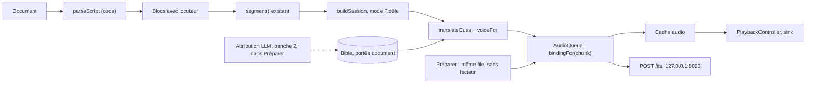

# ADR-018 — Jeu d'acteurs : plusieurs voix sur Kyutai TTS 1.6B, première tranche sans LLM

## Résumé en 10 lignes (validation humaine)

1. **Moteur unique** (décision de guilhem-bonnet) : Kyutai TTS 1.6B, ses 36 voix françaises, un seul modèle chargé. Ni Pocket TTS ni mélange. La voix système reste un repli à une seule voix.
2. **Fait central** : une voix n'est pas un modèle. Changer de voix à chaque passage ne demande pas de mémoire en plus, mais chaque passage coûte environ 1,8 s fixes (déduit de mesures, §1.3).
3. **Conséquence** : un dialogue à répliques courtes se génère plus lentement que le temps réel (une scène de 43 s : environ 54 s, déduit). La préparation à l'avance fait donc partie de la conception.
4. **Tranche 1, sans LLM** : théâtre et formats explicites reconnus par du code ; dialogues de roman lus par le narrateur. Les mots ne changent pas, les étiquettes de personnage ne sont pas lues.
5. **Distribution** : automatique, stable par document, modifiable, écrite dans la bible d'ADR-015. Narrateur = voix effective du mode. Une voix par personnage tant qu'il en reste. Aucun genre déduit.
6. **Contrat** : une voix optionnelle par `AudioChunk`, résolue en un seul point d'`AudioQueue` pour la requête et la clé de cache. Sans voix, la clé et la requête restent celles d'aujourd'hui.
7. **Préparer la lecture** : remplit le cache avec la même file, sans lecteur, donc sans lecture possible. Une lecture préparée se joue en mode jeu, puisqu'elle ne touche plus au GPU.
8. **Tranche 2, LLM local** : attribution des répliques de roman, pendant « Préparer » seulement. Le modèle rend des identifiants, jamais du texte : il ne peut pas changer un mot. Doute ou panne : le narrateur.
9. **Interface** : proposition non intrusive, panneau Distribution, ligne « qui parle », en réutilisant les vues existantes. Rien ne se lit tout seul.
10. **À décider par guilhem-bonnet** : accepter cet ADR et les six choix du § « Choix ». L'étape 0 mesure le moteur avant de figer les seuils ; les étapes 1 à 4 rendent le jeu d'acteurs audible.

## Statut

**Proposé (2026-11-06).** Carte du Mission Ledger : `GAO-jeu-d-acteur-001`. Rien n'est implémenté,
aucune vérification de ce document n'a été exécutée.

- **Précise la livraison d'ADR-015**, sans le réécrire : partition, `speakerId`, bible, traducteur et
  invariants restent les siens. Écarts assumés : §2.4 (attribution sans texte, hors du chemin de lecture)
  et §5.3 (mode jeu sans bascule automatique).
- **Applique ADR-017** : personnage > voix propre du mode > voix globale. Referme son point ouvert 2 (§4.2).
- **Répond au point ouvert 9 d'ADR-015** : les silences ne s'expriment pas sans changer `AudioQueue` et
  `PlaybackController` (§4.5).
- **Remplace, pour ce périmètre, la voie Pocket** retenue au banc de `docs/essais-voix/03-personnages.md`.

Numéros de ligne relus sur l'arbre de travail. `vscode-extension/src` évolue en parallèle : ils peuvent se
décaler.

## Contexte

### 1.1 La demande

« Le jeu d'acteurs, la multivoix sur des textes comme du théâtre, ou un style livre avec un narrateur et
plusieurs personnages. » Il veut le voir apparaître vite. Le texte ne sort jamais de la machine.

### 1.2 Ce que fait le code

| Constat | Source |
|---|---|
| Un seul binding de voix par session, fixé à la création de la file | `AudioQueue.ts:51-61, 162, 186` ; `PlaybackController.ts:231-238, 802-812` |
| La clé et la requête lisent ce binding, à deux endroits séparés | `AudioQueue.ts:404-419`, `557-571` |
| Un chunk par segment, sans locuteur ; `metadata` existe mais n'est pas recopié | `PlaybackController.ts:782-794` ; `core/narration.ts:13-20` ; `SessionFactory.ts:250-257` |
| Le chemin de lecture n'appelle pas la direction ; `startInternal` passe de `buildSegments` à `buildSession`, puis à `controller.start` | `Pipeline.ts:610-726` |
| Traducteur, bible, contrôleur, analyste et metteur en scène existent et sont testés, sans lecture réelle | `src/direction/**`, `test/unit/direction/**` |
| Le traducteur sait déjà donner une voix par rôle | `translate.ts:57-62, 205-218` |
| Le même provider sert aux deux moteurs Kyutai ; la voix part dans `voice_url` à chaque requête | `KyutaiPocketProvider.ts:25-27, 79-81, 184-188` |
| Le serveur 1.6B : une synthèse à la fois, voix du catalogue seules, WAV entier, 503 en mode jeu | `deploy/kyutai16/server.py:10-17, 201-210, 288-329` |
| Le découpage perd les marques d'italique et regroupe les phrases d'un bloc : plusieurs répliques d'un même paragraphe finiraient dans un seul segment | `parser/types.ts:40-47` ; `Segmenter.ts:138-156` |
| Texte brut : découpage en phrases sur tout le document, sans notion de ligne | `textSegments.ts:35-52` |

### 1.3 Mesures du moteur

| Mesure | Résultat | Source |
|---|---|---|
| 12 voix à la suite, modèle resté chargé, passages de 18 à 21 s | facteur 0,90 à 0,96 ; premier son 1,6 à 2,0 s ; VRAM crête 4 265 à 4 303 Mo | `_grimoire-output/evidence/GAO-essais-voix-001/ecoute-kyutai16/results.json` ; boucle : `scripts/voice-lab/kyutai16.py:109-133` |
| Phrase de 8 à 10,4 s (4 lignes relues) | facteur 1,01 à 1,10 ; premier son 1,8 à 2,1 s | même fichier |
| Service réel, avec Chatterbox, banc et Ollama en mémoire | deux 503, manque de mémoire (15,8 sur 17,1 Go) | `GAO-moteur-kyuta-001/evidence-pack.md:81` |
| Service réel, Chatterbox arrêté, banc actif | premier appel 38,7 s, puis 8,7 et 7,9 s pour 7 à 8,5 s d'audio | même pack, `:81` |
| Mémoire du service | 1,22 Go au départ, 6,21 Go chargé ; jeu pendant une synthèse : 503 en 3,4 s, 1,90 Go | même pack, `:88` |
| Metteur en scène `qwen2.5:7b`, avec format imposé | environ 30 ms par jeton ; analyste 3,3 à 6,6 s | `GAO-adr-015-5-an-001/direction-eval/latency-diagnosis.md:25, 45` |
| Pocket : 43,5 s de scène en 13,1 s | **ne s'applique plus** ; prouve seulement le principe « une synthèse par réplique » | `GAO-essais-voix-001/evidence-pack.md:47` |

**Modèle de coût (déduit, à confirmer à l'étape 0)** : temps de synthèse ≈ 1,8 s + 0,84 × durée audio.
Calculé sur les points ci-dessus, pas ajusté sur tout le fichier ; il retombe sur les 8,7 et 7,9 s du service.

| Passage | Synthèse estimée | Facteur |
|---|---|---|
| 2 s | 3,5 s | 1,75 |
| 5 s | 6,0 s | 1,20 |
| 10 s | 10,2 s | 1,02 |
| 20 s | 18,6 s | 0,93 |

Scène de `03-personnages.md` (10 répliques, 43,5 s d'audio sur Pocket, durée supposée égale sur 1.6B) :
environ 54 s de synthèse, soit environ 15 s d'avance nécessaire pour la jouer sans coupure. Plus les
répliques sont courtes, plus le déficit est grand ; une heure de dialogue à 4 s par réplique demanderait
environ 1 h 17 de GPU et 17 min d'avance. La lecture en direct tient pour un narrateur à longs passages,
pas pour une scène dialoguée longue.

### 1.4 Un seul GPU pour plusieurs voix

Une voix est un fichier d'embedding passé à chaque appel (`server.py:289, 530`), pas un modèle. La VRAM
crête reste stable sur 12 voix à la suite (§1.3), et ces voix tournaient déjà à la suite sur un modèle
chargé : **le changement de voix par passage est prouvé**. Reste inconnu : la part du changement dans les
1,8 s fixes, et l'effet de répliques très courtes.

Les limites sont ailleurs : une seule synthèse à la fois, et la mémoire partagée avec Ollama et Chatterbox.
Le modèle ne se décharge qu'en mode jeu ou sur manque de mémoire : aucun déchargement au repos n'apparaît
dans `server.py`.

### 1.5 Prior art (connaissance générale, non vérifiée ici)

Format Fountain pour les scénarios : personnage en capitales sur sa ligne, indications entre parenthèses.
Il inspire la grammaire sans être adopté tel quel. Attribution des répliques de roman (type BookNLP) :
problème connu et difficile, déjà relevé par ADR-015.

## Décision



(Rendu non vérifié par un outil Mermaid.)

### 1. Tranche 1 : détection déterministe

Module pur `src/direction/script/parseScript.ts`, sans `vscode`, sans réseau, sans modèle. Il travaille sur
le texte brut des blocs, avant la segmentation, car `segment()` efface l'italique et regroupe les phrases.
Il coupe un bloc en sous-blocs portant un `speakerId` optionnel, et `segment()` reste l'unique découpeur.

| Forme | Reconnaissance | Lu par | Étiquette dite ? |
|---|---|---|---|
| `@nom: réplique` | une seule occurrence suffit | le personnage | non |
| `% nom = voix` | identifiant ou prénom du catalogue, sinon ignorée | rien | non |
| `NOM : réplique`, `**NOM** :`, `NOM. — réplique` | capitales, 4 mots au plus, 40 caractères au plus, espace insécable admise | le personnage | non |
| `NOM` seul sur sa ligne, puis la réplique | mêmes capitales ; court jusqu'au prochain nom, titre ou séparateur | le personnage | non |
| Ligne entière entre parenthèses ou en italique | seulement dans une forme théâtre reconnue | le narrateur | sans objet |
| `NOM (à part) : …`, `(Elle soupire.)`, `*Elle sort.*` dans une réplique | découpée en trois passages | le narrateur pour l'indication | sans objet |
| Titres, `ACTE I`, `SCÈNE II`, texte sans étiquette | toujours | le narrateur | sans objet |
| `— réplique`, `– réplique`, `« réplique »` | marqués `dialogue` pour la tranche 2 | le narrateur | sans objet |

- **Alias du narrateur** : `narrateur`, `narratrice`, `narrator`, `récitant` donnent `NARRATOR_SPEAKER_ID`
  (`core/direction.ts:34`). Sinon, `@narrateur:` de `03-personnages.md` créerait un personnage. Les autres noms
  passent par `toRoleId` (`Analyst.ts:118`) : `ROMÉO`, `Roméo` et `ROMEO` sont un seul rôle.
- **Faux positifs** : les formes en capitales ne valent que si le document a au moins 2 noms distincts, chacun
  sur au moins 2 répliques, et au moins 4 répliques (proposé, non mesuré). Liste d'exclusion : `NOTE`,
  `ATTENTION`, `TODO`, `FIXME`, `WARNING`, `IMPORTANT`, `INFO`, `ERREUR`, `ACTE`, `SCÈNE`, `PERSONNAGES`.
  Les blocs de code, tableaux et listes ne sont jamais analysés. `Juliette : bonjour` n'est reconnu que si le
  nom est déclaré par `%` ou `@` : sinon `Résumé : …` serait un personnage.
- **Tiret de liste** : `- ` reste une liste en Markdown et n'est pas un dialogue.
- **Garde de fidélité** : au lancement, les mots de la lecture à plusieurs voix sont comparés à ceux de la
  lecture simple, étiquettes retirées (`tokenize`, `fidelity.ts:79`). Un écart abandonne le jeu d'acteurs pour
  cette lecture, avec un message : on perd les voix, jamais des mots.
- **Roman en tranche 1** : tout est lu par le narrateur. Une attribution par incise (`dit Julien`) n'est pas
  livrée : un roman où une réplique sur cinq change de voix sonne faux. Elle sert de témoin en tranche 2.
- **Modes qui réécrivent** : Professeur, Résumé et Révision n'ont plus de répliques à suivre. Le jeu d'acteurs
  est réservé au mode Fidèle dans les deux tranches, et le panneau le dit.

### 2. Tranche 2 : attribution par le LLM local

**Condition d'entrée** : l'évaluation E7 est gagnée, sinon la tranche 1 reste le produit.

1. **Analyste existant** (`Analyst.ts`), inchangé : liste des personnages, écrite en portée `document`.
   Il plafonne à 8 tranches de 16 000 caractères (`Analyst.ts:41-43`) : un long roman n'est donc pas entièrement
   lu, et un personnage absent reste au narrateur.
2. **Nouveau rôle `DialogueAttributor`**, sur `DirectionLlm` et `EgressGuard`. Entrée : passages `dialogue`
   numérotés, contexte voisin, personnages connus. Sortie, seule et complète :
   `{ "attributions": [{ "id": "d12", "speaker": "julien" }] }`, avec `speaker` dans une liste fermée qui
   comprend `narrator`.
3. **Les mots ne peuvent pas changer** : le modèle ne rend aucun texte. Le code assemble les consignes
   (`Cue.spokenText`) depuis le découpage de `parseScript`, et les passe au `PartitionController` et au
   `PartitionCache` existants.
4. **Écart avec ADR-015, assumé** : pas de metteur en scène ni de `cuesFor` pendant la lecture. L'attribution
   tourne **dans « Préparer la lecture » seulement**, parce que l'appel LLM et la synthèse se disputent un seul
   GPU et qu'une attribution en retard ferait changer un personnage de voix en pleine scène. Une lecture non
   préparée utilise ce qui est déjà en cache, et le narrateur pour le reste.
5. **Replis, jamais bloquants** : panne, délai, mode jeu, identifiant inconnu, réponse invalide, passage oublié :
   le narrateur. Un mauvais personnage est pire qu'un narrateur : on mesure d'abord la précision.
6. **Incises** : séparées par le code (`— Oui, dit-il, je viens.` : « dit-il » au narrateur). Une incise non
   reconnue reste dans la voix du personnage, sans perte de mot.
7. **Coût estimé** (déduit) : à 30 ms par jeton et environ 15 jetons par attribution, 100 répliques coûtent de
   l'ordre d'une minute, analyste compris. Non mesuré.

### 3. La distribution

**Stockage** : événements `addRole` et `assignVoice` de la bible, portée `document`, origine `casting`
(`bible/events.ts:31, 107-110`), rangés par `providerId` (ADR-015 §4). Sélection, presse-papiers et réponses de
Claude restent en mémoire (ADR-015 §4). L'activation par document est une préférence injectée, dont la perte
est tolérable : `globalState` dans VS Code, avec la seule empreinte du document comme clé.

**Attribution automatique**, pure, dans `src/direction/cast/casting.ts` :

1. Voix possibles = voix réellement disponibles du moteur, voix du narrateur exclue (ADR-015 §7).
2. Ordre propre au document : tri par `sha256(documentKey + voiceId)`. Deux documents n'ont pas la même
   distribution, et le même document retrouve la sienne.
3. Les personnages sont servis par ordre d'apparition, et l'attribution est écrite dès le premier passage :
   ajouter un personnage plus haut dans le texte ne décale pas les autres.
4. **Une voix par personnage tant qu'il en reste** : 35 personnages avec Camille comme narrateur. Au-delà : la
   voix la moins partagée, signalée « Voix partagée ».

| Situation | Résultat |
|---|---|
| L'utilisateur change une voix | `assignVoice`, `by: user`, `locked` ; jamais remplacée par la suite (ADR-015 §4) |
| `% nom = voix` dans le document | origine `casting`, jamais `user` : un texte ne dépasse pas un choix de l'utilisateur et ne modifie que son propre document |
| Voix du narrateur choisie pour un personnage | option désactivée, « C'est la voix du narrateur » |
| Voix globale devenue celle d'un personnage | règle d'ADR-017 §4 : attribution automatique refaite, attribution verrouillée gardée et signalée |
| Voix propre du mode | c'est elle, le narrateur (ADR-017 §4) |
| Voix effective hors 1.6B | jeu d'acteurs indisponible : « Le jeu d'acteurs demande une voix Kyutai 1.6B », bouton « Choisir une voix » ; la lecture reste possible à une voix |
| Échantillon de clonage ou « Ma voix » comme narrateur | même cas : le 1.6B ne clone pas (`server.py:191-192`) |

**Disponibilité** : pour 1.6B, `listVoices` lit `GET /voices` et ne garde que `available` (`server.py:255-258`),
avec repli sur le catalogue si le serveur ne répond pas. Une voix absente du cache rendrait sinon un 503, donc
une réplique sautée.

**Capacité plutôt qu'identifiant** (invariant P0 n°3) : nouvelle capacité `multiVoice: true`, déclarée par le cas
`kyutai-1-6b` de `createTtsProvider`, et non par Pocket. `direction.usesGpu: true` est déclaré au même endroit
(ADR-015 §5.2). Aucun test sur l'id du moteur.

**Genre** : aucun champ, aucune branche, aucune liste de prénoms. Le prénom d'une voix est un repère, pas une
identité (`kyutai16VoiceCatalog.ts:18-20`). Le seul moyen d'orienter la distribution est le choix de
l'utilisateur.

### 4. Le contrat technique

#### 4.1 Voix par passage

```ts
// core/playback.ts — ajout optionnel
export interface ChunkVoice {
  readonly speakerId: string;        // jamais haché, jamais journalisé avec un nom
  readonly voice?: string;
  readonly model?: string;
  readonly parameters?: Readonly<Record<string, unknown>>;
}
// AudioChunk.cast?: ChunkVoice
```

| Fichier | Changement |
|---|---|
| `parser/types.ts`, `core/source.ts`, `Segmenter.ts:92-100` | `speakerId?` sur le bloc et le segment, recopié par `buildSegment` |
| `SessionFactory.ts:250-257` | `metadata.speakerId` (porte prévue par ADR-015 §9) |
| `Pipeline.ts:773-786` | `buildSegments` insère `parseScript` entre `parseMarkdown` et `segment` si le jeu d'acteurs est actif |
| `Pipeline.ts:658-700` | consignes neutres avec `speakerId`, puis `translateCues({ binding, voiceFor, rangesFor, capabilities })`, le chemin d'ADR-015 ; la voix obtenue passe dans `metadata.cast` |
| `PlaybackController.ts:782-794` | `chunksFrom` recopie `metadata.cast` |
| `AudioQueue.ts:404-419, 557-571` | une seule fonction `bindingFor(chunk)`, utilisée par la clé et par la requête |
| `PlaybackController.ts:33-50, 225-262` | `prefetchChunks?` et `leadChunks?` par session (§5.1) |

Le changement de voix ne touche ni le provider ni son instance : même `tts`, autre `voice_url`. La logique reste
hors de `vscode` : `script/`, `cast/`, `core/`, `AudioQueue`, `PlaybackController`, `ReadingPreparer`. `Pipeline.ts`
n'ajoute qu'un appel, et l'application hors VS Code réutilisera le reste en fournissant son affichage et sa
préférence d'activation.

#### 4.2 Clé de cache

La clé reste calculée au seul endroit où elle l'est aujourd'hui : `computeCacheKey` avec `tts.id`, identité du
moteur résolu (`Pipeline.ts:2089, 2118`), plus `bindingFor(chunk)`.

- Un passage du narrateur a **la même clé** qu'en lecture simple : son audio est réutilisé.
- Deux personnages sur la même voix partagent l'audio d'un texte identique, ce qui est exact.
- Changer la voix d'un personnage ne régénère que ses répliques.
- `cacheVoice` et `cacheParameters` du traducteur (`translate.ts:78-81, 308-313`) ne sont pas utilisés par la
  file lue ici ; ils portent une clé parallèle. Ils sont retirés à l'étape 1 si aucun appelant ne s'en sert (à vérifier),
  ce qui referme le point ouvert 2 d'ADR-017. Le clonage reste géré par `tts.id`.

Le test doré exige l'égalité des clés et des requêtes sans `cast`, au champ près.

#### 4.3 Surlignage, navigation, qui parle

Le surlignage reste `highlight.show(uri, chunk.sourceRanges, …)` (`Pipeline.ts:504`) : aucun changement. La plage
d'une réplique exclut son étiquette. Précédent et Suivant vont de chunk en chunk, donc de réplique en réplique, sauf
réplique longue découpée.

« Qui parle » passe par `chunk.cast` dans `ChunkChange` (`PlaybackController.ts:60-64`) vers un champ optionnel
`PlayerStateView.speaker` (`core/playback.ts:66-80`). Les noms viennent du contenu : ils ne sont jamais journalisés.

#### 4.4 Pause et préchargement

Pause et reprise restent au niveau du lecteur (`PlaybackController.ts:265-280`), et `preloadAfter`
(`:630-680`) ne connaît pas la voix : aucun changement. Arrêter garde le cache. Le format ne change pas d'une voix à
l'autre, car tout vient du même serveur en WAV.

Une session ne change pas de voix en route : la distribution est figée au lancement, comme le prévoit ADR-017 §1.3.

#### 4.5 Silences

Hors tranche 1 : `pauseBeforeMs` et `pauseAfterMs` restent absents. `SilencePlanItem` existe, mais `chunksFrom` est
un pour un, et `next()` et `previous()` avancent d'un index sans notion de chunk non navigable
(`PlaybackController.ts:302, 329`). L'écart entre deux répliques est celui des bords de WAV ; il est écouté à
l'étape 4. S'il gêne : un type de chunk silence et une navigation qui le saute, dans un changement à part.

### 5. Génération, préparation, mode jeu

#### 5.1 Lire

Module pur `src/direction/cast/synthesisPlan.ts`. Durée d'un passage estimée à 17 caractères par seconde (déduit
des textes du banc), coût selon le §1.3, puis corrigé par les temps réels de la session (`ChunkTimingEvent`,
`AudioQueue.ts:101-111`).

Avance minimale pour ne pas couper : `D = max_k ( Σ(i ≤ k) synthèse_i − Σ(i < k) audio_i )`.

| Situation au geste « Lire » | Comportement |
|---|---|
| Tous les passages en cache | démarrage immédiat |
| `D` ≤ 20 s (proposé) | état `preparing`, étapes affichées, `leadChunks` prêts, puis lecture |
| `D` > 20 s | **rien ne part** : « Cette scène demande environ N min de préparation », boutons « Préparer » et « Lire quand même » |
| « Lire quand même » | lecture avec coupures possibles, et « Passage suivant en préparation… » |

**Fenêtre** : la fenêtre de 2 chunks (`AudioQueue.ts:127`) compte des passages, pas des secondes. Deux répliques de 2 s
ne donnent que 4 s d'avance avant une tirade. La session à plusieurs voix demande donc l'équivalent de 120 s d'audio
estimées (proposé). Arrêter annule la file comme aujourd'hui.

**Démarrage à froid** : premier appel de 38,7 s mesuré avec le banc actif, 6,7 s de chargement au banc : écart non
expliqué, à l'étape 0. L'attente d'un modèle froid s'ajoute à `D`.

#### 5.2 Préparer la lecture

`src/playback/ReadingPreparer.ts`, sans `vscode`. **Même `AudioQueue`, mêmes clés, aucun sink** : il ne peut donc rien
lire, et la fin de préparation affiche « Prêt » sans lancer le son (invariant P0 n°1).

- **Un seul travail à la fois** : un seul propriétaire de file pour tout le moteur. « Lire » arrête la préparation, puis
  reprend le cache où elle en est ; rien ne redémarre seul ensuite. Aucun cas de deux `POST /tts` simultanés.
- **Reprise gratuite** : le cache est l'état. Préparer de nouveau ne génère que ce qui manque, et un changement de voix
  annonce « 12 répliques à régénérer ».
- **Progrès réel** : « 12 passages sur 40 », jamais un faux pourcentage (`Panneau-preparation`).
- **Taille** : à 24 kHz, 16 bits, mono (non vérifié), 173 Mo par heure ; le cache de 512 Mo (`DiskAudioCache.ts:55`,
  `Pipeline.ts:467`) tient donc environ 3 h, partagées, et son éviction LRU pourrait retirer le début d'une préparation.
  Le préparateur estime la taille avant de partir et s'arrête à 80 % du budget (proposé), en disant jusqu'où il est allé.
- **Long roman** : 1 h de dialogue ≈ 1 h 17 de GPU (déduit). La préparation vise donc un chapitre, ou « la suite »
  depuis le curseur, plutôt que le livre entier.
- **Lots** : `model.generate` reçoit des listes (`server.py:529-531`), ce qui suggère plusieurs voix par appel, donc un
  gros gain pour Préparer. **Hypothèse** : signature non lue, mémoire et ROCm inconnus. Mesurée à l'étape 0 ; rien n'en
  dépend ici.
- **Mémoire** : Chatterbox et 1.6B ne cohabitent pas à l'état observé (§1.3). Le message « Mémoire » existant s'applique.
  En tranche 2, l'attribution passe avant la synthèse et le modèle Ollama est libéré avant le premier `POST /tts`
  (`keep_alive` non relu dans `OllamaDirectionLlm`). La cohabitation est mesurée à l'étape 0.

#### 5.3 Mode jeu et repli

Le serveur refuse déjà la charge en mode jeu (`server.py:293-297`). Le client ajoute :

| Situation | Comportement |
|---|---|
| Drapeau présent, lecture entièrement préparée | **toutes les voix jouent** : le cache suffit, aucun appel au moteur |
| Drapeau présent, lecture incomplète | pas de lecture ; panneau « La voix se met en retrait pendant le jeu », boutons « Lire avec la voix système » et « Réessayer » |
| Drapeau levé | rien ne repart seul ; « Réessayer » ou « Reprendre la préparation » |
| Drapeau apparu pendant une lecture | plus de synthèse ; les passages prêts sont joués ; au premier manquant, même panneau |
| Drapeau apparu pendant une préparation | suspendue, « Reprendre la préparation » |
| Aucune carte graphique ou moteur arrêté | panneau « Le moteur de voix est arrêté », bouton « Lire avec la voix système » |
| Voix système | toute la lecture à une voix : mêmes mots, sans étiquette si le jeu d'acteurs était actif ; jamais écrite comme voix globale (ADR-017 §4) |

**Écart avec ADR-015 §8, assumé** : pas de bascule automatique vers le CPU. Une voix système qui surgit au milieu d'une
scène serait pire qu'un arrêt annoncé, et les vues existantes prévoient ce choix explicite. Rien n'attend le drapeau : la
lecture s'arrête et le dit.

`Pipeline.ts:23` importe `createGpuYieldProbe` : son usage n'a pas été suivi. L'étape 6 s'y branche.

### 6. L'interface à maquetter

**Contraintes** : aucune lecture automatique, pas de mot « profil », boutons à taille fixe sans retour à la ligne
(vérifiés à 260, 320 et 500 px), mode jeu respecté. Le mot affiché est « Distribution ». Maquettes neuves dérivées des
vues du dossier `scratchpad/design/project/`.

| Besoin | Vue de départ | Contenu |
|---|---|---|
| Activation | `Panneau-document`, `Lancer-lecture` | Ligne : « Théâtre repéré : 4 personnages », bouton « Lire à plusieurs voix ». Le bouton change un réglage, sans lancer le son. Hors mode Fidèle ou hors 1.6B : le motif et une action. |
| Réglage permanent | `Style-lecture`, bloc « Personnages » | « Activer » existe déjà. Son texte « L'IA repère qui parle » devient vrai seulement à la tranche 2 : à reformuler pour la tranche 1. |
| Panneau Distribution | `Reserve-futur`, lien « Modifier les personnages » ; lignes de `Main` | Première ligne : Narrateur, voix effective, « Changer » envoie à `chooseVoice`. Puis par personnage : nom, N répliques, voix, « Écouter », « Changer ». Mentions « Voix partagée », « Choisie par vous ». Bas : « Refaire la distribution automatique » (ne touche pas aux choix verrouillés). |
| Écouter | `Galerie-etats` | Phrase courte synthétisée à la demande, car le 1.6B n'a pas d'échantillon livré (`kyutai16VoiceCatalog.ts:6-9`). Désactivé pendant une lecture, une préparation ou le mode jeu : ce serait une synthèse de plus sur le même GPU. |
| Changer | `Galerie-etats`, `Main` | Liste filtrée sur le 1.6B, voix déjà prises indiquées et choisissables. Sans genre. « Sera appliqué à la prochaine lecture », plus le nombre de répliques à régénérer. |
| Qui parle | `Panneau-lecture`, `Panneau-lecture-detail` | Sous le titre : « Juliette · voix Camille », pendant la lecture et en pause. Silence dans la barre d'état, qui garde la voix effective. |
| Préparer | `Reserve-futur`, `Panneau-preparation` | « Préparer la lecture » existe déjà. Étapes réelles, « 12 passages sur 40 », « Annuler ». Fin : « Prêt », bouton « Lire ». |
| Avance | `Panneau-lecture-detail` | « 3 passages d'avance » et « Passage suivant en préparation… » existent déjà. |
| Incidents | `Panneau-attente-incidents` | Les trois panneaux existent : moteur arrêté, jeu, mémoire. |
| Roman en tranche 1 | nouveau | « Dialogues de roman : lus par le narrateur pour l'instant. » |

Accessibilité : le changement de personnage est annoncé par une zone discrète (`aria-live="polite"`), à limiter pour ne
pas couvrir la voix. À trancher en maquette.

### 7. Découpe en étapes

Chaque étape est une carte du Mission Ledger. **Audible après l'étape 4.** Les étapes 1 à 3 peuvent avancer en parallèle.

| # | Livre | Tests qui le prouvent |
|---|---|---|
| 0 | **Mesures, sans code produit** : par le vrai serveur, drapeau vérifié avant et après. Coût par longueur de réplique, même voix contre voix changeante, modèle à froid, VRAM, lots, cohabitation Ollama | Script en code 0, JSON dans le pack de preuves, valeurs reportées ici. Mesure drapeau présent refusée |
| 1 | `ChunkVoice`, `bindingFor`, options de session ; retrait de la clé parallèle du traducteur ; rien de visible | `test:unit` : test doré, clés et requêtes égales sans `cast` ; voix différente = clé différente, requête exacte ; `speakerId` hors de la clé ; pins, annulation, reprise par chunk ; chaînage `enqueue` inchangé (`FakeAudioSink`) |
| 2 | `parseScript`, textes d'essai | Table de chaque forme ; propriété : mêmes mots qu'en lecture simple, étiquettes retirées ; **aucun personnage repéré sur `docs/adr/*.md`, `CHANGELOG.md`, `docs/Documentation-humaine/`** ; plages sans étiquette ; test statique sans `vscode` ; temps sur 1 Mo |
| 3 | `casting`, bible | Stabilité sur deux sessions avec bible rechargée ; personnage ajouté plus haut sans décalage ; narrateur jamais attribué ; voix uniques jusqu'à 35, partage ensuite ; choix verrouillé jamais remplacé ; `%` jamais `user` ; test statique : aucune branche de genre ; persistance selon la source |
| 4 | Branchement et `synthesisPlan` ; choix des voix par commande (Quick Pick), ligne « qui parle » | Profil `voice-chain` avec `MockTtsServer` : `voice_url` attendue pour chaque réplique, dans l'ordre, jamais deux requêtes simultanées ; relecture sans nouveau `POST` ; `D` calculé sur table ; zéro autoplay étendu ; `scripts/audio-proof/native-real.sh --kyutai16` sur une scène à 4 voix, sink nul, WER sous 10 %, voix relevées dans le journal du serveur ; **écoute de guilhem-bonnet** |
| 5 | Maquette puis panneau Distribution | `test:integration-voice` ; boutons à 260, 320, 500 px ; test du mot ; aucun geste du panneau n'appelle `play()` |
| 6 | `ReadingPreparer`, mode jeu | Cache complet, drapeau présent : lecture à plusieurs voix sans aucun `POST` ; drapeau simulé : zéro requête, panneau, aucune reprise seule ; arrêt puis reprise : seuls les manquants ; budget respecté, début non évincé ; fin sans lecture ; `POST` sérialisés entre Lire et Préparer |
| 7 | **Tranche 2, évaluation d'abord** : corpus annoté, 3 passages, drapeau absent, contre le témoin « incises » | Précision sur les répliques attribuées ≥ 90 %, couverture ≥ 60 % (proposés, non mesurés) ; étiquettes validées par guilhem-bonnet sur un échantillon. Sinon : la tranche 1 reste |
| 8 | `DialogueAttributor`, correction d'une réplique | Propriété : sortie LLM quelconque, mots identiques au découpage ; panne, délai, mode jeu, inconnu : narrateur, lecture jouable ; aucun appel LLM hors « Préparer » ; sentinelle absente des journaux |

Chaque carte passe `npm --prefix vscode-extension run test:unit` et `grimoire standard gate check --strict`.

**Textes à ajouter dans `docs/essais-voix/`** (domaine public à sourcer, un `.attendu.json` à côté de chacun) :

| Fichier | Contenu |
|---|---|
| `06-theatre-noms-en-ligne.md` | Molière : `NOM : réplique`, indications entre parenthèses, plusieurs par paragraphe |
| `07-theatre-noms-seuls.md` | Corneille ou Hugo : nom seul sur sa ligne, tirades sur plusieurs paragraphes, italique |
| `08-balises-distribution.md` | `03-personnages.md` réécrit avec des voix 1.6B : `vera`, `marius` et `javert` n'y existent pas (seule `estelle` est commune aux deux catalogues) |
| `09-roman-tirets.md` | Maupassant : tirets, incises, changements de locuteur |
| `10-roman-guillemets.md` | Zola ou Hugo : guillemets, tiret à l'intérieur, trois personnages |
| `11-pieges.md` | `NOTE :`, sigles, `Résumé :`, code, tableau, liste à tirets, capitales : aucun personnage attendu |
| `12-scene-repliques-courtes.md` | Échanges de 1 à 3 s : le pire cas du §1.3 |

## Invariants P0

| Invariant | Effet |
|---|---|
| 1. Zéro autoplay | Activer, distribuer, écouter sur clic seulement, préparer : aucun chemin vers `play()`, et le préparateur n'a pas de sink. L'invariant statique couvre `script/`, `cast/`, `ReadingPreparer`. |
| 2. Local-first | Moteur et LLM en boucle locale via `EgressGuard` ; bible hors cache ; serveur sans téléchargement (`server.py:11-12`) ; noms jamais journalisés. |
| 3. Provider agnostic | Voix portée par `TtsRequest.voice`, capacité déclarée ; le choix du seul 1.6B est une décision de produit, pas une branche sur son id. |
| 4. Configurable | Activation par document, distribution modifiable. |
| 5. Aucun modèle dans le VSIX | Inchangé ; aucune voix ni échantillon 1.6B livrés. |

## Conséquences

### Positives

- Audible sans LLM, sans attendre la fin d'ADR-015, en réutilisant bible et traducteur déjà testés.
- Une seule file, un seul cache, un seul lecteur, un seul découpeur. Lecture simple inchangée au champ près.
- Une lecture préparée marche pendant un jeu, en coupant toute charge GPU.
- La tranche 2 ne peut pas changer un mot, par construction.

### Négatives

- **Latence assumée** : une scène dialoguée attend avant le premier son, ou doit être préparée. Un long dialogue ne se lit
  pas en direct sur cette machine, selon les mesures actuelles.
- Le moteur occupe environ 5 Go de VRAM et ne cohabite pas avec Chatterbox à l'état observé.
- Sans carte graphique ou pendant un jeu, le jeu d'acteurs n'existe que pour ce qui a été préparé.
- Un roman reste à une voix de personnage en tranche 1 : la forme livre n'existe alors que par balises `@nom:`.
- Le cache de 512 Mo peut devenir trop petit pour des usages longs.
- Distribution par hachage : deux voix voisines peuvent tomber sur deux personnages qui se répondent.
- Les réglages `chunking` du mode font varier le coût : plus de découpes, plus de 1,8 s fixes.

## Ce qui reste ouvert

1. Valeurs proposées : seuils de détection, 20 s, 120 s, 80 %, 90 % et 60 % ; modèle de coût. Fixés par les étapes 0 et 7.
2. Écart de 38,7 s contre 6,7 s de chargement ; part du changement de voix dans le coût fixe.
3. Lots de voix par appel : gain et faisabilité sur ROCm.
4. Streaming du WAV (I3 de `GAO-moteur-kyuta-001`) : réduirait l'attente d'un passage, hors de cet ADR.
5. Reprises sur 503 (I2 du même pack) : à relire avec §5.3 à l'étape 6.
6. Silences entre répliques (§4.5), et réglage des pauses de la tranche 2.
7. Correction d'une réplique mal attribuée : événement de bible à ajouter à l'étape 8.
8. Direction expressive d'ADR-015 sur ce moteur : le 1.6B ne déclare ni émotion ni tempo. Elle pourrait ne rien apporter
   d'autre que les pauses ; à réexaminer après l'écoute.

## Choix à soumettre à guilhem-bonnet

1. **Activation** : proposée sur le document, désactivée par défaut et retenue par document (recommandé), ou active d'office
   dès qu'une forme est reconnue.
2. **Étiquettes** : `ROMÉO :` et `@nom:` ne sont pas lues (recommandé), les indications scéniques oui.
3. **Scène non préparée** : au-delà de 20 s d'attente, proposer « Préparer » ou « Lire quand même » (recommandé), ou toujours
   lancer avec coupures possibles.
4. **Mode jeu** : arrêt annoncé avec bouton « Lire avec la voix système » (recommandé, écart avec ADR-015 §8), ou bascule
   automatique.
5. **Contraste automatique** : ordre haché seul (recommandé en tranche 1, simple et sans aucune inférence), ou écart de hauteur
   mesurée entre voix, sans genre, mais qui s'appuie sur une mesure sujette aux erreurs d'octave.
6. **Changement de voix en cours de lecture** : à la prochaine lecture (recommandé, ADR-017 §1.3), ou sur les passages pas encore
   générés.

## Alternatives rejetées

- **Pocket TTS, ou mélange de moteurs** : écartés par décision de guilhem-bonnet. Le mélange aurait en plus changé de timbre et
  de volume d'un personnage à l'autre, et n'aurait laissé parler que la moitié d'une scène en mode jeu.
- **Un système de lecture à part pour le théâtre** : deux files et deux clés de cache à garder alignées.
- **Assembler une scène en un seul WAV** : méthode du banc (`lab.py:136-152`). Perd surlignage, navigation et avancement.
- **Une instance de provider par voix** : inutile, la voix passe dans la requête ; ajouterait des clés de cache.
- **Déterminer les répliques par LLM dès la tranche 1** : plus lent, moins fiable, et le théâtre se reconnaît sans lui.
- **Faire réécrire le texte par le metteur en scène pour l'attribution** : laisserait au modèle la possibilité de changer un mot,
  rattrapée seulement ensuite. Une sortie sans texte supprime le risque.
- **Attribution pendant la lecture** : deux charges sur un GPU, et des voix qui changent en cours de scène.
- **Attribution par incises seules comme produit** : couverture partielle, audible comme un défaut. Conservée comme témoin.
- **Déduire le genre d'un prénom ou d'une voix** : faux souvent, et blessant quand c'est faux ; contraire à la demande.
- **Bascule silencieuse vers la voix système** : changerait la nature de l'écoute sans geste, et voilerait l'état du moteur.
- **Préparation automatique à l'ouverture du document** : charge GPU sans geste.
- **Fichier de distribution à part** : la bible porte déjà les attributions par moteur, le journal et l'oubli.

## Ce qui est lu, ce qui est déduit

- **Lu dans le code ou les preuves** : tout ce qui porte un fichier et une ligne au §1.2 et au §1.3, ainsi que les vues citées au §6.
- **Déduit par cet ADR, sans exécution** : le modèle de coût, les temps de scène, `D`, l'heure de dialogue, 17 caractères par
  seconde, les 173 Mo par heure, le coût de l'attribution.
- **Non lu** : la suite de `core/direction.ts` après la ligne 260, `reducer.ts`, `OllamaDirectionLlm`, `MarkdownParser`, l'API
  de moshi, Pipeline en entier.
- **Non exécuté** : aucune commande, aucun test, aucune synthèse pour cet ADR.
